# PetTech — System Design & Architecture

> **เอกสารออกแบบระบบ v1.0** · 28 กันยายน 2569 (2026-09-28) · สถานะ: ร่างสำหรับเริ่มพัฒนา
> ขอบเขต: pilot 16 สัปดาห์ (LINE MINI App สำหรับเจ้าของแมว/หมาใน กทม.) + ฟีเจอร์ **PetID (AI Pet Biometrics)** · Deploy บน **Vercel** · ฐานข้อมูล **Supabase** · LLM **OpenAI `gpt-6-luna`** · Embedding **`text-embedding-3-small`**

---

## สารบัญ

0. [เกี่ยวกับเอกสารนี้](#0-เกี่ยวกับเอกสารนี้)
1. [สรุปสำหรับผู้ตัดสินใจ](#1-สรุปสำหรับผู้ตัดสินใจ)
2. [เป้าหมาย ข้อกำหนด และข้อจำกัด](#2-เป้าหมาย-ข้อกำหนด-และข้อจำกัด)
3. [ภาพรวมสถาปัตยกรรม](#3-ภาพรวมสถาปัตยกรรม)
4. [Framework และ Runtime (คำถามข้อ 1)](#4-framework-และ-runtime-คำถามข้อ-1)
5. [Repository และ Microservices (คำถามข้อ 2)](#5-repository-และ-microservices-คำถามข้อ-2)
6. [API Design (คำถามข้อ 3)](#6-api-design-คำถามข้อ-3)
7. [UI/UX Design (คำถามข้อ 4)](#7-uiux-design-คำถามข้อ-4)
8. [การจัดการคิว (คำถามข้อ 5)](#8-การจัดการคิว-คำถามข้อ-5)
9. [AI Architecture และ PetID](#9-ai-architecture)
10. [Data Architecture](#10-data-architecture-supabase-postgres)
11. [Authentication & Authorization](#11-authentication--authorization)
12. [Storage & Media (Vercel Blob)](#12-storage--media-vercel-blob)
13. [Cache, Rate limit และ Redis](#13-cache-rate-limit-และ-redis)
14. [Notifications, Reminders และ LINE](#14-notifications-reminders-และ-line)
15. [Security & Privacy (PDPA)](#15-security--privacy-pdpa)
16. [Observability & Operations](#16-observability--operations)
17. [Environments, CI/CD และ Testing](#17-environments-cicd-และ-testing)
18. [Reliability, Scalability และ Performance](#18-reliability-scalability-และ-performance)
19. [ประมาณการต้นทุน](#19-ประมาณการต้นทุน)
20. [KPI และ Analytics](#20-kpi-และ-analytics)
21. [Roadmap 16 สัปดาห์ (ฝั่งเทคนิค)](#21-roadmap-16-สัปดาห์-ฝั่งเทคนิค)
22. [ความเสี่ยง, Trade-offs และคำถามที่ต้องตัดสินใจ](#22-ความเสี่ยง-trade-offs-และคำถามที่ต้องตัดสินใจ)
23. [ภาคผนวก](#23-ภาคผนวก)

---

## 0. เกี่ยวกับเอกสารนี้

- **อ้างอิงจาก**: แผน pilot 16 สัปดาห์ (ฟีเจอร์กลุ่ม A/B/C, เกณฑ์ "พิสูจน์แล้ว", งานหลังบ้าน) + ไอเดีย AI Pet Biometrics + ข้อกำหนดใหม่ ได้แก่
  - Vercel ทั้งระบบ (Queues, Blob, Redis ฯลฯ)
  - Supabase
  - OpenAI `gpt-6-luna`
  - `text-embedding-3-small`
  - frontend/backend แยกกัน
  - microservices แยกโฟลเดอร์ใต้ `backend/`
- **ข้อเท็จจริงของแพลตฟอร์ม** (Vercel, Supabase, OpenAI, LINE) ตรวจกับเอกสารทางการ ณ **28 ก.ย. 2569** รายการที่ยังไม่มีเอกสารยืนยันจะติดป้าย **⚠️ ต้องยืนยัน** แพลตฟอร์มเหล่านี้เปลี่ยนเร็ว (หลายตัวยังเป็น beta) จึงควรตรวจซ้ำก่อนเริ่มแต่ละเฟส
- **สิ่งที่เปลี่ยนจากแผนเดิม**

| เรื่อง | แผนเดิม | ในเอกสารนี้ | เหตุผล |
|---|---|---|---|
| LLM | Claude Sonnet/Haiku | `gpt-6-luna` ผ่าน Vercel AI Gateway | ตามข้อกำหนดใหม่ (ต้นทุนคำนวณใหม่ในข้อ 19) |
| งานตั้งเวลา | Supabase Cron | Vercel Cron → scheduler → Vercel Queues | ใช้บริการของ Vercel + ได้ retry/dedupe จากคิว |
| เก็บรูป | Supabase Storage (private) | Vercel Blob (store private + store public) | ตามข้อกำหนดใหม่ (Blob private GA แล้ว) |
| สถาปัตยกรรม | แอปเดียว | 11 microservices (23 Vercel services) + 3 frontends | ตามข้อกำหนดใหม่ |
| โปสเตอร์/การ์ด | `@vercel/og` ฝั่ง server | render ฝั่ง client แล้วเก็บ Blob public | Satori ยังมีบั๊กวางสระบน/วรรณยุกต์ภาษาไทย และตัดบรรทัดไทยไม่ได้ |
| ค้นหาสัตว์หาย | โปสเตอร์ + QR | + **PetID** (ค้นหาด้วยรูปแบบ RAG) | ฟีเจอร์ใหม่ |
| Reply API ของ LINE | ข้อมูลขัดกันว่านับโควตาหรือไม่ | ไม่นับโควตา (ประกาศทางการ LINE Thailand) | ข้อ 14.1 |
| ติดตามผลหลังคัดกรอง | เฉพาะระดับ ≥ "พบหมอภายใน 24 ชม." (3 วัน) | ทุกระดับ: ระดับต่ำถามใน 24–48 ชม. ว่าอาการแย่ลงไหม, ระดับ ≥ 24 ชม. ถามใน 3 วัน | under-triage เกิดได้เฉพาะในผลระดับต่ำ จึงต้องติดตามกลุ่มนี้ด้วย (ข้อ 14.4) |

- **คำศัพท์**
  - *microservice* = หน่วยทางตรรกะ (โฟลเดอร์ `backend/<name>`)
  - *Vercel service* = หน่วย deploy ในโหมด Vercel Services (1 microservice = `<name>` + `<name>_worker`)
  - *น้อง* = สัตว์เลี้ยงในระบบ

---

## 1. สรุปสำหรับผู้ตัดสินใจ

### 1.1 การตัดสินใจหลัก (ADR summary)

| # | เรื่อง | เลือก | เหตุผลย่อ | ทางเลือกที่ไม่เลือก |
|---|---|---|---|---|
| ADR-01 | ช่องทาง | **LINE MINI App ตั้งแต่วันแรก** | LIFF ที่สร้างใต้ LINE Login channel ย้ายเป็น MINI App ภายหลังไม่ได้ | LIFF ธรรมดา, แอป native |
| ADR-02 | Frontend | **Next.js × 3 projects** (owner-app, clinic-portal, admin-console) | ผู้ใช้ต่างกลุ่ม โดเมนต่างกัน รอบ deploy ต่างกัน | แอปเดียวรวมทุกอย่าง |
| ADR-03 | Backend | **Hono + TypeScript** · 11 microservices + scheduler | เบา เร็ว type-safe ทั้งระบบ | NestJS, Express, FastAPI |
| ADR-04 | Topology | **Vercel project เดียวแบบ Vercel Services** (23 services) | topic ของ Vercel Queues เป็นของ project (+ deployment) จึงต้องอยู่ project เดียวกันเพื่อใช้คิวข้าม service | 1 project ต่อ service (เก็บเป็นทางถอย) |
| ADR-05 | Async | **Vercel Queues**: 21 job + 11 event + 11 cron topics, transactional outbox, DLQ ทำเอง | ผู้ใช้ไม่ต้องรอ AI, retry/fan-out ได้ | QStash, Workflows |
| ADR-06 | ตั้งเวลา | **Vercel Cron → scheduler → คิว** | cron ไม่มี retry แต่คิวมี และมี dedupe | Supabase Cron |
| ADR-07 | ฐานข้อมูล | **Supabase Postgres (สิงคโปร์)** schema ต่อ service + DB role ต่อ service + RLS + pgvector | ข้อมูลสุขภาพต้องมีความสัมพันธ์และความถูกต้อง, RLS เป็นชั้นกันพลาด | หลาย DB, NoSQL |
| ADR-08 | ไฟล์ | **Vercel Blob** 2 store (private: รูปผู้ใช้, public: โปสเตอร์/การ์ด) ที่ `sin1` | private GA แล้ว มี signed URL ในตัว | Supabase Storage |
| ADR-09 | Cache/limit | **Upstash Redis (Marketplace)** + **Vercel Firewall rate limit** | Vercel ไม่มี Redis ของตัวเอง, Upstash ติดตั้งอยู่แล้ว | — |
| ADR-10 | AI | **`gpt-6-luna` ผ่าน Vercel AI Gateway**, กฎของหมอมาก่อน, ห้ามลดระดับ, eval gate | budgets/fallback/observability ของ Vercel และราคาไม่บวกเพิ่ม | เรียก OpenAI ตรง (ยังทำได้ด้วยการเปลี่ยน config) |
| ADR-11 | PetID v0 | **LLM บรรยายลักษณะเป็น JSON → `text-embedding-3-small` → pgvector → LLM เทียบภาพ (RAG)** ค้นหาเฉพาะน้องที่หายเป็นค่าเริ่มต้น และเจ้าของยืนยันเสมอ | ไม่ต้องมีข้อมูลฝึก อธิบายผลได้ และเก็บข้อมูลไว้ฝึกโมเดลจริงภายหลัง | ฝึก ArcFace ตอนนี้ (ยังไม่มีข้อมูล) |
| ADR-12 | Auth | **JWT ของเราเอง (ES256)** แลกจาก LIFF ID token, คลินิกใช้ LINE Login + BFF, S2S ใช้ Vercel OIDC | ควบคุม claims/RLS ได้เอง และไม่ติดปัญหา ES256/HS256 ของ LINE | Supabase Auth + custom OIDC |
| ADR-13 | แจ้งเตือน | **.ics + LINE push รายวัน/รายเดือนตามงบ + reply (ฟรี) + inbox** และ service messages เมื่อ verified แล้ว | คุมโควตา LINE | push ทุกเรื่อง |
| ADR-14 | Observability | **Vercel Observability (+Plus) + log แบบ structured + ตาราง `ai_ops.requests`** | คนเดียวต้องหาสาเหตุได้เร็ว และต้อง audit AI ได้ | — |

### 1.2 ตัวเลขสำคัญของระบบ

| รายการ | จำนวน |
|---|---|
| Frontend apps (Vercel projects) | 3 |
| Microservices (logical) | 11 + scheduler |
| Vercel services ใน backend project | 23 |
| API endpoints (business) | **162** (P1: 32 · P2: 55 · P3: 44 · P4: 31) |
| Queue topics | **43** (21 job · 11 event · 11 cron) |
| Cron jobs | 14 |
| Postgres schemas | 14 (11 ของ service + `authz`, `ai_ops`, `ops`) |
| Blob stores | 2 (private, public) |
| ต้นทุนช่วง pilot (ประมาณ) | ≈ 3,000–3,500 บาท/เดือน (ข้อ 19) |

### 1.3 สิ่งที่ต้องรู้ก่อนเริ่ม (ข้อเท็จจริงที่เปลี่ยนการออกแบบ)

1. **Vercel Queues และ Vercel Services ยังเป็น public beta** จึงต้องทำ spike ในสัปดาห์แรก (ข้อ 5.8) และมีทางถอยที่ไม่ต้องแก้โค้ดธุรกิจ (ข้อ 5.2)
2. **`gpt-6-luna` ไม่มี dated snapshot ให้ pin** และ OpenAI เพิ่งแก้การเข้ารหัสรูปเมื่อ 25 ก.ย. 2569 จึงต้องมี eval canary รายสัปดาห์ และรัน eval ใหม่ทุกครั้งที่ผู้ให้บริการประกาศการเปลี่ยนแปลง
3. **`text-embedding-3-small` รับได้แค่ข้อความ** (OpenAI ยังไม่มี image embedding) PetID v0 จึงต้องให้ LLM "บรรยายรูปเป็นข้อความ" ก่อน ทำให้ขั้นค้นหาใช้คัดตัวเลือกเท่านั้น ส่วนการตัดสินอยู่ที่ LLM เทียบภาพ + เจ้าของยืนยัน (ข้อ 9.7)
4. **MINI App แบบ verified (ซึ่งปลดล็อก service messages ฟรี, การค้นหาใน LINE, shortcut หน้าจอ) ต้องเป็นนิติบุคคลไทย** ช่วงที่ยังเป็นบุคคลธรรมดาจะใช้ได้แค่แบบ unverified
5. **push ถึงผู้ใช้ได้เฉพาะคนที่เป็นเพื่อนกับ LINE OA** onboarding จึงต้องชวนเพิ่มเพื่อน (ตั้ง Add friend option ของ MINI App channel)
6. **MINI App channel และ Messaging API channel ต้องอยู่ใต้ provider เดียวกัน** ไม่เช่นนั้น LINE userId จะไม่ตรงกันและ push ไม่ถึง
7. **ตั้ง region `sin1` ให้ทุก function** (ค่าเริ่มต้นของ Vercel คือ `iad1` ซึ่งทำให้ทุก query ไป Supabase ข้ามแปซิฟิก)
8. **Supabase แผน Free หยุดโปรเจกต์เมื่อไม่มีการใช้งาน 1 สัปดาห์และไม่มี backup** ต้องขึ้น Pro ก่อนมีผู้ใช้จริง

---

## 2. เป้าหมาย ข้อกำหนด และข้อจำกัด

### 2.1 เป้าหมายของระบบ (ผูกกับเกณฑ์ "พิสูจน์แล้ว" ของ pilot)

| KPI ของ pilot (สัปดาห์ 16) | ระบบต้องทำอะไรให้วัดได้ |
|---|---|
| สัตว์ที่ลงทะเบียน ≥ 300 (แมวใน กทม.) | `pets.species`, `identity.users.district_code` (ไม่บังคับ) + attribution |
| ทำขั้นแรกครบใน 7 วัน ≥ 50% | events: `pet.created`, `vaccine.recorded`, `triage.session.completed` |
| กลับมาใช้ในเดือนที่ 2 ≥ 25% | events ที่มีความหมาย (ไม่นับแค่เปิดแอป) ในวันที่ 30–60 |
| ลิงก์สรุปถูกเปิด ≥ 100 (≥ 20 ที่คลินิกพาร์ทเนอร์) | `share.summary_views` + การระบุคลินิก |
| AI ตรงกับสัตวแพทย์ ≥ 85% และไม่มี under-triage ในชุดทดสอบ | `triage.vet_reviews`, `triage.eval_runs`, `triage.followups` |
| คลินิกนำร่อง 3–5 แห่ง, LOI ≥ 2 | `clinic.clinics.partner_status`, `clinic.lois` |
| "เสียดายมากถ้าแอปหายไป" ≥ 40% | `analytics.survey_responses` |

### 2.2 ข้อกำหนดเชิงฟังก์ชัน (สรุปตามกลุ่ม)

| กลุ่ม | ฟีเจอร์ | Service หลัก |
|---|---|---|
| A — แกนหลัก (สัปดาห์ 1–6) | F1 ล็อกอิน LINE + โปรไฟล์ 1 นาที, F2 สมุดวัคซีนจากรูป, F3 ระบบเตือน 3 ช่องทาง, F4 คัดกรองอาการ, F5 ส่องสุขภาพจากรูป, F6 สรุปก่อนพบหมอ | identity, pet, media, health, notification, triage, share |
| B — การเติบโต (สัปดาห์ 7–10) | F7 ประกาศน้องหาย, F8 เช็กอินรายเดือน, F9 ดูแลร่วม, F10 การ์ดแชร์, F11 รายชื่อคลินิก/รพ. 24 ชม., F12 ติดตามผล | lostfound, health, pet, share, clinic, triage |
| BIO — PetID | ลงทะเบียน, ค้นหา 1:N, ยืนยัน 1:1, บัตร PetID | biometric (+ lostfound, share) |
| C — สะพานไปคลินิก (สัปดาห์ 11–16) | F13 QR คลินิก, F14 Clinic Lite, F15 ปุ่มขอนัด, F16 แผงรีวิวของหมอ | clinic, identity (grants), triage |
| หลังบ้าน | PDPA/consent, บันทึก AI ทุกครั้ง, จำกัดการใช้ AI, แดชบอร์ด KPI | identity, `packages/ai`, analytics |

### 2.3 ข้อกำหนดที่ไม่ใช่ฟังก์ชัน (NFR)

| หมวด | เป้าหมาย |
|---|---|
| **ความปลอดภัยของผลคัดกรอง** | under-triage ในชุดทดสอบฉุกเฉิน = 0, ไม่แนะนำยา/ขนาดยา, หน้าฉุกเฉินแสดงได้แม้ AI ล่ม |
| **Latency (จาก กทม.)** | API อ่าน p95 < 300 ms, เขียน p95 < 600 ms · triage p95 ≤ 15 วิ · OCR ≤ 25 วิ · ส่องรูป ≤ 20 วิ · PetID identify ≤ 30 วิ |
| **Frontend** | LCP ≤ 2.5 วิ บน 4G, First Load JS ≤ 170 KB (หน้าแรก MINI App) |
| **Availability** | API 99.5% ต่อเดือน (pilot), หน้าฉุกเฉินและรายชื่อ รพ. 24 ชม. ใช้งานได้จาก cache แม้ backend ล่ม |
| **ความเป็นส่วนตัว** | PDPA, ข้อมูลอยู่สิงคโปร์ (ยกเว้นการประมวลผล AI ซึ่งต้องแจ้งผู้ใช้), consent แยกวัตถุประสงค์ |
| **ต้นทุน** | pilot ≤ ~3,500 บาท/เดือน, ต้นทุน AI ≤ 3 บาทต่อผู้ใช้ active ต่อเดือน |
| **การดูแลระบบ** | คนเดียวดูแลได้ ≤ 2 ชม./สัปดาห์: deploy อัตโนมัติ, แจ้งเตือนที่ลงมือแก้ได้, runbook |
| **Accessibility** | WCAG 2.2 AA ในส่วนที่ผู้ใช้ใช้บ่อย |
| **Maintainability** | TypeScript strict, contract ร่วม, test ครอบ domain/rules 100% |

### 2.4 ข้อจำกัดและสมมติฐาน

- **ข้อจำกัด**
  - Vercel Pro (มีอยู่แล้ว) + Supabase + บริการของ Vercel/Marketplace เท่านั้น
  - LLM เป็น `gpt-6-luna`, embedding เป็น `text-embedding-3-small`
  - ช่องทางผู้ใช้เป็น LINE MINI App (ไม่มีแอป native)
  - นักพัฒนา 1 คน ระยะเวลา 16 สัปดาห์
- **สมมติฐาน**
  - มีสัตวแพทย์ที่ปรึกษาภายในสัปดาห์ที่ 2
  - ผู้ใช้ส่วนใหญ่เป็นเจ้าของแมวใน กทม.
  - ยังไม่จดบริษัทในช่วง pilot (MINI App แบบ unverified)
  - อัตราแลกเปลี่ยนสำหรับประมาณการ 1 USD ≈ 34 บาท
  - `<domain>` ยังไม่กำหนด

### 2.5 ประมาณการขนาดระบบ (back-of-the-envelope)

| ตัวแปร | Pilot (สัปดาห์ 16) | ปีที่ 1 (เป้าออกแบบ) | เพดานที่ไม่ต้องเปลี่ยนสถาปัตยกรรม |
|---|---|---|---|
| ผู้ใช้ / สัตว์ | ~250 / 300 | 10,000 / 15,000 | 100,000 / 150,000 |
| DAU | ~50 | ~1,500 | ~15,000 |
| API requests | ~2K/วัน | ~72K/วัน (peak 5–10 rps) | ~700K/วัน (peak ~100 rps) |
| AI calls | ~30/วัน | ~400/วัน (~12K/เดือน) | ~4K/วัน |
| ข้อความในคิว | ~1K/วัน | ~10K/วัน | ~100K/วัน |
| LINE messages | ~300/เดือน | ~27K/เดือน | ~270K/เดือน |
| รูป (รวม variants ~0.5 MB/รูป) | ~3 GB | ~225 GB/ปี | ~2 TB |
| Postgres | < 200 MB | ~3–5 GB | ~40 GB (แบ่ง partition + archive) |
| PetID vectors (4 facets × 4 รูป/ตัว) | ~5K | ~240K (≈ 0.7 GB halfvec + HNSW index) | ~2.4M (ใช้ `dimensions: 512` หรือโมเดล v1) |

> **จุดที่ต้องขยายก่อนอย่างอื่น**
> - **RAM ของ HNSW index ใน Supabase**: Micro มี RAM 1 GB เมื่อ vectors เกิน ~50K ให้ขยาย compute หรือลดมิติ
> - **จำนวน connection ของ pooler**: Micro รับ client ได้ 200 จึงตั้ง pool เล็ก (`max: 3`) ต่อ instance
> - **โควตา LINE**: อยู่แผน Basic (+0.10 บาท/ข้อความส่วนเกิน) จนถึง ~20K ข้อความ/เดือน แล้วค่อยขึ้น Pro (ข้อ 14.2)

---

## 3. ภาพรวมสถาปัตยกรรม

### 3.1 System context

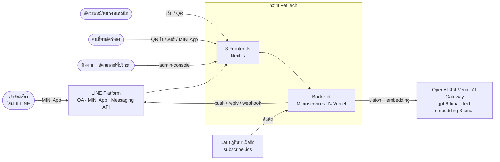

### 3.2 Container diagram (ภาพรวมทุกชิ้น)

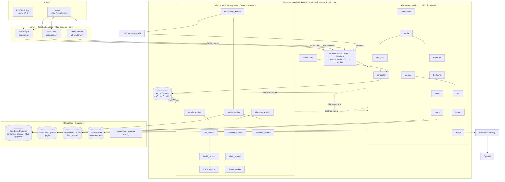

**อ่านภาพนี้อย่างไร**
- **frontend 3 ตัวเป็น Vercel project แยกกัน** เพราะผู้ใช้ โดเมน และรอบ deploy ต่างกัน
- **backend ทั้งหมดอยู่ใน Vercel project เดียวที่ใช้ Vercel Services** แต่ละ microservice เป็นโฟลเดอร์แยกใต้ `backend/` และ deploy เป็น 2 Vercel services
  - `<name>` = API สาธารณะ (Hono)
  - `<name>_worker` = queue consumer (private ไม่มี URL สาธารณะ)
- **Vercel Queues topic เป็นของ project (+ deployment)** ทุก service ใน deployment เดียวกันจึง publish/consume topic เดียวกันได้ ซึ่งเป็นเหตุผลหลักที่เลือกโครงนี้ (ดูข้อ 5.2)
- **service คุยกันแบบ sync ผ่าน Bindings** (URL ภายใน ไม่ออกอินเทอร์เน็ต) และตรวจ Vercel OIDC token ทุกครั้ง เพราะ binding เองไม่ได้ยืนยันตัวตนให้
- **ข้อมูลทั้งหมดอยู่ที่สิงคโปร์** (Supabase `ap-southeast-1`, Blob `sin1`, Redis `ap-southeast-1`, functions `sin1`) ยกเว้นการประมวลผล AI ที่ออกไปนอกภูมิภาค (ต้องระบุในนโยบายความเป็นส่วนตัว)

### 3.3 วงจรชีวิตของ request หนึ่งครั้ง

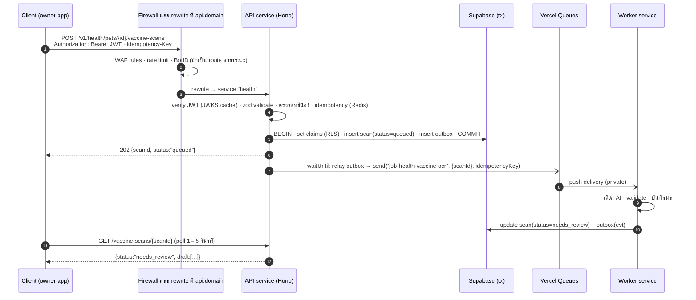

### 3.4 หลักการสถาปัตยกรรม (สิ่งที่ทุก service ต้องทำตาม)

| # | หลักการ | ทำไม |
|---|---|---|
| P1 | **Async by default สำหรับงาน AI, งานที่คุยกับระบบภายนอก และ side effect ข้าม service** | ผู้ใช้ไม่ต้องรอ, retry ได้, คุม rate limit ของ OpenAI/LINE ได้ |
| P2 | **Transactional outbox** ทุกครั้งที่เขียน DB แล้วต้องปล่อย event | กัน "เขียน DB สำเร็จแต่ส่ง event หาย" |
| P3 | **Consumer ต้อง idempotent** (Queues เป็น at-least-once) | ข้อความอาจมาซ้ำหรือไม่เรียงลำดับ |
| P4 | **service เป็นเจ้าของ schema ของตัวเอง** ส่วน service อื่นอ่านผ่าน API/event เท่านั้น | แยกฐานข้อมูลได้ในอนาคตโดยไม่รื้อโค้ด |
| P5 | **Contract-first** — ทุก API/event มี zod schema ใน `packages/contracts` | frontend/backend/worker ใช้ type เดียวกัน และ generate OpenAPI ได้ |
| P6 | **Safety over cleverness** — กฎของหมอ > LLM, ห้ามลดระดับ, มีทางออกเมื่อ AI ล่ม | เป็นทั้งจุดขายและความเสี่ยงสูงสุดของผลิตภัณฑ์ |
| P7 | **Privacy by design** — เก็บน้อยที่สุด, consent แยกวัตถุประสงค์, ตำแหน่งหยาบ, relay แทนเปิดเผยเบอร์ | PDPA และความไว้ใจของผู้ใช้ |
| P8 | **ทุกอย่างอยู่ `sin1` / Singapore** | ลด latency ระหว่าง function ↔ DB (region เริ่มต้นของ Vercel คือ `iad1` ถ้าลืมตั้ง ทุก query จะข้ามแปซิฟิก) |
| P9 | **Observability ตั้งแต่วันแรก** — correlation ID, structured log, บันทึก AI ทุกครั้ง | คนเดียวดูแลระบบ ต้องหาสาเหตุได้เร็ว |
| P10 | **Topology เป็น config ไม่ใช่โค้ด** — โค้ดคุยกับคิวผ่าน `packages/queue` เท่านั้น | ถ้า Vercel Services (beta) มีปัญหา แยกเป็นหลาย project ได้โดยเปลี่ยนแค่ transport (ข้อ 5.2) |

### 3.5 แผนที่บริการของ Vercel ที่ใช้

| บริการ | ใช้ทำอะไร | สถานะ ณ 28 ก.ย. 2569 |
|---|---|---|
| **Vercel Functions (Fluid compute)** | รันทุก API/worker (Node.js 24, `sin1`), คิดเงินตาม Active CPU ซึ่งเหมาะกับงานที่รอ LLM นาน | GA |
| **Vercel Services** | รวม 23 backend services ไว้ใน project เดียว, routing ด้วย top-level rewrites, Bindings สำหรับเรียกภายใน | **Public beta** |
| **Vercel Queues** | job/event/cron ทั้งหมด (topic `job-*`, `evt-*`, `cron-*`) | **Public beta** |
| **Vercel Cron Jobs** | ตั้งเวลา (ยิงเข้า `scheduler` แล้วแปลงเป็นข้อความในคิว) | GA |
| **Vercel Blob** | store แบบ private (รูปผู้ใช้) + store แบบ public (โปสเตอร์/การ์ด) ใน `sin1` | GA (private GA 30 มิ.ย. 2569) |
| **Redis (Upstash for Redis ผ่าน Marketplace)** | quota รายวัน, งบ AI, idempotency, denylist, cache, lock (Vercel ไม่มี Redis ของตัวเอง) | GA (integration ที่ติดตั้งอยู่แล้ว) |
| **Supabase (Marketplace native integration)** | Postgres + pgvector + RLS, billing รวมใน Vercel | GA |
| **Vercel AI Gateway** | เรียก `openai/gpt-6-luna` และ `openai/text-embedding-3-small`, budgets, fallback provider, observability | GA |
| **Vercel Flags / Global Config** | kill switch ฟีเจอร์ AI, rollout PetID, ค่า config (เช่น ตารางราคา AI) | GA (Edge Config เปลี่ยนชื่อเป็น Global Config) |
| **Vercel Firewall + BotID** | WAF rules, rate limit ต่อ route, กันบอทบนฟอร์มสาธารณะ | GA |
| **Vercel OIDC** | S2S auth ระหว่าง services, ต่อ Blob/AI Gateway โดยไม่ต้องเก็บ secret ยาวๆ | GA |
| **Observability (+ Plus), Logs, Drains** | log/trace/metric, เก็บ 30 วันด้วย Plus | GA |
| **Web Analytics / Speed Insights** | page view และ Core Web Vitals ของ frontends | GA |
| **Turborepo Remote Cache** | cache build ใน monorepo (ฟรีบน Vercel) | GA |
| **Vercel Workflows** | *ยังไม่ใช้ใน pilot* — SDK 4.x รันได้เฉพาะ `iad1` ส่วนการเลือก region ต้องใช้ 5.x (beta) จึงค่อยพิจารณาสำหรับ saga ยาวๆ ภายหลัง | GA (มีข้อจำกัด region) |

> **integration ที่ติดตั้งอยู่ในทีมตอนนี้** (จากภาพหน้าจอ): **Upstash** นำมาใช้ต่อได้เลย ส่วน **Neon**, **Exa**, **Parallel Web Systems** ไม่ได้ใช้ในสถาปัตยกรรมนี้ ถ้าไม่ได้ใช้กับโปรเจกต์อื่น ควรถอดออกเพื่อกันค่าใช้จ่ายที่ billed via Vercel และกันความสับสนเรื่อง env vars (เช่น `DATABASE_URL` ของ Neon ชนกับของ Supabase)

---

## 4. Framework และ Runtime (คำถามข้อ 1)

### 4.1 คำตอบสั้น

| ชั้น | เลือก | Runtime บน Vercel |
|---|---|---|
| **Frontend** (3 แอป) | **Next.js (App Router) + React + TypeScript + Tailwind CSS + shadcn/ui** และ LIFF SDK สำหรับแอปใน LINE | Node.js 24 (Fluid compute) · `sin1` |
| **Backend** (API services) | **Hono + TypeScript** (validate ด้วย `zod` และ generate OpenAPI ด้วย `@hono/zod-openapi`) | Node.js 24 (Fluid compute) ในโหมด Vercel Services · `sin1` |
| **Backend** (worker services) | TypeScript + `@vercel/queue` (`handleCallback`) และใช้ domain code ร่วมกับ API ของ service เดียวกัน | Node.js 24 · `sin1` · private |
| **Data access** | Drizzle ORM + `pg` (node-postgres) Pool ผ่าน Supavisor transaction mode (port 6543) | — |
| **AI** | OpenAI SDK (`openai`) → Vercel AI Gateway (`openai/gpt-6-luna`, `openai/text-embedding-3-small`) | — |
| **Monorepo** | pnpm workspaces + Turborepo (remote cache ฟรีบน Vercel) | — |

### 4.2 ทำไม frontend เป็น Next.js

1. **Vercel เป็นผู้สร้าง Next.js** ได้ zero-config deploy, preview ต่อ PR, Speed Insights/Web Analytics, OG image และ Image Optimization สำหรับรูป public
2. **แอปเดียวรองรับทั้ง LINE MINI App และหน้า public** (สรุปก่อนพบหมอ, ประกาศน้องหาย, การ์ดแชร์) ที่ต้องทำ SSR ให้ LINE/Facebook อ่าน OG tags ได้
3. **Route groups** แยก `(liff)` ที่โหลด LIFF SDK ออกจาก `(public)`/`(marketing)` ที่ไม่ต้องโหลด ทำให้หน้า public เบาและไม่พึ่ง LINE
4. **clinic-portal/admin-console ใช้ BFF pattern ได้ในตัว** — Route Handlers/Server Actions เก็บ session ใน httpOnly cookie แล้วเรียก API ฝั่ง server จึงไม่มี token ใน browser
5. **ใช้ React และ design system เดียวกันทั้ง 3 แอป** (`packages/ui`)

**ข้อควรระวัง**
- ใน owner-app ส่วนที่คุยกับ LIFF ต้องเป็น Client Component (`'use client'`) เพราะ LIFF SDK ทำงานฝั่ง browser เท่านั้น
- หน้าในกลุ่ม `(liff)` ใช้ client-side data fetching (TanStack Query) ส่วน RSC ใช้กับหน้า public/marketing

### 4.3 ทำไม backend เป็น Hono

| เกณฑ์ | Hono | NestJS | Express | Fastify | FastAPI (Python) |
|---|---|---|---|---|---|
| รองรับ zero-config บน Vercel | ✅ | ✅ | ✅ | ✅ | ✅ |
| ขนาด/cold start | เล็กมาก (web-standard `Request/Response`) | ใหญ่ (DI, decorators) | กลาง | กลาง | กลาง (ภาษาแยก) |
| Type-safety end-to-end กับ frontend TS | ✅ (`hc` RPC client + zod) | ปานกลาง | ต่ำ | ปานกลาง | ❌ (ต่างภาษา) |
| OpenAPI จาก schema | ✅ `@hono/zod-openapi` | ✅ | ต้องต่อเพิ่ม | ✅ | ✅ |
| ย้ายไป runtime อื่นได้ (Bun/Workers/Node server) | ✅ | จำกัด | Node เท่านั้น | Node เท่านั้น | — |
| ความซับซ้อนสำหรับคนเดียว | ต่ำ | สูง | ต่ำ | ต่ำ–กลาง | กลาง (ต้องดูแลสองภาษา) |

**เหตุผลหลัก**
- ทั้งระบบเป็น TypeScript ภาษาเดียว แชร์ `packages/contracts` (zod) ระหว่าง frontend/API/worker ได้ 100%
- Hono เบาและเป็น web-standard เหมาะกับ function ที่ scale ขึ้นลงบ่อย
- การเรียก LLM เป็นงานที่ "รอ I/O" เป็นส่วนใหญ่ Fluid compute คิดเงินตาม Active CPU ไม่ใช่เวลารอ จึงถูกมาก

**ทำไมไม่ใช้ Edge runtime**
- ต้องใช้ `sharp` (ย่อรูป/ตัด EXIF), TCP connection ไป Postgres และ Node crypto
- Vercel Services ไม่อนุญาต Edge runtime ภายใน service อยู่แล้ว

**Python เก็บไว้ทำอะไร** — เก็บไว้สำหรับอนาคต (PetID v1 ที่ต้องรันโมเดล vision ของตัวเอง) ซึ่ง Vercel Services รองรับการเพิ่ม service ภาษา Python ในภายหลังได้โดยไม่กระทบ service เดิม

### 4.4 เวอร์ชันและการตั้งค่า runtime

| รายการ | ค่า | หมายเหตุ |
|---|---|---|
| Node.js | **24.x** | Node 20 ถูกห้ามใช้กับ deployment ใหม่ตั้งแต่ 1 ต.ค. 2569 |
| Function region | **`sin1`** ทุก function | ต้องตั้งเอง (ค่าเริ่มต้นคือ `iad1`) และตรงกับ Supabase `ap-southeast-1` |
| `maxDuration` | API: 30–60 วินาที · Worker: 120–300 วินาที | Pro รองรับสูงสุด 800 วินาที แต่ delivery ที่ timeout จะถูกคิดเงินเต็ม `maxDuration` จึงแบ่งงานยาวเป็นข้อความย่อยแทน |
| Memory | 2 GB (ค่าเริ่มต้น) | Services ตั้ง memory ได้ระดับ project เท่านั้น |
| Request/response body | ≤ 4.5 MB | จึงอัปโหลดรูปตรงไป Blob (client upload) ไม่ผ่าน function |
| Background work | `waitUntil()` จาก `@vercel/functions` | ใช้ relay outbox หลังตอบ client (มีเวลาจำกัดเท่ากับ timeout ของ function) |
| DB pool | `pg.Pool({ max: 3, idleTimeoutMillis: 5_000 })` + `attachDatabasePool(pool)` | ปิด connection ว่างก่อน instance ถูกพัก |

### 4.5 ไลบรารีหลัก

| หมวด | Frontend | Backend |
|---|---|---|
| Validation/Contracts | `zod` (จาก `packages/contracts`) | `zod`, `@hono/zod-openapi` |
| Data fetching | TanStack Query + `hc` (Hono RPC client) | — |
| Forms | `react-hook-form` + zod resolver | — |
| DB | — | `drizzle-orm/node-postgres`, `pg` |
| Auth | `@line/liff` | `jose` (JWT/JWKS), `@vercel/oidc` |
| Queue | — | `@vercel/queue` (ครอบด้วย `packages/queue`) |
| Storage | `@vercel/blob/client` | `@vercel/blob` (`put`, `get`, `putImage`, signed URLs) |
| Cache/limit | — | `@upstash/redis`, `@upstash/ratelimit`, `@vercel/firewall` |
| AI | — | `openai` (ชี้ `baseURL` ไป AI Gateway), `sharp` |
| Images/QR | `html-to-image` (render โปสเตอร์/การ์ดฝั่ง client), `zxing-wasm` (ถอดบาร์โค้ด) | `qrcode` |
| Charts | Recharts | — |
| Observability | `@vercel/analytics`, `@vercel/speed-insights` | `pino`, `@vercel/otel` |
| Flags/Config | `flags` SDK + Vercel Flags | `@vercel/global-config` |
| Testing | Vitest, Playwright | Vitest, pgTAP, `k6` (load) |

---

## 5. Repository และ Microservices (คำถามข้อ 2)

### 5.1 โครงสร้าง monorepo

```
pettech/
├── SYSTEM_DESIGN.md                 # เอกสารนี้
├── package.json                     # pnpm workspaces root + scripts (turbo)
├── pnpm-workspace.yaml              # frontend/*, backend/*, packages/*
├── turbo.json                       # pipeline: build, lint, typecheck, test
├── .github/workflows/
│   ├── ci.yml                       # lint · typecheck · unit · contract · pgTAP · build
│   ├── evals.yml                    # รัน eval เมื่อแก้ prompt/rules/model (gate การ merge)
│   ├── migrate.yml                  # supabase db push เมื่อ merge เข้า main
│   └── db-backup.yml                # pg_dump รายสัปดาห์ → เข้ารหัส → Blob (private)
├── docs/
│   ├── adr/                         # Architecture Decision Records (ADR-0001 …)
│   ├── runbooks/                    # วิธีรับมือเหตุการณ์ (AI ล่ม, โควตา LINE หมด, …)
│   └── api/                         # OpenAPI ที่ generate จากแต่ละ service
│
├── frontend/                        # ── Vercel project ละ 1 แอป ──
│   ├── owner-app/                   # Next.js: LINE MINI App + หน้า public (app.<domain>)
│   │   ├── app/(liff)/…             #   หน้าในแอป (โหลด LIFF SDK)
│   │   ├── app/(public)/s/[token]/  #   สรุปก่อนพบหมอ
│   │   ├── app/(public)/lost/[slug]/
│   │   ├── app/(public)/join/[code]/  app/(public)/invite/[code]/  app/(public)/c/[publicId]/
│   │   ├── app/(marketing)/…        #   landing, privacy, terms, ai-safety
│   │   ├── lib/liff.ts · lib/api.ts (hc client) · lib/capture/ (กล้อง + วัดความคม)
│   │   └── vercel.json
│   ├── clinic-portal/               # Next.js: Clinic Lite + หน้ารีวิวของสัตวแพทย์ (clinic.<domain>)
│   └── admin-console/               # Next.js: หลังบ้าน (admin.<domain>)
│
├── backend/                         # ── Vercel project เดียว (Vercel Services) → api.<domain> ──
│   ├── vercel.json                  # services + top-level rewrites + crons (ข้อ 5.6)
│   ├── identity/                    # microservice 1 โฟลเดอร์ = 1 package
│   │   ├── package.json             #   @pettech/identity
│   │   ├── src/
│   │   │   ├── api.ts               #   entry ของ Vercel service "identity" (Hono app)
│   │   │   ├── worker.ts            #   entry ของ Vercel service "identity_worker" (queue consumers)
│   │   │   ├── routes/              #   HTTP handlers (zod-openapi) — บางมาก เรียก application layer
│   │   │   ├── application/         #   use cases (ทำงานใน transaction, เขียน outbox)
│   │   │   ├── domain/              #   กฎธุรกิจล้วน (ไม่มี I/O) → test ง่าย
│   │   │   ├── consumers/           #   handler ของแต่ละ topic
│   │   │   ├── db/schema.ts         #   Drizzle schema ของ schema "identity"
│   │   │   └── clients/             #   client ไป service อื่นผ่าน bindings (typed จาก contracts)
│   │   └── test/
│   ├── pet/  health/  triage/  biometric/  lostfound/  clinic/  share/  notification/  media/  analytics/
│   └── scheduler/                   # รับ Vercel Cron → send() เข้าคิว (ไม่มี DB)
│
├── packages/                        # ── โค้ดที่ใช้ร่วม (ไม่ deploy เอง) ──
│   ├── contracts/                   # zod: DTO ของทุก API, event/job payloads, error codes, routes table
│   ├── service-kit/                 # สร้าง Hono app มาตรฐาน: auth, error (RFC 9457), logging, idempotency,
│   │                                #   rate limit, CORS, security headers, /healthz, /openapi.json
│   ├── db/                          # pg Pool + drizzle + withUser()/withSystem() (RLS claims) + uuidv7 + outbox
│   ├── queue/                       # publish()/defineConsumer()/createWorker() บน @vercel/queue + DLQ + backoff
│   ├── auth/                        # sign/verify JWT (jose), LINE token verify, Vercel OIDC S2S
│   ├── ai/                          # ข้อ 9.3 (client, registry, prompts, schemas, budget, safety, cost, log)
│   ├── blob/                        # ห่อ @vercel/blob (path conventions, signed URL, variants)
│   ├── line/                        # Messaging API client, Flex templates, signature verify, retry key
│   ├── ui/                          # React components + Tailwind preset + design tokens
│   ├── i18n/                        # ข้อความไทย/อังกฤษ, รูปแบบวันที่ พ.ศ.
│   ├── observability/               # pino logger, @vercel/otel, correlation id
│   └── config/                      # tsconfig/eslint/prettier ร่วม
│
├── supabase/
│   ├── config.toml
│   ├── migrations/                  # <timestamp>_<service>_<desc>.sql (แหล่งความจริงของ schema)
│   ├── seed.sql                     # ข้อมูลทดสอบ (คลินิกตัวอย่าง, ผู้ใช้ทดสอบ)
│   └── tests/                       # pgTAP (ทดสอบ RLS)
│
└── evals/
    ├── triage/cases.jsonl           # เคสที่สัตวแพทย์เขียนเฉลย
    ├── photo/  ocr/  petid/
    └── runner/                      # CLI เรียก eval API และสรุปผล
```

**กฎการ import** (บังคับด้วย ESLint `no-restricted-imports` + dependency-cruiser)
- `backend/<a>` ห้าม import โค้ดจาก `backend/<b>` ต้องคุยผ่าน `packages/contracts` + HTTP (bindings) หรือคิวเท่านั้น
- `frontend/*` import ได้เฉพาะ `packages/contracts`, `ui`, `i18n` (ห้ามแตะ `db`, `ai`, `queue`)
- `domain/` ห้าม import อะไรที่ทำ I/O

### 5.2 Deployment topology — ทำไม backend อยู่ใน Vercel project เดียว

**ข้อเท็จจริงที่ตัดสินเรื่องนี้**: topic ของ Vercel Queues เป็นของ project (และแบ่งตาม deployment) producer ใน project A ส่งให้ consumer ใน project B ไม่ได้ ส่วน **Vercel Services** รวมหลาย backend ไว้ใน project เดียว โดย "ทุก service ใน deployment publish/consume topic ชุดเดียวกัน" ตามเอกสารของ Vercel

| | **A. Vercel Services — 1 project (เลือก)** | B. 1 project ต่อ microservice |
|---|---|---|
| คิวข้าม service | ✅ ใช้ Vercel Queues ได้ตรงๆ รวมถึง fan-out หลาย consumer group | ❌ ต้องทำ HTTP event relay เอง (outbox → POST ไปทุก subscriber → subscriber ใส่คิวของตัวเอง) |
| เรียกกันแบบ sync | Bindings (URL ภายใน ไม่ผ่านอินเทอร์เน็ต) | external URL + ต้องเปิด public |
| API gateway | top-level rewrites ใน project เดียว ไม่มี hop เพิ่ม | ต้องมี gateway project แล้ว rewrite ออกไป (มี hop และเรื่อง cache ที่ต้องระวัง) |
| Deploy | ทุก service deploy/rollback พร้อมกัน (atomic) | อิสระต่อกัน |
| Preview ต่อ PR | 1 preview มีทุก service ครบ | ต้องจับคู่ preview หลาย project |
| env vars | ใช้ร่วมกันทั้ง project | แยกต่อ project |
| ความพร้อม | **Services และ Queues ยังเป็น public beta** | Queues ยัง beta (ส่วนอื่น GA) |
| เหมาะกับ | ทีมเล็ก/คนเดียวในช่วง pilot | ทีมหลายทีมที่ต้อง deploy อิสระ |

**ข้อสรุป**
- เลือก **A** เพราะใช้ Vercel Queues ตามที่ต้องการได้เต็มที่ ดูแลง่ายสำหรับคนเดียว และ atomic deploy ช่วยลดปัญหา contract ไม่ตรงกันระหว่าง service
- ขอบเขตของ microservice ยังชัดเจนครบ: โค้ดแยกโฟลเดอร์ แยก package แยก schema แยก DB role และคุยกันผ่าน contract เท่านั้น
- **ทางถอย (ถ้า beta มีปัญหา)**: เพราะโค้ดคุยกับคิวผ่าน `packages/queue` เท่านั้น การย้ายไป **B** จึงทำได้โดย
  1. แยก `backend/<svc>` เป็น project ของตัวเอง ใช้ Hono ผ่าน `api/[[...route]].ts` และ consumer เป็นไฟล์ `api/queues/*.ts` ที่มี trigger
  2. สลับ transport ของ event ข้าม project เป็น HTTP relay ที่ยืนยันตัวตนด้วย Vercel OIDC token
  3. job ภายใน service ยังใช้ Vercel Queues ได้ตามเดิม

### 5.3 แคตตาล็อก Microservices

แต่ละ microservice deploy เป็น 2 Vercel services
- `<name>` — Hono API สาธารณะผ่าน top-level rewrite
- `<name>_worker` — queue consumers ซึ่งเป็น private โดยอัตโนมัติเมื่อมี queue trigger

รวม 11 × 2 + `scheduler` = **23 Vercel services** (ขีดจำกัด 100 ต่อ deployment)

| # | Microservice | หน้าที่หลัก | Schema | Jobs ที่รับ | Events ที่ปล่อย | Events ที่ฟัง | Bindings ไปหา | เฟส |
|---|---|---|---|---|---|---|---|---|
| 1 | **identity** | ล็อกอิน LINE, JWT/JWKS, ผู้ใช้, consent, สิทธิ์คลินิก (grants), PDPA (export/ลบ), authz functions | `identity`, `authz` | `job-privacy-export`, `job-privacy-delete` | `evt-identity` | `evt-clinic`, `evt-privacy` | — | P1 |
| 2 | **pet** | โปรไฟล์น้อง, เลข PetID, สมาชิกและบทบาท, คำเชิญ, ไมโครชิป | `pets` | `job-pet-microchip-ocr` | `evt-pet` | `evt-identity`, `evt-media` | media | P1 |
| 3 | **health** | วัคซีน (OCR/กรอกเอง/คลินิกยืนยัน), ยา/การป้องกัน, น้ำหนัก, เช็กอิน, ไทม์ไลน์ | `health` | `job-health-vaccine-ocr` | `evt-health` | `evt-identity`, `evt-pet`, `evt-triage`, `evt-media` | media | P2 |
| 4 | **triage** | ชุดคำถาม, rules engine, ประเมินด้วย LLM, ส่องรูป, ติดตามผล, รีวิวของหมอ, rule sets, evals | `triage` | `job-triage-assess`, `job-triage-photo-check`, `job-triage-eval-run`, `job-triage-eval-case` | `evt-triage` | `evt-identity`, `evt-pet`, `evt-media` | media | P1–P2 |
| 5 | **biometric** | PetID: ลงทะเบียน, signature, embeddings (pgvector), identify 1:N, verify 1:1, feedback, reindex | `biometric` | `job-petid-enroll`, `job-petid-identify`, `job-petid-verify`, `job-petid-reindex` | `evt-biometric` | `evt-identity`, `evt-pet`, `evt-lost`, `evt-media` | media | P3 |
| 6 | **lostfound** | ประกาศน้องหาย, หน้า public, การพบเห็น, relay chat, แจ้งเตือนพื้นที่, moderation | `lostfound` | `job-lost-alert-fanout` | `evt-lost` | `evt-identity`, `evt-pet`, `evt-biometric`, `evt-media` | media, pet | P3 |
| 7 | **clinic** | directory/รพ. 24 ชม., คลินิกพาร์ทเนอร์และพนักงาน, QR คลินิก + attribution, Clinic Lite, คำขอนัด, insights, LOI, leads | `clinic` | `job-clinic-due-reminders` | `evt-clinic` | `evt-identity`, `evt-pet`, `evt-health`, `evt-share`, `evt-analytics` | pet, health, triage, media | P3–P4 |
| 8 | **share** | สรุปก่อนพบหมอ (token, snapshot, หมดอายุ, ประวัติการเปิด), QR, metadata ของการ์ด/โปสเตอร์ | `share` | `job-share-snapshot` | `evt-share` | `evt-identity`, `evt-pet`, `evt-lost` | pet, health, triage, media | P2 |
| 9 | **notification** | LINE webhook, สถานะ follow, reminders engine, ICS feeds, inbox, ส่งข้อความ (งบโควตา, dedupe, quiet hours), templates | `notify` | `job-notify-send`, `job-notify-digest`, `job-line-webhook` | — | `evt-*` (ทุก event) | — | P1–P2 |
| 10 | **media** | ออก token อัปโหลด, ยืนยันไฟล์, สร้าง variants, signed URL, ผูกกับ resource, GC, ลบตาม PDPA | `media` | `job-media-process` | `evt-media` | `evt-identity`, `evt-pet` | — | P1 |
| 11 | **analytics** | รับ event จาก client, เก็บ domain events, KPI/scorecard/funnel/cohort, ต้นทุน AI, รายงานคลินิก, PMF survey, DLQ console | `analytics`, (`ops` อ่าน) | `job-analytics-ingest`, `job-ops-dead-letter` | `evt-analytics` | `evt-*` (ทุก event) | — | P1–P2 |
| — | **scheduler** | จุดรับ Vercel Cron → `send('cron-<svc>')` พร้อม idempotency key | — | — | `cron-*` | — | — | P1 |

> ทุก worker ยังฟัง topic `cron-<svc>` ของตัวเอง (สำหรับงานตั้งเวลาและ outbox sweep) ส่วน topic `evt-privacy` คือข้อความที่ทุก worker ส่งกลับไปบอก identity ว่าจัดการข้อมูลของตัวเองเสร็จแล้วใน saga ของ PDPA (ข้อ 8.9)

### 5.4 กติกาการสื่อสารระหว่าง service

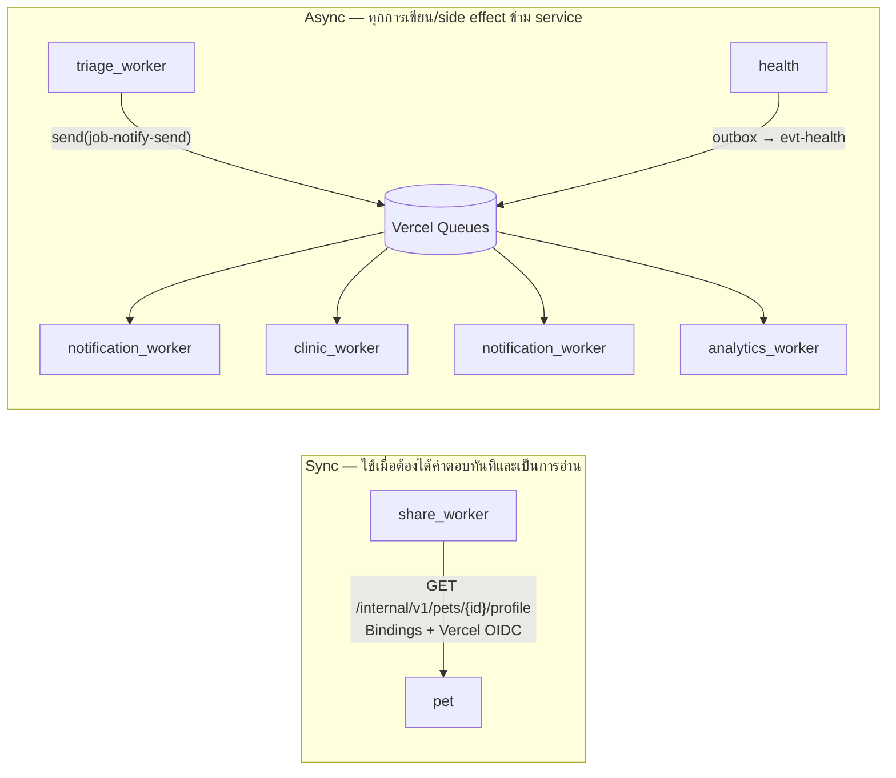

| กติกา | รายละเอียด |
|---|---|
| **ห้ามเขียน DB ของ service อื่น** | DB role ของแต่ละ service มีสิทธิ์เขียนเฉพาะ schema ตัวเอง |
| **การอ่านข้าม service** | ใช้ internal API (`/internal/v1/*`) ผ่าน Bindings เท่านั้น (ยกเว้น `authz.*` ที่ใช้ใน RLS และ analytics ที่อ่าน view สำหรับรายงาน) |
| **การสั่งงานข้าม service** | ส่งข้อความเข้า job topic ของ service ปลายทาง (เช่น `job-notify-send`) โดยใช้ schema จาก `packages/contracts` เจ้าของ topic เป็นคนกำหนด schema |
| **การแจ้งว่ามีอะไรเกิดขึ้น** | publish domain event ผ่าน outbox (`evt-<domain>`) ใครสนใจก็สร้าง consumer group เอง ผู้ส่งไม่ต้องรู้ว่าใครฟัง |
| **ความลึกของ sync call** | ไม่เกิน 1 hop ใน request ของผู้ใช้ (A → B แล้วจบ ห้าม A → B → C) |
| **ยืนยันตัวตนภายใน** | ผู้เรียกแนบ Vercel OIDC token (`getVercelOidcToken({ audience: 'pettech-internal:<target>' })`) ผู้รับตรวจ issuer/audience/subject ด้วย JWKS ของ Vercel ทุกครั้ง เพราะ binding ไม่ได้ยืนยันตัวตนให้ (ข้อจำกัดเรื่องการแยกผู้เรียกดูข้อ 11.6) |
| **เวอร์ชันของ contract** | เปลี่ยนแบบ backward-compatible เท่านั้น (เพิ่มฟิลด์ได้ ห้ามลบ/เปลี่ยนความหมาย) ถ้าจำเป็นต้องเปลี่ยนให้ออก `v2` คู่กันจนกว่า consumer จะย้ายครบ |

### 5.5 โครงภายในของหนึ่ง service (template)

```ts
// backend/health/src/api.ts — entry ของ Vercel service "health"
import { serve } from '@hono/node-server';
import { createServiceApp } from '@pettech/service-kit';
import { vaccineRoutes } from './routes/vaccines';
import { scanRoutes } from './routes/vaccine-scans';
import { internalRoutes } from './routes/internal';

const app = createServiceApp({
  name: 'health',
  // service-kit ใส่ให้ครบ: request-id, pino logger, CORS, security headers, error handler (RFC 9457),
  // JWT verify (JWKS ของ identity), idempotency (Redis), rate limit, /healthz, /openapi.json
});

app.route('/v1/health', scanRoutes);
app.route('/v1/health', vaccineRoutes);
app.route('/internal/v1/health', internalRoutes); // ต้องมี Vercel OIDC token เท่านั้น

export default serve({ fetch: app.fetch }); // ตามตัวอย่าง Hono ใน Vercel Services (framework "node") ⚠️ ยืนยันใน spike ข้อ 5.8 #1
```

```ts
// backend/health/src/routes/vaccine-scans.ts
import { OpenAPIHono, createRoute, z } from '@hono/zod-openapi';
import { CreateVaccineScanBody, VaccineScan } from '@pettech/contracts/health';
import { requirePetAccess } from '@pettech/service-kit/authz';
import { withUser } from '@pettech/db';
import { publishViaOutbox } from '@pettech/db/outbox';

export const scanRoutes = new OpenAPIHono<AppEnv>().openapi(
  createRoute({
    method: 'post',
    path: '/pets/{petId}/vaccine-scans',
    request: {
      params: z.object({ petId: z.string().uuid() }),
      body: { content: { 'application/json': { schema: CreateVaccineScanBody } } },
    },
    responses: { 202: { content: { 'application/json': { schema: VaccineScan } }, description: 'queued' } },
  }),
  async (c) => {
    const { petId } = c.req.valid('param');
    const body = c.req.valid('json');
    const user = c.get('user');
    await requirePetAccess(user, petId, 'health.write');           // ชั้น 1: ตรวจในโค้ด
    await media.attach(body.mediaIds, { petId, purpose: 'vaccine_book', owner: user.sub }); // binding → media
    const scan = await withUser(user.claims, async (tx) => {        // ชั้น 2: RLS
      const s = await createScan(tx, { petId, mediaIds: body.mediaIds, createdBy: user.sub });
      await publishViaOutbox(tx, 'job-health-vaccine-ocr', { scanId: s.id }, { key: s.id });
      return s;
    });
    return c.json(scan, 202);                                        // outbox relay ทำงานต่อใน waitUntil()
  },
);
```

### 5.6 `backend/vercel.json` (Vercel Services)

> syntax ของ `services`, `rewrites → { "service": … }`, `bindings` และ `experimentalTriggers` (`queue/v2beta`) มาจากเอกสาร Vercel ณ 28 ก.ย. 2569 ส่วนรูปแบบ key ใน `functions` ของ service แบบ Node และพฤติกรรมของ cron ที่ route เข้า service **ต้องยืนยันใน spike สัปดาห์แรก** (ข้อ 5.8)

```jsonc
{
  "$schema": "https://openapi.vercel.sh/vercel.json",
  "services": {
    "identity": {
      "root": "identity/", "framework": "node", "entrypoint": "src/api.ts",
      "functions": { "src/api.ts": { "maxDuration": 30, "regions": ["sin1"] } }
    },
    "identity_worker": {
      "root": "identity/", "framework": "node", "entrypoint": "src/worker.ts",
      "functions": { "src/worker.ts": { "maxDuration": 300, "regions": ["sin1"], "experimentalTriggers": [
        { "type": "queue/v2beta", "topic": "job-privacy-export", "maxDeliveries": 5,  "retryAfterSeconds": 60 },
        { "type": "queue/v2beta", "topic": "job-privacy-delete", "maxDeliveries": 10, "retryAfterSeconds": 60 },
        { "type": "queue/v2beta", "topic": "evt-clinic",  "maxDeliveries": 8 },
        { "type": "queue/v2beta", "topic": "evt-privacy", "maxDeliveries": 8 },
        { "type": "queue/v2beta", "topic": "cron-identity", "maxDeliveries": 3 }
      ]}}
    },

    "triage": {
      "root": "triage/", "framework": "node", "entrypoint": "src/api.ts",
      "functions": { "src/api.ts": { "maxDuration": 30, "regions": ["sin1"] } },
      "bindings": [ { "type": "service", "service": "media", "format": "url", "env": "MEDIA_URL" } ]
    },
    "triage_worker": {
      "root": "triage/", "framework": "node", "entrypoint": "src/worker.ts",
      "bindings": [ { "type": "service", "service": "media", "format": "url", "env": "MEDIA_URL" } ],
      "functions": { "src/worker.ts": { "maxDuration": 120, "regions": ["sin1"], "experimentalTriggers": [
        { "type": "queue/v2beta", "topic": "job-triage-assess",      "maxDeliveries": 3, "retryAfterSeconds": 5,  "maxConcurrency": 20 },
        { "type": "queue/v2beta", "topic": "job-triage-photo-check", "maxDeliveries": 3, "retryAfterSeconds": 5,  "maxConcurrency": 10 },
        { "type": "queue/v2beta", "topic": "job-triage-eval-run",    "maxDeliveries": 3, "maxConcurrency": 1 },
        { "type": "queue/v2beta", "topic": "job-triage-eval-case",   "maxDeliveries": 4, "maxConcurrency": 5 },
        { "type": "queue/v2beta", "topic": "cron-triage",            "maxDeliveries": 3 },
        { "type": "queue/v2beta", "topic": "evt-identity",           "maxDeliveries": 8 },
        { "type": "queue/v2beta", "topic": "evt-pet",                "maxDeliveries": 8 },
        { "type": "queue/v2beta", "topic": "evt-media",              "maxDeliveries": 8 }
      ]}}
    },

    "notification_worker": {
      "root": "notification/", "framework": "node", "entrypoint": "src/worker.ts",
      "functions": { "src/worker.ts": { "maxDuration": 120, "regions": ["sin1"], "experimentalTriggers": [
        { "type": "queue/v2beta", "topic": "job-notify-send",   "maxDeliveries": 6, "maxConcurrency": 20 },
        { "type": "queue/v2beta", "topic": "job-notify-digest", "maxDeliveries": 5, "maxConcurrency": 5 },
        { "type": "queue/v2beta", "topic": "job-line-webhook",  "maxDeliveries": 5, "retryAfterSeconds": 2 },
        { "type": "queue/v2beta", "topic": "cron-notification", "maxDeliveries": 3 },
        { "type": "queue/v2beta", "topic": "evt-*",             "maxDeliveries": 8 }
      ]}}
    },

    "scheduler": {
      "root": "scheduler/", "framework": "node", "entrypoint": "src/api.ts",
      "functions": { "src/api.ts": { "maxDuration": 15, "regions": ["sin1"] } }
    }
    // … pet, health, biometric, lostfound, clinic, share, notification, media, analytics
    //   และ *_worker ของแต่ละตัว ตามตารางข้อ 5.3 / 8.3
  },

  "rewrites": [
    { "source": "/.well-known/jwks.json",      "destination": { "service": "identity" } },
    { "source": "/v1/auth/(.*)",               "destination": { "service": "identity" } },
    { "source": "/v1/me",                      "destination": { "service": "identity" } },
    { "source": "/v1/consents(.*)",            "destination": { "service": "identity" } },
    { "source": "/v1/grants(.*)",              "destination": { "service": "identity" } },
    { "source": "/v1/privacy/(.*)",            "destination": { "service": "identity" } },
    { "source": "/v1/admin/users(.*)",         "destination": { "service": "identity" } },
    { "source": "/v1/pets(.*)",                "destination": { "service": "pet" } },
    { "source": "/v1/invites/(.*)",            "destination": { "service": "pet" } },
    { "source": "/v1/health/(.*)",             "destination": { "service": "health" } },
    { "source": "/v1/triage/(.*)",             "destination": { "service": "triage" } },
    { "source": "/v1/admin/triage/(.*)",       "destination": { "service": "triage" } },
    { "source": "/v1/petid/(.*)",              "destination": { "service": "biometric" } },
    { "source": "/v1/admin/petid/(.*)",        "destination": { "service": "biometric" } },
    { "source": "/v1/lost/(.*)",               "destination": { "service": "lostfound" } },
    { "source": "/v1/admin/lost/(.*)",         "destination": { "service": "lostfound" } },
    { "source": "/v1/clinics(.*)",             "destination": { "service": "clinic" } },
    { "source": "/v1/clinic-portal/(.*)",      "destination": { "service": "clinic" } },
    { "source": "/v1/admin/clinics(.*)",       "destination": { "service": "clinic" } },
    { "source": "/v1/share/(.*)",              "destination": { "service": "share" } },
    { "source": "/v1/notifications/(.*)",      "destination": { "service": "notification" } },
    { "source": "/v1/calendar/(.*)",           "destination": { "service": "notification" } },
    { "source": "/v1/line/(.*)",               "destination": { "service": "notification" } },
    { "source": "/v1/admin/notifications/(.*)","destination": { "service": "notification" } },
    { "source": "/v1/media/(.*)",              "destination": { "service": "media" } },
    { "source": "/v1/events",                  "destination": { "service": "analytics" } },
    { "source": "/v1/surveys/(.*)",            "destination": { "service": "analytics" } },
    { "source": "/v1/admin/metrics/(.*)",      "destination": { "service": "analytics" } },
    { "source": "/v1/admin/ops/(.*)",          "destination": { "service": "analytics" } },
    { "source": "/internal/cron/(.*)",         "destination": { "service": "scheduler" } }
  ],

  "crons": [
    { "path": "/internal/cron/outbox-sweep",       "schedule": "*/5 * * * *" },
    { "path": "/internal/cron/reminders-dispatch", "schedule": "0 1 * * *" },
    { "path": "/internal/cron/monthly-digest",     "schedule": "0 2 1 * *" },
    { "path": "/internal/cron/line-quota-sync",    "schedule": "5 * * * *" },
    { "path": "/internal/cron/followups-dispatch", "schedule": "0 3,11 * * *" },
    { "path": "/internal/cron/eval-canary",        "schedule": "0 20 * * 0" },
    { "path": "/internal/cron/media-gc",           "schedule": "0 19 * * *" },
    { "path": "/internal/cron/share-expiry",       "schedule": "30 19 * * *" },
    { "path": "/internal/cron/lost-maintenance",   "schedule": "0 20 * * *" },
    { "path": "/internal/cron/petid-refresh",      "schedule": "0 4 * * 1" },
    { "path": "/internal/cron/due-list-rebuild",   "schedule": "0 22 * * *" },
    { "path": "/internal/cron/metrics-rollup",     "schedule": "0 18 * * *" },
    { "path": "/internal/cron/retention-purge",    "schedule": "0 21 * * *" },
    { "path": "/internal/cron/session-cleanup",    "schedule": "15 21 * * *" }
  ]
}
```

> ไฟล์ `vercel.json` จริงใส่คอมเมนต์ไม่ได้ ให้ลบบรรทัด `//` ออกก่อนใช้
>
> `/internal/v1/*` ไม่มี rewrite สาธารณะ จึงเข้าถึงได้ผ่าน Bindings เท่านั้น แต่ service-kit ยังบังคับตรวจ Vercel OIDC token ทุก request ของ `/internal/v1/*` อีกชั้น (เผื่อกรณี path normalization ที่ไม่ได้คาดไว้)

### 5.7 การตั้งค่า Vercel projects ทั้งหมด

| Vercel project | Root Directory | Framework preset | Domain | หมายเหตุ |
|---|---|---|---|---|
| `pettech-backend` | `backend/` | **Services** | `api.<domain>` | เปิด "Include files outside root directory" (ต้องใช้ `packages/*`), เชื่อม Supabase / Upstash / Blob (2 stores) / AI Gateway |
| `pettech-owner-app` | `frontend/owner-app` | Next.js | `app.<domain>` และ `<domain>` | `relatedProjects: ["<project ID ของ pettech-backend เช่น prj_…>"]` เพื่อให้ preview ชี้ backend preview ของ branch เดียวกัน |
| `pettech-clinic-portal` | `frontend/clinic-portal` | Next.js | `clinic.<domain>` | BFF (cookie session) |
| `pettech-admin-console` | `frontend/admin-console` | Next.js | `admin.<domain>` | BFF + allowlist + Firewall rule เข้มกว่า |

- ทุก project เปิด **skip deployments ของ project ที่ไม่ได้รับผลกระทบ** (monorepo ที่ใช้ pnpm workspaces บน GitHub) เพื่อไม่ build ทั้ง repo ทุก commit
- Turborepo remote cache เปิดอัตโนมัติ

### 5.8 Spike สัปดาห์แรก — สิ่งที่ต้องพิสูจน์ก่อนเขียนโค้ดจริง

เนื่องจาก Vercel Services และ Vercel Queues ยังเป็น beta ให้สร้าง `backend/` ขนาดจิ๋ว (2 service + 2 worker) แล้วตรวจสิ่งต่อไปนี้ภายใน 1–2 วัน

| # | ต้องพิสูจน์ | ถ้าไม่ผ่าน |
|---|---|---|
| 1 | Hono (`framework: "node"`) เป็น Vercel service ที่รับ traffic ผ่าน top-level rewrite ได้ | ลอง `framework: "hono"` หรือใช้โครง `api/[[...route]].ts` |
| 2 | Worker service ที่มี `experimentalTriggers` บน entrypoint รับข้อความจาก `send()` ของ service อื่นใน project เดียวกัน และ dispatch ตาม topic ได้ | ใช้ไฟล์ consumer แยกต่อ topic หรือ Nitro (`vercel.queues.triggers`) |
| 3 | fan-out: 2 worker ฟัง topic เดียวกันแล้วได้คนละสำเนา | — (เป็นพฤติกรรมที่เอกสารระบุ) |
| 4 | `maxConcurrency` ถูกบังคับใช้จริง | ใช้ Redis semaphore (มีอยู่แล้วในแบบ) อย่างเดียว |
| 5 | Bindings + ตรวจ Vercel OIDC token (custom audience) ได้ | ใช้ HMAC ภายในชั่วคราว |
| 6 | Vercel Cron → `/internal/cron/*` → scheduler service ทำงาน | ย้าย cron ไปไว้ที่ frontend project แล้วเรียก API ผ่าน OIDC |
| 7 | `vercel dev` ใช้งาน services + queues ได้ในเครื่อง | ใช้ `QUEUE_DRIVER=inline` + รัน Hono แยก port |
| 8 | Build time ของ 23 services อยู่ในเกณฑ์ (Turbo cache) | รวม worker ที่งานน้อยเข้าด้วยกันชั่วคราว |

ถ้าข้อ 1–3 ไม่ผ่าน ให้ใช้ topology **B** (ข้อ 5.2) ตั้งแต่ต้น ซึ่งโค้ดใน `routes/`, `application/`, `domain/`, `consumers/` ไม่ต้องแก้

### 5.9 ข้อควรรู้เรื่อง env vars และความลับใน Services

- env vars ของ Vercel Services **ใช้ร่วมกันทั้ง project** ดังนั้นทุก service มองเห็น secret ของกันและกัน
- ในช่วง pilot ยอมรับได้ เพราะโค้ดทั้งหมดเป็นของเราเอง แต่ให้ลดความเสี่ยงดังนี้
  - ตั้งชื่อ secret แยกตาม service (`DB_URL_HEALTH`, `DB_URL_TRIAGE`, …) และมี lint rule ให้แต่ละ service อ่านได้เฉพาะตัวแปรของตัวเอง (`packages/config/env.ts` ทำ `zod` parse เฉพาะ key ที่ประกาศ)
  - DB role แยกต่อ service ยังป้องกัน "บั๊ก" ไม่ให้เขียนข้าม schema ได้ (แต่ไม่ได้ป้องกันโค้ดที่ตั้งใจร้าย)
  - ใช้ OIDC แทน secret ยาวๆ เมื่อทำได้ (Blob, AI Gateway, S2S)
- ถ้าวันหนึ่งต้องแยก secret อย่างเข้มงวด (เช่น มีทีมหลายทีม) ให้ย้าย service ที่อ่อนไหว (identity) ไปเป็น project แยกตามทางถอยในข้อ 5.2

---

## 6. API Design (คำถามข้อ 3)

### 6.1 สรุปจำนวน API

**รวมทั้งหมด 162 เส้น** (business endpoints) แยกเป็น
- 131 เส้นที่ frontend/ผู้ใช้เรียก
- 24 เส้นสำหรับ admin/สัตวแพทย์ที่ปรึกษา
- 5 เส้น internal (service ↔ service ผ่าน Bindings)
- 1 เส้น webhook (LINE)
- 1 เส้น cron (scheduler)

**ไม่นับรวมใน 162**
- utility อีก 24 เส้น (`GET /healthz` และ `GET /openapi.json` ของแต่ละ 12 service)
- route ของ BFF ใน clinic-portal/admin-console (OAuth callback, logout, proxy)
- queue consumers ซึ่งไม่ใช่ HTTP API

**ทยอยทำตามเฟส** (สะสม)

| เฟส | สัปดาห์ | จำนวนใหม่ | สะสม |
|---|---|---:|---:|
| P1 | 1–2 | 32 | 32 |
| P2 | 3–6 | 55 | 87 |
| P3 | 7–10 | 44 | 131 |
| P4 | 11–16 | 31 | 162 |

**จำนวนต่อ service**

| Service | รวม | P1 (สัปดาห์ 1–2) | P2 (3–6) | P3 (7–10) | P4 (11–16) | sync | sync+evt | async (202) | client-facing | admin | internal (S2S) | cron | webhook |
|---|---:|---:|---:|---:|---:|---:|---:|---:|---:|---:|---:|---:|---:|
| `identity-service` | 17 | 8 | 3 | 0 | 6 | 12 | 4 | 1 | 16 | 1 | 0 | 0 | 0 |
| `pet-service` | 16 | 9 | 1 | 6 | 0 | 8 | 7 | 1 | 15 | 0 | 1 | 0 | 0 |
| `health-service` | 18 | 0 | 15 | 2 | 1 | 7 | 10 | 1 | 17 | 0 | 1 | 0 | 0 |
| `triage-service` | 22 | 6 | 11 | 2 | 3 | 16 | 3 | 3 | 13 | 8 | 1 | 0 | 0 |
| `biometric-service` | 12 | 0 | 0 | 8 | 4 | 4 | 3 | 5 | 10 | 2 | 0 | 0 | 0 |
| `lostfound-service` | 16 | 0 | 0 | 16 | 0 | 10 | 5 | 1 | 15 | 1 | 0 | 0 | 0 |
| `clinic-service` | 21 | 0 | 1 | 4 | 16 | 14 | 6 | 1 | 17 | 4 | 0 | 0 | 0 |
| `share-service` | 10 | 0 | 6 | 4 | 0 | 7 | 2 | 1 | 10 | 0 | 0 | 0 | 0 |
| `notification-service` | 13 | 1 | 12 | 0 | 0 | 12 | 1 | 0 | 11 | 1 | 0 | 0 | 1 |
| `media-service` | 7 | 6 | 1 | 0 | 0 | 5 | 2 | 0 | 5 | 0 | 2 | 0 | 0 |
| `analytics-service` | 9 | 1 | 5 | 2 | 1 | 6 | 1 | 2 | 2 | 7 | 0 | 0 | 0 |
| `scheduler` | 1 | 1 | 0 | 0 | 0 | 0 | 1 | 0 | 0 | 0 | 0 | 1 | 0 |
| **รวมทั้งหมด** | **162** | **32** | **55** | **44** | **31** | **101** | **45** | **16** | **131** | **24** | **5** | **1** | **1** |

### 6.2 Base URL และ routing

| สภาพแวดล้อม | Base URL |
|---|---|
| Production | `https://api.<domain>` (Vercel project `pettech-backend`) |
| Preview (ต่อ PR) | URL ของ backend preview deployment ที่ frontend preview ได้มาจาก Related Projects |
| Local | `http://localhost:3000` (`vercel dev` ที่ `backend/`) |

Top-level rewrites ส่ง path prefix ไปยัง service (ข้อ 5.6)

| Prefix | Service |
|---|---|
| `/v1/auth/*`, `/v1/me`, `/v1/consents*`, `/v1/grants*`, `/v1/privacy/*`, `/v1/admin/users*`, `/.well-known/jwks.json` | identity |
| `/v1/pets*`, `/v1/invites/*` | pet |
| `/v1/health/*` | health |
| `/v1/triage/*`, `/v1/admin/triage/*` | triage |
| `/v1/petid/*`, `/v1/admin/petid/*` | biometric |
| `/v1/lost/*`, `/v1/admin/lost/*` | lostfound |
| `/v1/clinics*`, `/v1/clinic-portal/*`, `/v1/admin/clinics*` | clinic |
| `/v1/share/*` | share |
| `/v1/notifications/*`, `/v1/calendar/*`, `/v1/line/*`, `/v1/admin/notifications/*` | notification |
| `/v1/media/*` | media |
| `/v1/events`, `/v1/surveys/*`, `/v1/admin/metrics/*`, `/v1/admin/ops/*` | analytics |
| `/internal/cron/*` | scheduler |
| `/internal/v1/*` | *ไม่มี public route* (เรียกผ่าน Bindings เท่านั้น) |

**frontend เรียก API อย่างไร**
- **owner-app** เรียก `api.<domain>` ตรงด้วย `fetch` + `Authorization: Bearer` (CORS allowlist เฉพาะ origin ของเรา และ `Access-Control-Max-Age: 600`) ถ้าวัดแล้วพบว่า preflight ใน LINE webview ช้า ให้เปลี่ยนเป็น rewrite `/api/*` ใน owner-app ไปที่ `api.<domain>` (same-origin) โดยตั้ง `Cache-Control: no-store` กันการ cache ของ rewrite
- **clinic-portal / admin-console** เรียกจากฝั่ง server (BFF) เท่านั้น browser ไม่เห็น token

### 6.3 ข้อตกลงร่วมของทุก API

| เรื่อง | ข้อตกลง |
|---|---|
| **Versioning** | เวอร์ชันอยู่ใน path (`/v1`) เปลี่ยนแบบเพิ่มฟิลด์ได้เสมอ ถ้าต้อง breaking ให้ออก `/v2` ของ resource นั้นและใส่ header `Deprecation`/`Sunset` ที่ `/v1` |
| **รูปแบบข้อมูล** | JSON UTF-8, ฟิลด์เป็น `camelCase`, เวลาเป็น ISO 8601 UTC (`2026-09-28T02:15:04Z`), วันที่เป็น `YYYY-MM-DD` (ค.ศ.) |
| **ID** | UUIDv7 (string) ส่วนเลข PetID สำหรับคนอ่าน (`public_code`) แยกต่างหาก |
| **Authentication** | `Authorization: Bearer <JWT>` (ข้อ 11) ส่วน endpoint แบบ token-in-URL (ลิงก์สรุป, ฟีดปฏิทิน) ใช้ token แบบสุ่ม 128 บิตที่เก็บเป็น hash |
| **Error** | RFC 9457 `application/problem+json` เช่น `{ "type": "https://api.<domain>/problems/pet-not-found", "title": "Pet not found", "status": 404, "code": "PET_NOT_FOUND", "detail": "...", "requestId": "req_…", "errors": [{ "path": "name", "code": "too_long" }] }` โดย frontend แปลง `code` เป็นข้อความไทยเอง (server ไม่ส่งข้อความสำหรับผู้ใช้) |
| **Validation** | zod ทั้ง request และ response (response validate ใน dev/preview) |
| **Idempotency** | `POST` ที่สร้าง resource หรือเริ่มงาน async ต้องส่ง `Idempotency-Key` (UUID) เก็บใน Redis 24 ชม. ผูกกับ user + route ถ้าส่งซ้ำจะได้คำตอบเดิม |
| **งาน async** | ตอบ `202 Accepted` + header `Location: /v1/.../{id}` + body ที่มี `status` แล้ว client poll ด้วย backoff (ข้อ 8.8) |
| **Pagination** | cursor-based: `?limit=20&cursor=…` คืน `{ items: [...], nextCursor: "…" \| null }` |
| **Rate limit** | header `RateLimit-Limit`, `RateLimit-Remaining`, `RateLimit-Reset` และคืน `429` พร้อม `Retry-After` |
| **Caching** | endpoint ที่ต้องล็อกอินใช้ `Cache-Control: private, no-store` เสมอ ส่วน endpoint สาธารณะที่ไม่อ่อนไหว (flows, clinics) ใช้ `public, s-maxage=300, stale-while-revalidate=600` |
| **Correlation** | รับ/คืน `X-Request-Id` แล้วส่งต่อใน envelope ของคิวและ log ทุกบรรทัด |
| **Privacy ใน log** | path ที่มี token (`/v1/share/public/summaries/{token}`, `/v1/calendar/feeds/{token}.ics`) ต้องถูก redact ก่อน log และหน้าเว็บที่ใช้ token ตั้ง `Referrer-Policy: no-referrer` |
| **OpenAPI** | ทุก service เปิด `/openapi.json` (generate จาก zod) แล้วรวมเป็นเอกสารเดียวใน admin-console |
| **Typed client** | frontend ใช้ `hc<AppType>` ของ Hono ต่อ service หรือ client ที่ generate จาก OpenAPI |

### 6.4 ความหมายของคอลัมน์ในตาราง API

- **Auth**
  - `public` = ไม่ต้องล็อกอิน (ยังมี rate limit)
  - `public+botid` = ต้องผ่าน BotID
  - `user` = ล็อกอินแล้ว
  - `member:viewer|carer|owner` = เป็นสมาชิกของน้องตัวนั้นอย่างน้อยบทบาทที่ระบุ
  - `owner` (ใน media) = ผู้อัปโหลดไฟล์นั้น, `self` = ผู้ใช้คนนั้นเอง (เช่น ออกจากการดูแลร่วม)
  - `clinic` = พนักงานคลินิก, `clinic:admin` = ผู้ดูแลของคลินิก, `clinic+grant:<scope>` = คลินิกที่เจ้าของให้สิทธิ์ scope นั้น
  - `vet` = สัตวแพทย์ผู้รีวิว, `vet-advisor` = สัตวแพทย์ที่ปรึกษา
  - `admin` = ทีมงาน, `ci` = GitHub Actions (token สำหรับ eval เท่านั้น)
  - `service` = service อื่น (Vercel OIDC)
  - `cron` = Vercel Cron (`CRON_SECRET`)
  - `webhook:*` = ตรวจลายเซ็นของผู้ส่ง
  - `token` = capability token ใน URL
  - `participant` = คู่สนทนาใน thread
  - `requester` = ผู้สร้างคำขอนั้น
- **Mode**
  - `sync` = ตอบผลทันที
  - `sync+evt` = ตอบทันทีและปล่อย domain event ผ่าน outbox
  - `async` = ตอบ 202 แล้วงานทำต่อในคิว
- **Phase**: P1 = สัปดาห์ 1–2, P2 = 3–6, P3 = 7–10, P4 = 11–16
- **Feature**
  - F1–F16 = หมายเลขฟีเจอร์ตามแผน pilot
  - BIO = PetID
  - SAFETY = ความปลอดภัยของ AI
  - PDPA = ความเป็นส่วนตัว
  - PLAT = โครงสร้างพื้นฐาน
  - OPS = ปฏิบัติการ
  - KPI = ตัวชี้วัด
  - AI = ต้นทุน/คุณภาพ AI

### 6.5 รายการ API ทั้งหมด แยกตาม service

#### identity-service — 17 เส้น

| ID | Method | Path | Auth | Mode | Phase | Feature | หน้าที่ |
|---|---|---|---|---|---|---|---|
| IDN-01 | `POST` | `/v1/auth/liff/exchange` | public | sync | P1 | F1 | แลก LIFF ID token (หรือ LIFF access token) เป็น access token ของระบบ (JWT 60 นาที) และสร้างผู้ใช้ใหม่ถ้ายังไม่มี |
| IDN-02 | `POST` | `/v1/auth/line-login/exchange` | public | sync | P4 | F14 | (เรียกจาก BFF ของ clinic-portal/admin-console) แลก authorization code ของ LINE Login แบบ PKCE เป็น session (access + refresh) |
| IDN-03 | `POST` | `/v1/auth/refresh` | public | sync | P4 | F14 | หมุน refresh token ของ web session (ใช้ได้ครั้งเดียว ตรวจจับการใช้ซ้ำ) |
| IDN-04 | `POST` | `/v1/auth/logout` | user | sync | P1 | PLAT | เพิกถอน session ปัจจุบัน (ใส่ sid ลง denylist ใน Redis จนกว่า token จะหมดอายุ) |
| IDN-05 | `GET` | `/.well-known/jwks.json` | public | sync | P1 | PLAT | public key (ES256) ให้ทุก service ใช้ verify JWT (cache ได้) |
| IDN-06 | `GET` | `/v1/me` | user | sync | P1 | F1 | ข้อมูลผู้ใช้ บทบาท สถานะ onboarding และสรุป consent |
| IDN-07 | `PATCH` | `/v1/me` | user | sync | P1 | F1 | แก้ชื่อที่แสดง เขตที่อยู่ (ไม่บังคับ ใช้วัดเป้า "แมวใน กทม.") และภาษา |
| IDN-08 | `GET` | `/v1/consents` | user | sync | P1 | PDPA | สถานะความยินยอมแยกตามวัตถุประสงค์ พร้อมเวอร์ชันประกาศที่ยินยอม |
| IDN-09 | `PUT` | `/v1/consents/{purpose}` | user | sync+evt | P1 | PDPA | ให้/ถอนความยินยอม: service, ai_improvement, location_alerts, marketing (แยกจากกันเด็ดขาด) |
| IDN-10 | `GET` | `/v1/privacy/notice` | public | sync | P1 | PDPA | ประกาศความเป็นส่วนตัวฉบับปัจจุบัน (มีเลขเวอร์ชัน) |
| IDN-11 | `POST` | `/v1/privacy/requests` | user | async | P2 | PDPA | ขอสำเนาข้อมูล (export) หรือขอลบบัญชี (delete) แล้วรัน saga ข้ามทุก service |
| IDN-12 | `GET` | `/v1/privacy/requests/{requestId}` | user | sync | P2 | PDPA | สถานะคำขอ และลิงก์ดาวน์โหลดไฟล์ export (หมดอายุใน 24 ชม.) |
| IDN-13 | `POST` | `/v1/grants` | member:owner | sync+evt | P4 | F14 | เจ้าของให้สิทธิ์คลินิกเข้าถึงข้อมูลน้อง (scopes และวันหมดอายุ) |
| IDN-14 | `GET` | `/v1/grants` | user | sync | P4 | F14 | รายการสิทธิ์ที่เคยให้ (กรองตาม petId ได้) |
| IDN-15 | `DELETE` | `/v1/grants/{grantId}` | member:owner | sync+evt | P4 | F14 | เพิกถอนสิทธิ์ทันที |
| IDN-16 | `POST` | `/v1/grants/requests/{requestId}/decision` | member:owner | sync+evt | P4 | F14 | อนุมัติหรือปฏิเสธคำขอเข้าถึงจากคลินิก (กดจากปุ่มในข้อความ LINE) |
| IDN-17 | `GET` | `/v1/admin/users` | admin | sync | P2 | OPS | ค้นหาผู้ใช้เพื่อ support (mask PII และบันทึก audit log ทุกครั้ง) |

#### pet-service — 16 เส้น

| ID | Method | Path | Auth | Mode | Phase | Feature | หน้าที่ |
|---|---|---|---|---|---|---|---|
| PET-01 | `POST` | `/v1/pets` | user | sync+evt | P1 | F1 | สร้างโปรไฟล์น้อง (บังคับแค่ชื่อ ชนิด เพศ อายุ การทำหมัน) |
| PET-02 | `GET` | `/v1/pets` | user | sync | P1 | F1 | รายการน้องที่ฉันเป็นสมาชิก พร้อมบทบาท |
| PET-03 | `GET` | `/v1/pets/{petId}` | member:viewer | sync | P1 | F1 | โปรไฟล์น้อง |
| PET-04 | `PATCH` | `/v1/pets/{petId}` | member:carer | sync+evt | P1 | F1 | แก้ไขโปรไฟล์ (สายพันธุ์ สี วันเกิด ฯลฯ) |
| PET-05 | `DELETE` | `/v1/pets/{petId}` | member:owner | sync+evt | P1 | F1 | เก็บถาวรหรือลบโปรไฟล์ (soft delete 30 วันแล้วค่อย purge) |
| PET-06 | `PUT` | `/v1/pets/{petId}/avatar` | member:carer | sync | P1 | F1 | ตั้งรูปโปรไฟล์จาก mediaId |
| PET-07 | `POST` | `/v1/pets/{petId}/microchip-scans` | member:carer | async | P1 | F1 | ส่งรูปใบรับรองหรือสติกเกอร์บาร์โค้ดให้ AI อ่านเลขชิป (ถ้า client ถอดบาร์โค้ดได้เองจะข้ามขั้นนี้) |
| PET-08 | `GET` | `/v1/pets/{petId}/microchip-scans/{scanId}` | member:viewer | sync | P1 | F1 | สถานะ เลขที่อ่านได้ และความมั่นใจ |
| PET-09 | `PUT` | `/v1/pets/{petId}/microchip` | member:carer | sync+evt | P1 | F1 | ยืนยันหรือกรอกเลขชิป 15 หลัก (ตรวจรูปแบบ ISO 11784/11785 และเลขซ้ำ) |
| PET-10 | `GET` | `/v1/pets/{petId}/members` | member:viewer | sync | P3 | F9 | รายชื่อผู้ดูแลร่วมและบทบาท |
| PET-11 | `POST` | `/v1/pets/{petId}/invites` | member:owner | sync | P3 | F9 | สร้างลิงก์เชิญ (บทบาท หมดอายุ 72 ชม. จำกัดจำนวนครั้ง) |
| PET-12 | `GET` | `/v1/invites/{code}` | public | sync | P3 | F9 | ข้อมูลคำเชิญ (ชื่อและรูปน้อง ชื่อผู้เชิญ) สำหรับหน้ารับคำเชิญ |
| PET-13 | `POST` | `/v1/invites/{code}/accept` | user | sync+evt | P3 | F9 | รับคำเชิญแล้วเป็นสมาชิก |
| PET-14 | `PATCH` | `/v1/pets/{petId}/members/{userId}` | member:owner | sync+evt | P3 | F9 | เปลี่ยนบทบาทสมาชิก |
| PET-15 | `DELETE` | `/v1/pets/{petId}/members/{userId}` | member:owner / self | sync+evt | P3 | F9 | ลบสมาชิก หรือออกจากการดูแลร่วมด้วยตัวเอง |
| PET-16 | `GET` | `/internal/v1/pets/{petId}/profile` | service | sync | P2 | F6 | โปรไฟล์น้องสำหรับประกอบ snapshot (share-service, clinic-service) |

#### health-service — 18 เส้น

| ID | Method | Path | Auth | Mode | Phase | Feature | หน้าที่ |
|---|---|---|---|---|---|---|---|
| HLT-01 | `POST` | `/v1/health/pets/{petId}/vaccine-scans` | member:carer | async | P2 | F2 | ส่งรูปหน้าสมุดวัคซีน (1–6 รูป) ให้ AI อ่าน |
| HLT-02 | `GET` | `/v1/health/pets/{petId}/vaccine-scans/{scanId}` | member:viewer | sync | P2 | F2 | สถานะ และรายการร่างที่ AI อ่านได้ (ช่องที่ไม่มั่นใจจะถูก flag) |
| HLT-03 | `POST` | `/v1/health/pets/{petId}/vaccine-scans/{scanId}/confirm` | member:carer | sync+evt | P2 | F2 | ผู้ใช้ยืนยันหรือแก้ไข แล้วบันทึกจริงพร้อมตั้งเตือนอัตโนมัติ |
| HLT-04 | `GET` | `/v1/health/pets/{petId}/vaccines` | member:viewer | sync | P2 | F2 | ประวัติวัคซีน พร้อมป้ายแหล่งที่มา (AI อ่าน / กรอกเอง / ยืนยันโดยคลินิก) |
| HLT-05 | `POST` | `/v1/health/pets/{petId}/vaccines` | member:carer | sync+evt | P2 | F2 | เพิ่มวัคซีนเอง |
| HLT-06 | `PATCH` | `/v1/health/pets/{petId}/vaccines/{recordId}` | member:carer | sync+evt | P2 | F2 | แก้ไข (ถ้าแก้รายการที่คลินิกยืนยัน ป้ายยืนยันจะหลุด) |
| HLT-07 | `DELETE` | `/v1/health/pets/{petId}/vaccines/{recordId}` | member:carer | sync+evt | P2 | F2 | ลบ (soft delete) |
| HLT-08 | `GET` | `/v1/health/pets/{petId}/treatments` | member:viewer | sync | P2 | F3 | ยาถ่ายพยาธิ ยาป้องกันเห็บหมัด/พยาธิหนอนหัวใจ และยาที่ใช้อยู่ (แยกด้วย type) |
| HLT-09 | `POST` | `/v1/health/pets/{petId}/treatments` | member:carer | sync+evt | P2 | F3 | เพิ่มรายการ (บันทึกตามที่หมอสั่งเท่านั้น ระบบไม่แนะนำยาหรือขนาดยา) |
| HLT-10 | `PATCH` | `/v1/health/pets/{petId}/treatments/{treatmentId}` | member:carer | sync+evt | P2 | F3 | แก้ไขหรือหยุดใช้ |
| HLT-11 | `DELETE` | `/v1/health/pets/{petId}/treatments/{treatmentId}` | member:carer | sync+evt | P2 | F3 | ลบ |
| HLT-12 | `GET` | `/v1/health/pets/{petId}/weights` | member:viewer | sync | P2 | F8 | ข้อมูลกราฟน้ำหนัก |
| HLT-13 | `POST` | `/v1/health/pets/{petId}/weights` | member:carer | sync+evt | P2 | F8 | บันทึกน้ำหนัก และตรวจการเปลี่ยนแปลงเร็วผิดปกติ |
| HLT-14 | `POST` | `/v1/health/pets/{petId}/checkins` | member:carer | sync+evt | P3 | F8 | เช็กอินรายเดือน: น้ำหนัก รูป 1 รูป และ 5 คำถาม |
| HLT-15 | `GET` | `/v1/health/pets/{petId}/checkins` | member:viewer | sync | P3 | F8 | ประวัติเช็กอินและแนวโน้ม |
| HLT-16 | `GET` | `/v1/health/pets/{petId}/timeline` | member:viewer | sync | P2 | F6 | ไทม์ไลน์สุขภาพรวม (วัคซีน ยา น้ำหนัก เช็กอิน ผลคัดกรอง) |
| HLT-17 | `POST` | `/v1/health/clinic/pets/{petId}/vaccines` | clinic+grant:vaccines.write | sync+evt | P4 | F14 | คลินิกบันทึกวัคซีนที่ฉีดเอง ขึ้นป้าย "ยืนยันโดยคลินิก" และนัดครั้งถัดไปผูกกับคลินิกนี้ |
| HLT-18 | `GET` | `/internal/v1/health/pets/{petId}/summary` | service | sync | P2 | F6 | ข้อมูลสุขภาพสำหรับ snapshot (วัคซีน ยา น้ำหนัก) |

#### triage-service — 22 เส้น

| ID | Method | Path | Auth | Mode | Phase | Feature | หน้าที่ |
|---|---|---|---|---|---|---|---|
| TRG-01 | `GET` | `/v1/triage/flows/{species}` | public | sync | P2 | F4 | ชุดคำถามคัดกรองเวอร์ชันปัจจุบัน (cache ที่ CDN) |
| TRG-02 | `POST` | `/v1/triage/sessions` | member:viewer | sync | P2 | F4 | เริ่มเซสชัน (petId และอาการหลัก) พร้อมตรวจ red flag ชุดแรก (ผู้ชม/พี่เลี้ยงใช้ได้ เพราะเรื่องฉุกเฉินต้องไม่ถูกบล็อกด้วยบทบาท) |
| TRG-03 | `POST` | `/v1/triage/sessions/{sessionId}/answers` | member:viewer | sync | P2 | F4 | ส่งคำตอบทีละขั้น ได้คำถามถัดไป หรือหยุดทันทีถ้าเข้ากฎฉุกเฉิน (rules ทำงานทุกขั้น) |
| TRG-04 | `POST` | `/v1/triage/sessions/{sessionId}/assess` | member:viewer | async | P2 | F4 | ปิดเซสชัน ได้ระดับเบื้องต้นจาก rules ทันที (แสดงเมื่อ ≥ 2) แล้วส่งงาน LLM เข้าคิว (เส้นตาย 20 วิ) |
| TRG-05 | `GET` | `/v1/triage/sessions/{sessionId}` | member:viewer | sync | P2 | F4 | สถานะและผลสุดท้าย (ระดับ เหตุผล สิ่งที่ต้องสังเกต สิ่งที่ควรบอกหมอ) |
| TRG-06 | `GET` | `/v1/triage/sessions` | member:viewer | sync | P2 | F4 | ประวัติการคัดกรองของน้อง |
| TRG-07 | `POST` | `/v1/triage/photo-checks` | member:carer | async | P2 | F5 | ส่องสุขภาพจากรูป (area: eye / skin_coat / mouth / body_condition + mediaIds) |
| TRG-08 | `GET` | `/v1/triage/photo-checks/{checkId}` | member:viewer | sync | P2 | F5 | สถานะและผล หรือคำขอให้ถ่ายใหม่พร้อมเหตุผล |
| TRG-09 | `GET` | `/v1/triage/followups` | user | sync | P3 | F12 | รายการติดตามผลที่รอคำตอบ |
| TRG-10 | `POST` | `/v1/triage/followups/{followupId}/response` | member:carer | sync+evt | P3 | F12 | ตอบว่าได้ไปหาหมอไหม และหมอบอกว่าอะไร (ใช้วัดความแม่นยำ) |
| TRG-11 | `GET` | `/v1/triage/reviews/queue` | vet | sync | P4 | F16 | เคสสุ่มที่รอสัตวแพทย์รีวิว (ปิดข้อมูลเจ้าของ) |
| TRG-12 | `POST` | `/v1/triage/reviews` | vet | sync+evt | P4 | F16 | ส่งผลรีวิว: ระดับถูกหรือผิด ระดับที่ควรเป็น และหมายเหตุ |
| TRG-13 | `GET` | `/v1/triage/reviews/stats` | vet / admin | sync | P4 | F16 | % ความตรงกับสัตวแพทย์ จำนวน under-triage และ confusion matrix |
| TRG-14 | `GET` | `/v1/admin/triage/rule-sets` | admin / vet-advisor | sync | P1 | SAFETY | ชุดกฎอาการฉุกเฉินทุกเวอร์ชัน (draft / approved / active / retired) |
| TRG-15 | `POST` | `/v1/admin/triage/rule-sets` | admin / vet-advisor | sync | P1 | SAFETY | สร้างร่างชุดกฎใหม่ |
| TRG-16 | `POST` | `/v1/admin/triage/rule-sets/{ruleSetId}/approve` | vet-advisor | sync+evt | P1 | SAFETY | สัตวแพทย์ที่ปรึกษาอนุมัติ (ต้องแนบ eval run ที่ผ่าน) แล้วสลับเป็นเวอร์ชันที่ใช้งาน |
| TRG-17 | `GET` | `/v1/admin/triage/eval-cases` | admin / vet-advisor | sync | P1 | SAFETY | ชุดทดสอบ 50–100 เคสพร้อมเฉลย |
| TRG-18 | `POST` | `/v1/admin/triage/eval-cases` | admin / vet-advisor | sync | P1 | SAFETY | เพิ่มเคสทดสอบ |
| TRG-19 | `PATCH` | `/v1/admin/triage/eval-cases/{caseId}` | admin / vet-advisor | sync | P1 | SAFETY | แก้ไขเคสหรือเฉลย |
| TRG-20 | `POST` | `/v1/admin/triage/eval-runs` | admin / ci | async | P2 | SAFETY | รันชุดทดสอบกับ prompt / model / rules เวอร์ชันที่ระบุ |
| TRG-21 | `GET` | `/v1/admin/triage/eval-runs/{runId}` | admin / ci | sync | P2 | SAFETY | ผล: accuracy, under-triage (ต้องเป็น 0) และรายเคสที่ผิด |
| TRG-22 | `GET` | `/internal/v1/triage/pets/{petId}/recent` | service | sync | P2 | F6 | ผลคัดกรองและผลส่องรูปล่าสุด คำตอบ และ mediaIds สำหรับ snapshot |

#### biometric-service — 12 เส้น

| ID | Method | Path | Auth | Mode | Phase | Feature | หน้าที่ |
|---|---|---|---|---|---|---|---|
| BIO-01 | `POST` | `/v1/petid/pets/{petId}/captures` | member:carer | async | P3 | BIO | ส่งรูปลงทะเบียน PetID (view: face_front / nose / body_side ฯลฯ) เพื่อตรวจคุณภาพ สกัดลักษณะ และทำ embedding |
| BIO-02 | `GET` | `/v1/petid/pets/{petId}/enrollment` | member:viewer | sync | P3 | BIO | สถานะ: มุมที่ครบ คุณภาพ และพร้อมใช้งานหรือยัง |
| BIO-03 | `DELETE` | `/v1/petid/pets/{petId}/captures/{captureId}` | member:carer | sync+evt | P3 | BIO | ลบรูปลงทะเบียน (ลบ vector ที่เกี่ยวข้องด้วย) |
| BIO-04 | `PATCH` | `/v1/petid/pets/{petId}/settings` | member:owner | sync+evt | P3 | BIO | โหมดการค้นหา: lost_only (ค่าเริ่มต้น) / always / off |
| BIO-05 | `DELETE` | `/v1/petid/pets/{petId}` | member:owner | async | P3 | BIO | ถอน PetID: ลบ captures, signatures และ vectors ทั้งหมด |
| BIO-06 | `POST` | `/v1/petid/identify` | user | async | P3 | BIO | สแกนน้องที่พบ (1:N) ต้องล็อกอิน LINE และมี rate limit |
| BIO-07 | `GET` | `/v1/petid/identify/{requestId}` | requester | sync | P3 | BIO | ผลการค้นหา (เปิดเผยข้อมูลตามนโยบายความเป็นส่วนตัวเท่านั้น) |
| BIO-08 | `POST` | `/v1/petid/identify/{requestId}/confirm` | member:owner | sync+evt | P3 | BIO | เจ้าของยืนยันหรือปฏิเสธว่าใช่น้องตัวเอง (ground truth สำหรับวัดความแม่นยำ) |
| BIO-09 | `POST` | `/v1/petid/verify` | member:viewer / clinic+grant:identity.verify | async | P4 | BIO | ยืนยันตัวตน 1:1 (petId + mediaId) เช่นเช็กอินที่คลินิก |
| BIO-10 | `GET` | `/v1/petid/verify/{requestId}` | requester | sync | P4 | BIO | ผล: verified / uncertain / mismatch พร้อมหลักฐาน |
| BIO-11 | `GET` | `/v1/admin/petid/metrics` | admin | sync | P4 | BIO | Top-1/Top-5, FMR/FNMR ตาม threshold, latency และต้นทุน |
| BIO-12 | `POST` | `/v1/admin/petid/reindex` | admin | async | P4 | BIO | สร้าง embedding ใหม่ทั้งฐานเมื่อเปลี่ยนโมเดล embedding หรือ prompt |

#### lostfound-service — 16 เส้น

| ID | Method | Path | Auth | Mode | Phase | Feature | หน้าที่ |
|---|---|---|---|---|---|---|---|
| LST-01 | `POST` | `/v1/lost/reports` | member:carer | sync+evt | P3 | F7 | ประกาศน้องหาย สร้างโปสเตอร์ เปิดการค้นหา PetID และแจ้งเตือนพื้นที่ (ตามงบโควตา) |
| LST-02 | `GET` | `/v1/lost/reports` | user | sync | P3 | F7 | ประกาศของฉัน |
| LST-03 | `GET` | `/v1/lost/reports/{reportId}` | member:viewer | sync | P3 | F7 | รายละเอียดและสถิติ (views, shares, sightings, ข้อความ) |
| LST-04 | `PATCH` | `/v1/lost/reports/{reportId}` | member:carer | sync+evt | P3 | F7 | อัปเดตพื้นที่หรือรายละเอียด (re-render โปสเตอร์) |
| LST-05 | `POST` | `/v1/lost/reports/{reportId}/resolve` | member:carer | sync+evt | P3 | F7 | พบแล้วหรือยกเลิก ปิดหน้า public และหยุดการค้นหา |
| LST-06 | `GET` | `/v1/lost/public/{slug}` | public | sync | P3 | F7 | ข้อมูลหน้าประกาศสาธารณะ (เฉพาะที่เจ้าของเลือกเปิดเผย) |
| LST-07 | `GET` | `/v1/lost/nearby` | public | sync | P3 | F7 | ประกาศที่ยัง active ในพื้นที่ (geohash หยาบราว 5 กม.) |
| LST-08 | `POST` | `/v1/lost/sightings` | public+botid | async | P3 | F7 | แจ้งพบเห็น (รูป พื้นที่ หมายเหตุ) แล้วจับคู่เฉพาะกับประกาศหายที่ active (ไม่ค้น PetID ทั้งฐาน และไม่คืนผลจับคู่ให้ผู้ส่ง ถ้าจะค้น PetID ต้องล็อกอินผ่าน /v1/petid/identify) |
| LST-09 | `POST` | `/v1/lost/public/{slug}/messages` | public+botid | sync+evt | P3 | F7 | ผู้พบส่งข้อความถึงเจ้าของผ่านระบบ (ไม่เห็นเบอร์โทร) และเปิด thread |
| LST-10 | `GET` | `/v1/lost/threads` | user | sync | P3 | F7 | กล่องข้อความ relay ของฉัน |
| LST-11 | `GET` | `/v1/lost/threads/{threadId}/messages` | participant | sync | P3 | F7 | ข้อความใน thread (ผู้พบที่ไม่ล็อกอินใช้ thread token) |
| LST-12 | `POST` | `/v1/lost/threads/{threadId}/messages` | participant | sync+evt | P3 | F7 | ส่งข้อความ (กรองเบอร์/ลิงก์อันตราย และจำกัดความถี่) |
| LST-13 | `PUT` | `/v1/lost/alert-subscription` | user | sync | P3 | F7 | สมัครรับแจ้งเตือนน้องหายในพื้นที่ (ต้องมี consent location_alerts) |
| LST-14 | `DELETE` | `/v1/lost/alert-subscription` | user | sync | P3 | F7 | ยกเลิกการรับแจ้งเตือน |
| LST-15 | `POST` | `/v1/lost/public/{slug}/abuse-reports` | public+botid | sync | P3 | OPS | รายงานประกาศไม่เหมาะสมหรือหลอกลวง |
| LST-16 | `GET` | `/v1/admin/lost/reports` | admin | sync | P3 | OPS | คิว moderation (ประกาศที่ถูกรายงาน ข้อความต้องสงสัย) |

#### clinic-service — 21 เส้น

| ID | Method | Path | Auth | Mode | Phase | Feature | หน้าที่ |
|---|---|---|---|---|---|---|---|
| CLN-01 | `GET` | `/v1/clinics` | public | sync | P3 | F11 | ค้นหาคลินิก/รพ.สัตว์ (เขต, 24 ชม., เปิดอยู่ตอนนี้, ใกล้ฉัน) cache ที่ CDN 5 นาที |
| CLN-02 | `GET` | `/v1/clinics/{clinicId}` | public | sync | P3 | F11 | รายละเอียดคลินิก (เวลาทำการ เบอร์ ลิงก์แผนที่) |
| CLN-03 | `POST` | `/v1/clinics/{clinicId}/appointment-requests` | member:carer | sync+evt | P4 | F15 | ขอนัด (ช่วงเวลาที่สะดวก เหตุผล และแนบลิงก์สรุปก่อนพบหมอ) |
| CLN-04 | `GET` | `/v1/clinics/join/{code}` | public | sync | P4 | F13 | resolve QR ประจำคลินิก คืนข้อมูลคลินิกสำหรับหน้า landing |
| CLN-05 | `POST` | `/v1/clinics/join/{code}/attribute` | user | sync+evt | P4 | F13 | ผูกผู้ใช้กับคลินิกที่พามา (first-touch attribution) |
| CLN-06 | `POST` | `/v1/clinics/leads` | public+botid | sync+evt | P2 | F6 | ฟอร์ม "คลินิกของคุณอยากรับเคสแบบนี้? ลงทะเบียนฟรี" ท้ายหน้าสรุป |
| CLN-07 | `GET` | `/v1/clinic-portal/me` | clinic | sync | P4 | F14 | โปรไฟล์คลินิกและบทบาทของพนักงาน |
| CLN-08 | `POST` | `/v1/clinic-portal/pets/resolve` | clinic | sync | P4 | F14 | สแกน QR น้องหรือลิงก์สรุป เพื่อระบุตัวน้องและดูสถานะสิทธิ์ที่คลินิกมี |
| CLN-09 | `POST` | `/v1/clinic-portal/pets/{petId}/access-requests` | clinic | sync+evt | P4 | F14 | ขอความยินยอมจากเจ้าของ (ส่งปุ่มอนุมัติทาง LINE) |
| CLN-10 | `GET` | `/v1/clinic-portal/pets/{petId}/summary` | clinic+grant:summary.read | sync | P4 | F14 | สรุปข้อมูลน้องแบบสด (เฉพาะเมื่อมีสิทธิ์) |
| CLN-11 | `GET` | `/v1/clinic-portal/due-list` | clinic | sync | P4 | F14 | น้องที่ใกล้ครบกำหนดวัคซีนซึ่งนัดไว้กับคลินิกนี้ |
| CLN-12 | `POST` | `/v1/clinic-portal/due-list/reminders` | clinic | async | P4 | F14 | ให้ระบบส่งเตือนเจ้าของ (เฉพาะผู้ที่ยินยอม คิดจากโควตา) |
| CLN-13 | `GET` | `/v1/clinic-portal/appointment-requests` | clinic | sync | P4 | F15 | กล่องคำขอนัด |
| CLN-14 | `PATCH` | `/v1/clinic-portal/appointment-requests/{requestId}` | clinic | sync+evt | P4 | F15 | อัปเดตสถานะ (เห็นแล้ว / โทรกลับแล้ว / นัดได้ / ยกเลิก) |
| CLN-15 | `GET` | `/v1/clinic-portal/insights` | clinic | sync | P4 | F13 | ตัวเลขของคลินิก: สรุปถูกเปิด กดโทร/นำทาง ผู้ใช้ที่ผูก และการกลับมาฉีดตามนัด |
| CLN-16 | `GET` | `/v1/clinic-portal/staff` | clinic:admin | sync | P4 | F14 | รายชื่อพนักงาน |
| CLN-17 | `POST` | `/v1/clinic-portal/staff/invites` | clinic:admin | sync | P4 | F14 | เชิญพนักงาน (ลิงก์ล็อกอิน LINE) |
| CLN-18 | `POST` | `/v1/admin/clinics` | admin | sync | P3 | F11 | เพิ่มคลินิกลง directory |
| CLN-19 | `PATCH` | `/v1/admin/clinics/{clinicId}` | admin | sync+evt | P3 | F11 | แก้ไขข้อมูล หรือตั้งสถานะ partner (none / pilot / paid) |
| CLN-20 | `POST` | `/v1/admin/clinics/{clinicId}/qr-codes` | admin | sync | P4 | F13 | ออก QR ประจำคลินิก (แยกแคมเปญได้) |
| CLN-21 | `POST` | `/v1/admin/clinics/{clinicId}/lois` | admin | sync | P4 | KPI | บันทึก LOI (ไฟล์และเงื่อนไข) สำหรับตัวชี้วัดคลินิกนำร่อง |

#### share-service — 10 เส้น

| ID | Method | Path | Auth | Mode | Phase | Feature | หน้าที่ |
|---|---|---|---|---|---|---|---|
| SHR-01 | `POST` | `/v1/share/summaries` | member:carer | async | P2 | F6 | สร้าง "สรุปก่อนพบหมอ" ได้ลิงก์และ QR ทันที ส่วน snapshot ประกอบในคิว (หมดอายุ 7–14 วัน) |
| SHR-02 | `GET` | `/v1/share/summaries` | member:viewer | sync | P2 | F6 | ลิงก์สรุปทั้งหมดของน้องพร้อมยอดเปิด |
| SHR-03 | `GET` | `/v1/share/summaries/{summaryId}` | member:viewer | sync | P2 | F6 | สถานะ snapshot และประวัติการเปิด (เวลา และคลินิกถ้าทราบ) |
| SHR-04 | `DELETE` | `/v1/share/summaries/{summaryId}` | member:carer | sync+evt | P2 | F6 | เพิกถอนลิงก์ทันที |
| SHR-05 | `GET` | `/v1/share/summaries/{summaryId}/qr.svg` | member:viewer | sync | P2 | F6 | QR code (SVG) |
| SHR-06 | `GET` | `/v1/share/public/summaries/{token}` | token | sync+evt | P2 | F6 | ข้อมูลหน้า "สรุปก่อนพบหมอ" สำหรับคลินิก และบันทึกการเปิด |
| SHR-07 | `POST` | `/v1/share/cards` | member:viewer | sync | P3 | F10 | สร้างการ์ดแชร์ (passport / checkin_done / petid_card) คืน publicId และข้อมูลสำหรับ render ฝั่ง client |
| SHR-08 | `GET` | `/v1/share/cards/{publicId}` | public | sync | P3 | F10 | ข้อมูลการ์ดสำหรับหน้า landing (มีลิงก์กลับเข้าแอป) |
| SHR-09 | `POST` | `/v1/share/cards/{publicId}/image` | member:viewer | sync | P3 | F10 | Vercel Blob client-upload handler ของ public store: ออก token ให้ client อัปโหลดการ์ดที่ render ในเครื่อง (ภาษาไทยถูกต้อง) ตรงไป Blob แล้วผูกเป็น og:image |
| SHR-10 | `POST` | `/v1/share/posters/{reportId}/images` | member:carer | sync | P3 | F7 | Vercel Blob client-upload handler ของ public store: ออก token ให้ client อัปโหลดโปสเตอร์ (A4 / สี่เหลี่ยม / story) ตรงไป Blob แล้วผูกกับประกาศ |

#### notification-service — 13 เส้น

| ID | Method | Path | Auth | Mode | Phase | Feature | หน้าที่ |
|---|---|---|---|---|---|---|---|
| NTF-01 | `GET` | `/v1/notifications/preferences` | user | sync | P2 | F3 | ช่องทาง ช่วงเวลาห้ามรบกวน และวันส่งสรุปรายเดือน |
| NTF-02 | `PUT` | `/v1/notifications/preferences` | user | sync | P2 | F3 | แก้ไขการตั้งค่า |
| NTF-03 | `GET` | `/v1/notifications/reminders` | user | sync | P2 | F3 | เตือนที่กำลังจะถึง (กรองตาม petId ได้) |
| NTF-04 | `POST` | `/v1/notifications/reminders/{reminderId}/complete` | member:carer | sync+evt | P2 | F3 | ทำแล้ว (เช่น ฉีดแล้ว แล้วชวนสแกนสมุดหน้าใหม่) |
| NTF-05 | `POST` | `/v1/notifications/reminders/{reminderId}/snooze` | member:carer | sync | P2 | F3 | เลื่อนเตือน |
| NTF-06 | `GET` | `/v1/notifications/inbox` | user | sync | P2 | F3 | การแจ้งเตือนในแอป (fallback เมื่อส่ง LINE ไม่ได้หรือเกินงบโควตา) |
| NTF-07 | `POST` | `/v1/notifications/inbox/read` | user | sync | P2 | F3 | ทำเครื่องหมายว่าอ่านแล้ว |
| NTF-08 | `POST` | `/v1/calendar/feeds` | user | sync | P2 | F3 | สร้างหรือหมุน token ปฏิทิน คืน webcal:// และลิงก์ Google Calendar |
| NTF-09 | `DELETE` | `/v1/calendar/feeds/{feedId}` | user | sync | P2 | F3 | ยกเลิก feed |
| NTF-10 | `GET` | `/v1/calendar/feeds/{token}.ics` | token | sync | P2 | F3 | ฟีดปฏิทิน .ics ของทุกน้องที่ผู้ใช้ดูแล |
| NTF-11 | `GET` | `/v1/calendar/events/{reminderId}.ics` | token | sync | P2 | F3 | ไฟล์นัดเดี่ยว (มี VALARM) สำหรับปุ่ม "เพิ่มนัดนี้ลงปฏิทิน" เปิดผ่านลิงก์ลงนามอายุสั้นที่ API ออกให้ (เบราว์เซอร์ภายนอกส่ง Bearer ไม่ได้) |
| NTF-12 | `POST` | `/v1/line/webhook` | webhook:line | sync | P1 | PLAT | LINE webhook: follow / unfollow / message / postback (ตรวจ x-line-signature แล้วตอบ 200 ทันที) |
| NTF-13 | `GET` | `/v1/admin/notifications/quota` | admin | sync | P2 | OPS | โควตา LINE ที่ใช้/เหลือ และคาดการณ์สิ้นเดือน |

#### media-service — 7 เส้น

| ID | Method | Path | Auth | Mode | Phase | Feature | หน้าที่ |
|---|---|---|---|---|---|---|---|
| MED-01 | `POST` | `/v1/media/uploads` | user / public+botid / webhook:blob | sync | P1 | PLAT | Vercel Blob client-upload handler (`handleUpload`): (1) ออก client token หลังตรวจ purpose ชนิด ขนาด และโควตา แล้วจอง mediaId (2) รับ callback `onUploadCompleted` จาก Blob — ผู้ไม่ล็อกอินได้เฉพาะ purpose=sighting ไม่เกิน 2 รูปและผูกกับ thread token |
| MED-02 | `POST` | `/v1/media/{mediaId}/complete` | owner | sync+evt | P1 | PLAT | client แจ้งว่าอัปโหลดเสร็จ server ตรวจด้วย `head()` (ขนาด/ชนิด) แล้วส่ง `job-media-process` (idempotent กับ callback) |
| MED-03 | `GET` | `/v1/media/{mediaId}` | owner / member:viewer | sync | P1 | PLAT | metadata และสถานะ (pending / uploaded / ready / rejected / deleted) |
| MED-04 | `GET` | `/v1/media/{mediaId}/url` | owner / member:viewer | sync | P1 | PLAT | คืน signed URL อายุสั้นของ private Blob (variant=thumb\|display) — browser โหลดตรงจาก Blob ไม่ผ่าน function |
| MED-05 | `DELETE` | `/v1/media/{mediaId}` | owner | sync+evt | P1 | PLAT | ลบไฟล์ |
| MED-06 | `POST` | `/internal/v1/media/attach` | service | sync | P1 | PLAT | ตรวจสิทธิ์และผูก mediaIds กับ resource (กันการอ้าง media ของคนอื่น) |
| MED-07 | `POST` | `/internal/v1/media/sign` | service | sync | P2 | F6 | ออก signed URL (Vercel Blob presign) แบบ batch ให้ service อื่น เช่น หน้าสรุปก่อนพบหมอ/โปสเตอร์ |

#### analytics-service — 9 เส้น

| ID | Method | Path | Auth | Mode | Phase | Feature | หน้าที่ |
|---|---|---|---|---|---|---|---|
| ANL-01 | `POST` | `/v1/events` | user / public | async | P1 | KPI | รับ event จาก client แบบ batch (sendBeacon) แล้วส่งเข้าคิว |
| ANL-02 | `POST` | `/v1/surveys/responses` | user | sync+evt | P3 | KPI | แบบสอบถาม PMF ("ถ้าแอปหายไปจะเสียดายแค่ไหน") |
| ANL-03 | `GET` | `/v1/admin/metrics/scorecard` | admin | sync | P2 | KPI | ตาราง 7 ตัวชี้วัดเทียบเป้า ณ สัปดาห์ปัจจุบัน |
| ANL-04 | `GET` | `/v1/admin/metrics/funnels/{funnel}` | admin | sync | P2 | KPI | funnel: เปิดแอป → สร้างโปรไฟล์ → บันทึกวัคซีนหรือเช็กอาการภายใน 7 วัน |
| ANL-05 | `GET` | `/v1/admin/metrics/retention` | admin | sync | P3 | KPI | cohort retention รายสัปดาห์และรายเดือน |
| ANL-06 | `GET` | `/v1/admin/metrics/ai` | admin | sync | P2 | AI | ต้นทุน latency error และ refusal แยกตามฟีเจอร์และเวอร์ชันโมเดล |
| ANL-07 | `GET` | `/v1/admin/metrics/clinics/{clinicId}` | admin | sync | P4 | KPI | รายงานรายคลินิก (ใช้คุยขายและขอ LOI) |
| ANL-08 | `GET` | `/v1/admin/ops/dead-letters` | admin | sync | P2 | OPS | ข้อความที่ล้มเหลวถาวรจากทุก service |
| ANL-09 | `POST` | `/v1/admin/ops/dead-letters/{id}/replay` | admin | async | P2 | OPS | ส่งข้อความกลับเข้าคิวเดิม |

#### scheduler — 1 เส้น

| ID | Method | Path | Auth | Mode | Phase | Feature | หน้าที่ |
|---|---|---|---|---|---|---|---|
| SCH-01 | `GET` | `/internal/cron/{job}` | cron | sync+evt | P1 | PLAT | จุดรับ Vercel Cron จุดเดียว: ตรวจ CRON_SECRET แล้ว send() เข้า topic `cron-<svc>` ของ service เจ้าของงาน (type `cron.<job>`) พร้อม idempotencyKey = job + ช่วงเวลา (กัน cron ยิงซ้ำ) |

---

## 7. UI/UX Design (คำถามข้อ 4)

### 7.1 หลักการออกแบบ

| # | หลักการ | แปลเป็นการออกแบบอย่างไร |
|---|---|---|
| 1 | **ได้ของใน 1 นาที ประทับใจใน 2 นาที** | onboarding บังคับกรอกแค่ 5 ช่อง ส่วนหน้าจอแรกหลังสร้างโปรไฟล์คือ "ถ่ายสมุดวัคซีน" |
| 2 | **ใจเย็น ชัด ปลอดภัย** | หน้าผลคัดกรองมีข้อความหลักเดียวและปุ่มหลักปุ่มเดียว ห้ามใช้คำว่า "ไม่เป็นไร" และทุกระดับต้องมี "ไปทันทีถ้า…" |
| 3 | **สีไม่ใช่สัญญาณเดียว** | ระดับความเร่งด่วนใช้ สี + ไอคอน + ข้อความ เสมอ (รองรับตาบอดสี) |
| 4 | **มือเดียว นิ้วโป้ง** | ปุ่มหลักอยู่ครึ่งล่างของจอ สูงอย่างน้อย 48 px และ bottom sheet แทน modal กลางจอ |
| 5 | **รู้สึกเป็นส่วนหนึ่งของ LINE** | ใช้ภาษาพูดสุภาพแบบเพื่อน แชร์ผ่าน `shareTargetPicker` และแจ้งเตือนเป็น Flex Message |
| 6 | **ค่อยๆ เปิดเผย** | เก็บข้อมูลเพิ่ม (สายพันธุ์ ชิป น้ำหนัก) ตอนที่ผู้ใช้ได้ประโยชน์จากมันทันที ไม่ใช่ตอนสมัคร |
| 7 | **โปร่งใสเรื่อง AI** | บอกเสมอว่าอะไรมาจาก AI มีป้าย "AI อ่าน — โปรดตรวจ" ให้แก้ได้ทุกช่อง และแสดง "ตรวจทานโดยสัตวแพทย์ที่ปรึกษา" ที่ชุดกฎ |
| 8 | **เคารพความเป็นส่วนตัว** | ก่อนแชร์แสดงเสมอว่า "ใครจะเห็นอะไร นานแค่ไหน" และเพิกถอนได้ในแตะเดียว |

### 7.2 Design system

**ฟอนต์**
- UI: **LINE Seed Sans TH** (สัญญาอนุญาต SIL OFL ให้ความรู้สึกเข้ากับ LINE) โดยมี `IBM Plex Sans Thai` เป็น fallback
- ตัวเลขและกราฟใช้ `tabular-nums`
- ขนาดตัวอักษรขั้นต่ำ 16 px สำหรับเนื้อหา line-height 1.6 (สระบนล่างของไทยต้องการพื้นที่)
- ใช้ `next/font/local` และ subset เฉพาะ Thai + Latin เพื่อลดขนาดโหลด

**สี (design tokens)** — สีหลักตั้งใจไม่ใช้เขียว LINE (#06C755) เพื่อไม่ให้สับสนกับแบรนด์ LINE

| Token | ค่า (light) | ใช้กับ |
|---|---|---|
| `--brand` | `#177A6C` (teal) | ปุ่มหลัก, ลิงก์ |
| `--brand-soft` | `#E6F4F1` | พื้นหลังการ์ดเด่น |
| `--urgent-emergency` | `#C8102E` + ไอคอน 🚨 | "ไปโรงพยาบาลทันที" |
| `--urgent-24h` | `#C2410C` + ไอคอน ⏱ | "พบหมอภายใน 24 ชม." |
| `--urgent-routine` | `#1C64D1` + ไอคอน 📅 | "นัดตรวจตามปกติ" |
| `--urgent-home` | `#15803D` + ไอคอน 🏠 | "ดูแลที่บ้านและเฝ้าดู" |
| `--verified` | `#6741D9` | ป้าย "ยืนยันโดยคลินิก" |
| `--ai` | `#6B7280` | ป้าย "AI อ่าน — โปรดตรวจ" |

- ทุกคู่สีข้อความ/พื้นต้องผ่าน WCAG AA (4.5:1)
- มี dark mode ตาม `prefers-color-scheme` ของเครื่อง (คนมักเช็กอาการตอนดึก จึงต้องทดสอบหน้าฉุกเฉินใน dark mode ด้วย)

**Component library** — `packages/ui` สร้างบน Tailwind CSS + shadcn/ui (Radix) แล้วใช้ร่วมกันทั้ง 3 frontend
- `PetSwitcher` — แถบ avatar เลื่อนเลือกน้อง
- `UrgencyBanner` — แบนเนอร์ระดับความเร่งด่วน (สี + ไอคอน + หัวข้อ + คำอธิบาย 1 บรรทัด)
- `AiField` — ช่องข้อมูลที่มาจาก AI (ขอบประ, ป้าย AI, highlight เมื่อ confidence ต่ำ)
- `CaptureGuide` — กล้องพร้อมกรอบนำและมาตรวัดคุณภาพภาพ (ความคม/แสง)
- `StepWizard` — คำถามทีละข้อพร้อม progress bar
- `ClinicCard` — ปุ่ม [โทร] [นำทาง] ขนาดใหญ่ (ติด tracking)
- `ConsentSheet` — bottom sheet สรุป "ใครเห็นอะไร นานแค่ไหน"
- `ShareSheet` — ตัวเลือกแชร์ LINE, บันทึกรูป, คัดลอกลิงก์ และ QR เต็มจอ
- `TimelineItem`, `WeightChart` (Recharts), `EmptyState`, `ErrorState`, `SkeletonCard`

**รูปแบบวันที่** — แสดงเป็นไทย เช่น "12 มี.ค. 2568" (พ.ศ.) แต่เก็บใน DB เป็น ISO date (ค.ศ.) เสมอ และให้ผู้ใช้เลือกแสดง ค.ศ. ได้ในการตั้งค่า

### 7.3 Information Architecture

#### (A) `owner-app` — LINE MINI App ของเจ้าของ

```
Bottom navigation (5 แท็บ)
┌────────────┬────────────┬──────────────┬────────────┬──────────┐
│ หน้าหลัก    │ สมุดสุขภาพ  │ 🩺 ต้องไปหาหมอ │ PetID/น้องหาย │ ฉัน       │
│            │            │    ไหม? (FAB) │            │          │
└────────────┴────────────┴──────────────┴────────────┴──────────┘

หน้าหลัก
 ├─ PetSwitcher
 ├─ การ์ด "วันนี้": เรื่องที่ใกล้ครบกำหนด (วัคซีน/ยา/เช็กอิน)
 ├─ Quick actions: สแกนสมุดวัคซีน · เช็กอาการ · ส่องสุขภาพ · สรุปก่อนพบหมอ
 ├─ แบนเนอร์เช็กอินรายเดือน (ถ้าถึงรอบ)
 └─ แบนเนอร์น้องหายใกล้บ้าน (ถ้าสมัครรับแจ้งเตือน)
สมุดสุขภาพ
 ├─ วัคซีน (รายการ + ป้ายแหล่งที่มา + ปุ่มสแกนหน้าใหม่)
 ├─ ยาและการป้องกัน (ถ่ายพยาธิ / เห็บหมัด / ยาที่ใช้อยู่)
 ├─ น้ำหนักและเช็กอิน (กราฟ)
 ├─ ไทม์ไลน์
 └─ ลิงก์สรุปก่อนพบหมอที่เคยสร้าง
ต้องไปหาหมอไหม? (ปุ่มกลาง)
 ├─ เช็กอาการ (wizard)
 ├─ ส่องสุขภาพจากรูป (ตา / ผิวหนังและขน / ช่องปาก / รูปร่าง)
 └─ โรงพยาบาลสัตว์ 24 ชม.
PetID / น้องหาย
 ├─ บัตร PetID (Digital ID card) + สถานะการลงทะเบียน
 ├─ ลงทะเบียน/เพิ่มรูป PetID
 ├─ ประกาศน้องหาย / จัดการประกาศ / กล่องข้อความ relay
 └─ สแกนน้องที่พบ (1:N)
ฉัน
 ├─ ผู้ดูแลร่วม (เชิญ/จัดการ)
 ├─ ปฏิทินและการแจ้งเตือน (subscribe .ics, quiet hours)
 ├─ ความเป็นส่วนตัว (consent, สิทธิ์ที่ให้คลินิก, ขอสำเนา/ลบข้อมูล)
 └─ ช่วยเหลือ / ติดต่อเรา / เกี่ยวกับ AI และข้อจำกัด
```

**หน้า public (อยู่ใน owner-app แต่ไม่ต้องล็อกอิน ไม่โหลด LIFF SDK)**

| Route | ผู้ใช้ | หมายเหตุ |
|---|---|---|
| `/` | คนทั่วไป | landing page + ปุ่ม "เพิ่มเพื่อน LINE OA" |
| `/s/[token]` | สัตวแพทย์/คลินิก | สรุปก่อนพบหมอ (`noindex`, `Referrer-Policy: no-referrer`, `Cache-Control: private, no-store`) |
| `/lost/[slug]` | คนที่เห็นโปสเตอร์ | ประกาศน้องหาย + ปุ่ม "ฉันเห็นน้อง" / "ส่งข้อความถึงเจ้าของ" |
| `/c/[publicId]` | เพื่อนที่เห็นการ์ดแชร์ | การ์ด + ปุ่ม "สร้างพาสปอร์ตให้น้องของคุณ" |
| `/join/[code]` | ลูกค้าคลินิก | landing จาก QR ประจำคลินิก (attribution) แล้วพาเข้า MINI App |
| `/invite/[code]` | ผู้ถูกเชิญ | รับคำเชิญดูแลร่วม |
| `/emergency` | ทุกคน (ไม่ต้องล็อกอิน) | หน้าฉุกเฉิน + รายชื่อ รพ. 24 ชม. แบบเว็บ ใช้ได้แม้ LINE ล่ม (cache ที่ CDN และบนเครื่อง) |
| `/privacy`, `/terms`, `/ai-safety` | ทุกคน | นโยบาย และคำอธิบายว่า AI ทำอะไรได้/ไม่ได้ |

#### (B) `clinic-portal` — Clinic Lite (desktop-first ใช้ที่เคาน์เตอร์ รองรับแท็บเล็ต)

```
Sidebar: แดชบอร์ด · สแกนน้อง · คำขอนัด · รายชื่อใกล้ครบกำหนด · Insights · รีวิวผล AI (เฉพาะสัตวแพทย์) · ตั้งค่าคลินิก/พนักงาน
```

#### (C) `admin-console` — หลังบ้านของทีม

```
Scorecard (7 KPI) · Funnels/Cohorts · AI Ops (ต้นทุน/latency/error/เวอร์ชัน) · Evals (runs, เคสที่ผิด)
· Rule sets (ร่าง → eval → หมออนุมัติ) · Dead letters (replay) · คลินิก (directory, partner, QR, LOI)
· Moderation (ประกาศ/ข้อความที่ถูกรายงาน) · ผู้ใช้ (support, PII masked) · LINE quota
```

### 7.4 User flows หลัก

#### Flow 1 — Onboarding (เป้า ≤ 60 วินาที)

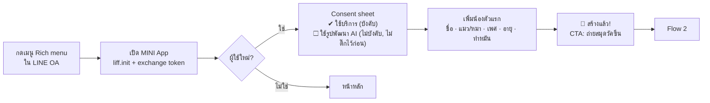

```
┌──────────────────────────────┐   ┌──────────────────────────────┐
│ ← เพิ่มน้องตัวแรก        1/1 │   │                              │
│                              │   │          🎉                  │
│ ชื่อน้อง                      │   │   สร้างโปรไฟล์ "ถั่วเหลือง" แล้ว  │
│ [ ถั่วเหลือง               ] │   │                              │
│                              │   │ ขั้นต่อไปที่คุ้มที่สุด:           │
│ ชนิด                          │   │ ┌──────────────────────────┐ │
│ [ 🐱 แมว ] [ 🐶 หมา ]         │   │ │ 📷 ถ่ายสมุดวัคซีน          │ │
│                              │   │ │ AI แปลงเป็นสมุดดิจิทัล      │ │
│ เพศ   [ ผู้ ] [ เมีย ]          │   │ │ และตั้งเตือนให้อัตโนมัติ     │ │
│ อายุ  [ 2 ปี ▾ ] [ 3 เดือน ▾ ] │   │ └──────────────────────────┘ │
│       ☐ ไม่ทราบแน่ชัด          │   │                              │
│ ทำหมันแล้ว [ใช่][ไม่][ไม่แน่ใจ] │   │   ไว้ทีหลัง                   │
│                              │   │                              │
│ [        บันทึก          ]   │   │                              │
└──────────────────────────────┘   └──────────────────────────────┘
```

#### Flow 2 — ถ่ายสมุดวัคซีน (ช่วงประทับใจใน 2 นาที)

1. **กล้อง**: มีกรอบนำให้ "ถ่ายทีละหน้า ให้เห็นสติกเกอร์ชัด" ถ่ายได้หลายหน้า และบีบอัด/ย่อรูปฝั่ง client ก่อนอัปโหลด (canvas → JPEG ด้านยาว ~1600 px ซึ่งตัด EXIF/GPS ไปในตัว)
2. **รอผล** (5–20 วินาที): skeleton + เคล็ดลับระหว่างรอ + ข้อความ "ปิดหน้านี้ได้ เสร็จแล้วจะแจ้งใน LINE"
3. **ตรวจทาน**: การ์ดวัคซีนแต่ละรายการ ช่องที่ AI ไม่มั่นใจขึ้นขอบสีเหลือง แตะแก้ได้ทันที และมีรูปต้นฉบับครอปให้เทียบข้างๆ
4. **ยืนยัน**: "บันทึก 3 รายการ และตั้งเตือนแล้ว 2 รายการ" แล้วแสดง CTA 2 อัน
   - "เพิ่มลงปฏิทินมือถือ" (subscribe .ics)
   - "แชร์พาสปอร์ตน้อง" (การ์ดแชร์)

```
┌──────────────────────────────┐
│ ← ตรวจทานข้อมูลที่ AI อ่าน     │
│ AI อ่านได้ 3 รายการ — แตะเพื่อแก้ │
│ ┌──────────────────────────┐ │
│ │ 💉 วัคซีนรวมแมว (FVRCP)     │ │
│ │ ฉีดเมื่อ   12 มี.ค. 2568     │ │
│ │ นัดครั้งถัดไป ┆12 มี.ค. 2569┆⚠ │ │  ← ขอบเหลือง = ไม่มั่นใจ
│ │ คลินิก    คลินิกรักสัตว์ ลาดพร้าว │ │
│ │ [ดูรูปต้นฉบับ]   AI อ่าน ⓘ   │ │
│ └──────────────────────────┘ │
│ ┌──────────────────────────┐ │
│ │ 💉 พิษสุนัขบ้า (Rabies)      │ │
│ │ ...                      │ │
│ └──────────────────────────┘ │
│ + เพิ่มรายการเอง               │
│ [   ยืนยันและตั้งเตือน    ]    │
└──────────────────────────────┘
```

> **กับดักข้อมูลในสมุดไทย ที่ prompt และ UI ต้องรองรับ**: ปีเป็น พ.ศ. แบบ 2 หลัก (เช่น "12/03/68"), ลำดับ วัน/เดือน, ชื่อเดือนย่อภาษาไทย, และวันหมดอายุของล็อตวัคซีน (EXP/MFG บนสติกเกอร์) ที่ **ไม่ใช่** วันนัดครั้งถัดไป

#### Flow 3 — ระบบเตือนและปฏิทิน

- ปุ่ม "เพิ่มลงปฏิทินมือถือ" ตรวจ OS ก่อน
  - iOS → เปิด `webcal://…/feeds/{token}.ics` ผ่าน `liff.openWindow({ external: true })`
  - Android → เปิด `https://calendar.google.com/calendar/r?cid=<webcal-url-encoded>`
- หลัง subscribe ให้พาไปหน้า "ทดสอบการแจ้งเตือน" ที่ให้เพิ่มนัดทดสอบเป็นไฟล์ .ics เดี่ยว (VALARM อีก 2 นาที เพราะฟีดที่ subscribe อาจ refresh ช้าเป็นชั่วโมง) แล้วให้ผู้ใช้ตรวจว่าปฏิทิน "น้องๆ ของฉัน" ปรากฏแล้ว
- มีปุ่ม "เพิ่มนัดนี้ลงปฏิทิน" (ไฟล์ .ics เดี่ยวที่มี VALARM) ในการ์ดทุกนัด เป็นทางสำรอง
- เหตุผล: แอปปฏิทินหลายตัวจัดการ alert ของปฏิทินที่ subscribe ไม่เหมือนกัน (บางตัวตัด alert ทิ้ง หรือ refresh ช้าเป็นชั่วโมง) จึงต้องมีทั้งการทดสอบ ไฟล์นัดเดี่ยว และ LINE เป็นทางสำรอง (ดูข้อ 14.5)

#### Flow 4 — "น้องเป็นแบบนี้ ต้องไปหาหมอไหม"

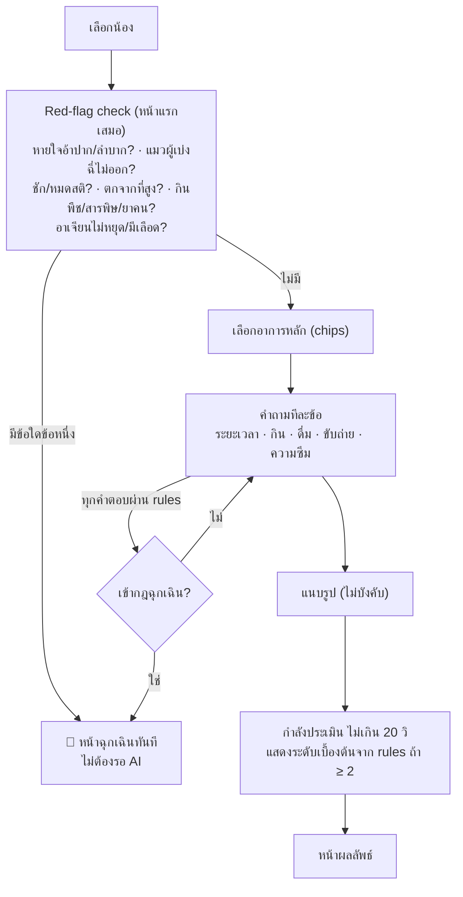

หน้าผลลัพธ์ (โครงเดียวกันทุกระดับ แต่สีและไอคอนเปลี่ยนตามระดับ):

```
┌──────────────────────────────┐
│ ⏱ พบหมอภายใน 24 ชั่วโมง        │ ← UrgencyBanner (สี+ไอคอน+ข้อความ)
│ ถั่วเหลือง · อาเจียน 3 ครั้งใน 1 วัน │
├──────────────────────────────┤
│ ทำไมถึงเป็นระดับนี้              │
│ • อาเจียนบ่อยร่วมกับกินน้อยลง…    │
│ สิ่งที่ต้องสังเกตต่อ              │
│ • จำนวนครั้งที่อาเจียน ปริมาณน้ำที่ดื่ม │
│ 🚨 ไปโรงพยาบาลทันทีถ้า           │
│ • มีเลือดปน · ซึมมาก · ไม่ดื่มน้ำเลย │
│ สิ่งที่ควรบอกหมอ                 │
│ • เริ่มอาเจียนเมื่อ… ลักษณะ…       │
├──────────────────────────────┤
│ [ 📋 สร้างสรุปส่งหมอ (1 แตะ) ]    │ ← ปุ่มหลัก
│ [ 🏥 คลินิก/รพ. 24 ชม. ใกล้ฉัน ]  │
│ ข้อมูลนี้ช่วยประเมินความเร่งด่วน     │
│ ไม่ใช่การวินิจฉัยโรค · ไม่แนะนำยา    │
└──────────────────────────────┘
```

**หน้าฉุกเฉิน** ต้องโหลดได้แม้ backend ช้า:
- คำถาม red flag หน้าแรกประเมินฝั่ง client ได้ด้วยจาก rule set ที่ cache ไว้ (มากับ `GET /v1/triage/flows/{species}`) ถ้า API ไม่ตอบใน 3 วินาที และใช้ได้กับสมาชิกทุกบทบาท (รวมผู้ชม/พี่เลี้ยง)
- รายชื่อโรงพยาบาล 24 ชม. cache ไว้ใน `localStorage` และที่ CDN
- ปุ่ม [โทร] เป็น `tel:` ธรรมดา และปุ่ม [นำทาง] เป็นลิงก์ Google Maps ตรงๆ
- ข้อแนะนำระหว่างเดินทางเป็นข้อความคงที่ที่หมอที่ปรึกษาอนุมัติ ไม่ได้มาจาก LLM
- ปุ่ม "สร้างสรุปส่งหมอ" ทำงานระหว่างเดินทางได้

#### Flow 5 — ส่องสุขภาพจากรูป

- เลือกจุด (ตา / ผิวหนังและขน / ช่องปาก / รูปร่าง) แล้วเห็นคำแนะนำการถ่ายเฉพาะจุด เช่น
  - ตา: "ถ่ายใกล้ๆ ในที่สว่าง ไม่ใช้แฟลช"
  - รูปร่าง: "ถ่าย 2 รูป จากด้านบนและด้านข้าง"
- ถ้าภาพเบลอหรือมืด ให้แสดง "ถ่ายใหม่" พร้อมบอกว่าเพราะอะไร (ไม่นับโควตา AI ของผู้ใช้)
- ผลลัพธ์บอกแค่ "สิ่งที่เห็นในรูป" กับระดับความเร่งด่วน แล้วมีปุ่ม "ตอบคำถามเพิ่มเพื่อความแม่นยำ" ที่พาเข้า Flow 4 โดยเติมข้อมูลไว้ให้แล้ว

#### Flow 6 — สรุปก่อนพบหมอ

1. เลือกหัวข้อที่จะแชร์ (สวิตช์ต่อหัวข้อ: วัคซีน, อาการล่าสุด, รูป, กราฟน้ำหนัก, ยาที่ใช้อยู่)
2. ConsentSheet: "ใครก็ตามที่มีลิงก์นี้จะเห็นข้อมูลข้างต้นได้ 7 วัน" พร้อมตัวเลือก 7 หรือ 14 วัน
3. ได้ QR เต็มจอ (บอกผู้ใช้ให้เพิ่มความสว่างจอ) + ปุ่ม [ส่งใน LINE] ผ่าน shareTargetPicker + [คัดลอกลิงก์]
4. สถานะ "เปิดแล้ว 2 ครั้ง · ล่าสุด 10:42 (คลินิก X)" และปุ่มเพิกถอน

**หน้า `/s/[token]` ที่สัตวแพทย์เห็น** (ออกแบบให้อ่านจบใน 30 วินาที และพิมพ์ A4 ได้)

```
┌───────────────────────────────────────────────────────────────┐
│ ถั่วเหลือง · แมว (Domestic Shorthair) · เพศผู้ ทำหมัน · 2 ปี 3 เดือน │
│ น้ำหนักล่าสุด 4.6 กก. (−0.4 กก. ใน 30 วัน ⚠) · Microchip 764…       │
├───────────────────────────────────────────────────────────────┤
│ ⏱ ผลคัดกรองล่าสุด: พบหมอภายใน 24 ชม. (27 ก.ย. 22:14)             │
│ Red flags ที่ตอบว่า "ไม่": dyspnea, urinary obstruction, trauma…   │
├──────────────────────────┬────────────────────────────────────┤
│ ลำดับอาการ (timeline)      │ รูปถ่าย (แตะเพื่อขยาย)                 │
│ • 26 ก.ย. เริ่มอาเจียน…      │ [img] [img]                          │
│ • 27 ก.ย. กินน้อยลง…        │                                      │
├──────────────────────────┴────────────────────────────────────┤
│ คำถาม–คำตอบทั้งหมด (พับได้) · ยาที่ใช้อยู่ · ประวัติวัคซีน (✔ ยืนยันโดยคลินิก) │
│ กราฟน้ำหนัก 12 เดือน                                             │
├───────────────────────────────────────────────────────────────┤
│ คลินิกของคุณอยากรับเคสแบบนี้? ลงทะเบียนฟรี →                        │
└───────────────────────────────────────────────────────────────┘
```

#### Flow 7 — น้องหาย (เจ้าของ) และ Flow 7b — ผู้พบ

- **เจ้าของ**: ปุ่มแดง "น้องหาย"
  1. ยืนยันน้อง แล้วกรอกเวลาและพื้นที่ที่เห็นครั้งสุดท้าย (เลือกเขต/แขวง หรือปักหมุดซึ่งระบบจะเก็บแบบหยาบ)
  2. กรอกลักษณะเด่น แล้วเลือกวิธีติดต่อ: relay อย่างเดียว (ค่าเริ่มต้น) หรือแสดงเบอร์
  3. ได้โปสเตอร์ 3 ขนาด (A4 สำหรับพิมพ์, สี่เหลี่ยมสำหรับโพสต์, story) และปุ่มแชร์
     - โปสเตอร์ render ในเครื่องผู้ใช้ด้วย HTML → canvas เพราะ browser วางสระ/วรรณยุกต์และตัดคำไทยได้ถูกต้อง
     - จากนั้นอัปโหลดเป็นรูปใน Blob แบบ public ซึ่งใช้เป็น `og:image` ของหน้า `/lost/[slug]` ด้วย (ดูข้อ 12)
  4. ปุ่ม "แจ้งเตือนคนในพื้นที่" แสดงจำนวนคนที่จะได้รับและใช้โควตาเท่าไร
  5. แดชบอร์ดประกาศ: ยอดเห็น ยอดแชร์ การพบเห็น ข้อความ
  6. กด "เจอแล้ว!" แล้วชวนแชร์เรื่องจบสวย (viral loop)
- **ผู้พบ**: สแกน QR บนโปสเตอร์ เปิด `/lost/[slug]` แล้วกด [ฉันเห็นน้อง] (รูป + พื้นที่) หรือ [ส่งข้อความถึงเจ้าของ] ซึ่งไม่ต้องล็อกอิน แต่มี BotID และ rate limit
- **ผู้พบที่เจอสัตว์ไม่มีโปสเตอร์**: เข้า MINI App แล้วใช้ "สแกนน้องที่พบ" (PetID identify, Flow 9)

#### Flow 8 — ลงทะเบียน PetID

```
┌──────────────────────────────┐
│ PetID ของถั่วเหลือง   2/4 มุม   │
│ ┌──────────────────────────┐ │
│ │      (กล้อง live)          │ │
│ │     ╭──────────╮          │ │  ← กรอบนำ "หน้าตรง"
│ │     │  ( •ᴥ• ) │          │ │
│ │     ╰──────────╯          │ │
│ └──────────────────────────┘ │
│ ความคม ▓▓▓▓▓▓▓░░  แสง ▓▓▓▓▓▓▓▓░ │  ← วัดบนเครื่อง (JS)
│ "นิ่งไว้… กำลังถ่ายอัตโนมัติ"      │
│ ✔ หน้าตรง  ✔ ลำตัวด้านข้าง         │
│ ○ จมูกระยะใกล้  ○ ลักษณะเด่น (ถ้ามี) │
└──────────────────────────────┘
```

- ผู้ใช้ต้องแตะ "เริ่มถ่าย" ก่อนเปิดกล้อง เพราะแนวทางของ LINE กำหนดให้การเรียกกล้อง/ตำแหน่งเกิดจากการแตะของผู้ใช้
- มุมที่บังคับ
  - แมว: หน้าตรง + ลำตัวด้านข้าง
  - หมา: หน้าตรง + จมูกระยะใกล้ + ลำตัวด้านข้าง
- มุมที่แนะนำเพิ่ม: หน้าเอียง 3/4, ลักษณะเด่น (แผล, ปานสี, หูตัด/หูขลิบจากการทำหมันแมวจร, หางงอ)
- ถ่ายอัตโนมัติเมื่อความคมและแสงผ่านเกณฑ์และภาพนิ่ง 500 ms โดยถ่ายต่อเนื่อง 3 เฟรมแล้วเลือกเฟรมที่คมที่สุด ถ้าเครื่องไม่รองรับกล้อง live ให้ fallback เป็น `<input type="file" capture>`
- เมื่อครบ แสดง "PetID พร้อมแล้ว" + บัตร PetID (การ์ดแชร์) และสวิตช์โหมดการค้นหา
  - "ค้นหาได้เฉพาะตอนประกาศหาย" (ค่าเริ่มต้น)
  - "ค้นหาได้เสมอ"
  - "ปิดการค้นหา"

#### Flow 9 — สแกนน้องที่พบ (1:N)

- ถ่ายรูป (มีกรอบนำเหมือน Flow 8) แล้วรอ "กำลังค้นหา…" 5–20 วินาที
- ผลที่เป็นไปได้
  - **พบประกาศที่ตรง**: การ์ดประกาศ (รูปจากเจ้าของ ชื่อน้อง "เจ้าของกำลังตามหา") + [ส่งข้อความถึงเจ้าของ] + [แชร์ตำแหน่งคร่าวๆ] ส่วนเจ้าของได้รับแจ้งเตือนทันที
  - **อาจใช่ (ไม่มั่นใจ)**: ขอรูปอีกมุม ("ช่วยถ่ายหน้าตรง/ด้านข้างอีก 1 รูป")
  - **น้องที่ลงทะเบียนแต่ไม่ได้หาย**: "น้องตัวนี้มีเจ้าของที่ลงทะเบียนไว้" + [ส่งข้อความถึงเจ้าของ] โดยไม่แสดงชื่อน้อง
  - **ไม่พบ**: ชวนสร้าง "รายงานพบสัตว์" ที่ให้เจ้าของที่กำลังตามหามาเจอ + แสดงประกาศใกล้เคียง
- **ไม่แสดงเบอร์โทร ชื่อ หรือที่อยู่เจ้าของโดยอัตโนมัติ** (ต่างจากไอเดียต้นฉบับ ดูเหตุผลในข้อ 9.7.9)

#### Flow 10 — เช็กอินรายเดือน (≤ 60 วินาที)

1. ชั่งน้ำหนัก พร้อมคำแนะนำ: "อุ้มน้องชั่งพร้อมตัวเอง แล้วลบน้ำหนักตัวเอง" (ระบบคำนวณให้)
2. ถ่ายรูป 1 รูป
3. ตอบ 5 คำถามแบบแตะเลือก (ความอยากอาหาร, การดื่มน้ำ, การขับถ่าย/กระบะทราย, การเคลื่อนไหว, การอาเจียน) โดยใช้สเกล "น้อยลง / เท่าเดิม / มากขึ้น"
4. ดูกราฟ ถ้าน้ำหนักเปลี่ยนเกินเกณฑ์ที่หมอกำหนดใน 30 วัน ให้ขึ้นแบนเนอร์ชวนนัดตรวจ
5. การ์ด "เช็กสุขภาพเดือนนี้แล้ว ✔" สำหรับแชร์ (render ในเครื่องแบบเดียวกับโปสเตอร์)

#### Flow 11 — ดูแลร่วมกัน

- เมนูสมาชิก → [เชิญ] → เลือกบทบาท
  - ผู้ดูแล: บันทึกได้
  - ผู้ชม: ดูอย่างเดียว
- ส่งลิงก์เชิญผ่าน LINE ผู้รับจะเห็นหน้า `/invite/[code]` (รูปน้อง + ชื่อผู้เชิญ) แล้วกดรับ
- ไทม์ไลน์แสดง "ใครบันทึกอะไร" เพื่อไม่ให้ป้อนยาซ้ำ

#### Flow 12 — ติดตามผลหลังพบหมอ

- ข้อความ LINE "ถั่วเหลืองเป็นอย่างไรบ้าง?" ส่งใน 24–48 ชม. สำหรับผลระดับ "ดูแลที่บ้าน/นัดตรวจ" และใน 3 วันสำหรับระดับ "พบหมอภายใน 24 ชม." ขึ้นไป มีปุ่มตอบเร็ว [ไปหาหมอแล้ว] [ยังไม่ได้ไป] [หายแล้ว] [แย่ลง]
- ถ้าตอบ "แย่ลง" ให้เปิดการคัดกรองใหม่ทันทีโดยเติมข้อมูลเดิมไว้ให้
- ถ้าตอบว่าไปแล้ว ถามต่อว่า "หมอบอกว่าอะไร" (เลือกหมวด + ข้อความ + ถ่ายรูปใบนัด/ใบสั่งยาได้) แล้วขอบคุณ
- คำตอบใช้วัด AI accuracy

### 7.5 Clinic portal (Clinic Lite)

| หน้า | องค์ประกอบหลัก |
|---|---|
| **แดชบอร์ด** | คำขอนัดวันนี้ · น้องที่ใกล้ครบกำหนด 14 วัน · สรุปที่ถูกเปิดสัปดาห์นี้ |
| **สแกนน้อง** | ใช้กล้องเว็บแคมหรือมือถือสแกน QR สรุป/พาสปอร์ต → ถ้ายังไม่มีสิทธิ์ ให้กด "ขอความยินยอม" (เจ้าของได้ปุ่มใน LINE) → เห็นสรุปสด |
| **บันทึกวัคซีน** | เลือกวัคซีนจากรายการยี่ห้อที่ใช้บ่อย, lot no., วันที่ฉีด, นัดครั้งถัดไป → ขึ้นป้าย "ยืนยันโดยคลินิก" |
| **รายชื่อใกล้ครบกำหนด** | ตารางกรองตามวัคซีน/ช่วงวัน → [ส่งเตือนผ่านระบบ] (เฉพาะผู้ที่ยินยอม, แสดงจำนวนที่ส่งได้) |
| **คำขอนัด** | inbox + สถานะ (ใหม่ / เห็นแล้ว / โทรกลับแล้ว / นัดได้ / ยกเลิก) + ปุ่มโทร + ลิงก์สรุป |
| **Insights** | ตัวเลขรายเดือน: สรุปถูกเปิด, กดโทร/นำทาง, ผู้ใช้ที่ผูกผ่าน QR, % กลับมาฉีดตามนัด |
| **รีวิวผล AI** (สัตวแพทย์) | ทีละเคส: สรุปอาการ + รูป + ระดับที่ AI ให้ → [ถูก] [ควรด่วนกว่า] [ควรด่วนน้อยกว่า] + ระดับที่ถูก + หมายเหตุ ใช้คีย์ลัด 1/2/3/Enter ได้ ใช้เวลาไม่เกิน 30 วินาทีต่อเคส |

### 7.6 LINE-specific UX

- **เพิ่มเพื่อน OA**: ตั้ง Add friend option ของ MINI App channel ให้ชวนเพิ่มเพื่อนตอนขอสิทธิ์ครั้งแรก และถ้ายังไม่ได้เพิ่มให้แสดงแบนเนอร์ในแอป เพราะ push ส่งได้เฉพาะผู้ที่เป็นเพื่อน
- **หน้าขอสิทธิ์ของ LINE**: ผู้ใช้ไทยจะเห็น 1 ครั้งตอนเปิดครั้งแรก (ฟีเจอร์ข้ามหน้านี้ใช้ได้เฉพาะญี่ปุ่น) หน้าแรกของเราจึงต้องสั้นที่สุดเพื่อให้รวมแล้วยังอยู่ใน 60 วินาที
- **Rich menu 6 ช่อง**: เช็กอาการ · สมุดวัคซีน · โรงพยาบาล 24 ชม. · สรุปก่อนพบหมอ · น้องหาย · เปิดแอป — ทุกช่องเป็น deep link เข้า MINI App โดยตรง ลดการคุยในแชท (reply ไม่นับโควตาในไทย แต่ push ที่ตามมานับ)
- **Flex Message templates**: เตือนรวมรายวัน, สรุปรายเดือน, ติดตามผล 3 วัน, คำขอความยินยอมจากคลินิก, แจ้งเจ้าของว่ามีคนพบน้อง, ข้อความ relay ใหม่
- **แชร์**: ใช้ `liff.shareTargetPicker()` ส่ง Flex การ์ด (รูป + ปุ่มเปิด) ถ้าไม่รองรับ ให้ fallback เป็น Web Share API แล้วค่อยคัดลอกลิงก์
- **Deep link**: ใช้ permanent link ของ MINI App ในทุกข้อความ พร้อม `?ref=` สำหรับ attribution
- **นอก LINE**: ถ้ามีคนเปิดลิงก์ MINI App ในเบราว์เซอร์ธรรมดา ให้แสดงหน้า "เปิดใน LINE" + QR (ยกเว้นหน้า public)
- **Performance budget**: First Load JS ≤ 170 KB (gzip) บนหน้าแรก, LCP ≤ 2.5 วินาทีบน 4G และ `preconnect` ไปที่ `api.<domain>`

### 7.7 สถานะหน้าจอที่ต้องออกแบบครบทุกหน้า

| สถานะ | แนวทาง |
|---|---|
| Empty | บอกประโยชน์และปุ่มเดียว เช่น "ยังไม่มีวัคซีน — ถ่ายสมุดวัคซีนใน 1 นาที" |
| Loading (AI) | บอกเวลาโดยประมาณ + ให้ออกจากหน้าได้ + แจ้งผลใน LINE/inbox เมื่อเสร็จ |
| Partial | เช่น OCR อ่านได้บางช่อง ให้แสดงช่องที่อ่านได้ และให้เติมช่องที่เหลือ |
| Error | บอกว่าเกิดอะไรและทำอะไรต่อได้ เช่น "AI ไม่พร้อมตอนนี้ — กรอกเองได้เลย" เพื่อให้มีทางออกเสมอ |
| Quota/limit | "วันนี้ใช้เช็กอาการครบ 10 ครั้งแล้ว — หากฉุกเฉินให้ดูรายชื่อ รพ. 24 ชม." โดยหน้าฉุกเฉินไม่ถูกจำกัดเด็ดขาด |
| Offline | แสดงข้อมูลที่ cache ไว้ (โปรไฟล์ วัคซีน รายชื่อ รพ.) แบบอ่านอย่างเดียว |

### 7.8 Microcopy ด้านความปลอดภัย

- ข้อความท้ายผลคัดกรองทุกครั้ง: "ข้อมูลนี้ช่วยประเมินความเร่งด่วน ไม่ใช่การวินิจฉัยโรค และไม่แนะนำยา หากกังวลให้ติดต่อสัตวแพทย์"
- ห้ามใช้: "ไม่เป็นไร", "หายเองได้", ชื่อยา, ขนาดยา, ชื่อโรคแบบฟันธง
- ระดับ "ดูแลที่บ้านและเฝ้าดู" ต้องมีกล่อง "ไปทันทีถ้า…" เสมอ
- PetID: "PetID ช่วยค้นหาและยืนยันตัวน้องจากรูป — เป็นการประเมินด้วย AI ไม่ใช่หลักฐานทางกฎหมาย และไม่ได้แทนไมโครชิป"

### 7.9 Accessibility checklist

- touch target ≥ 48×48 px, contrast AA, รองรับการขยายตัวอักษรของระบบถึง 200% โดย layout ไม่แตก
- ทุกรูปมี alt และทุกไอคอนมี aria-label, ลำดับ focus ถูกต้องใน wizard
- ไม่มี timeout ที่บังคับรีบ (ยกเว้น QR ที่หมดอายุ ซึ่งต้องบอกล่วงหน้า)
- ข้อความฉุกเฉินต้องอ่านได้ด้วย screen reader ก่อนองค์ประกอบอื่น

---

## 8. การจัดการคิว (คำถามข้อ 5)

### 8.1 ข้อเท็จจริงของ Vercel Queues ที่ใช้ออกแบบ (ตรวจ ณ 28 ก.ย. 2569, สถานะ public beta)

| เรื่อง | ค่า/พฤติกรรม | ผลต่อการออกแบบ |
|---|---|---|
| ขอบเขต topic | เป็นของ **project + deployment** ทุก service ใน project ใช้ topic ชุดเดียวกัน และ push mode ส่งกลับไปที่ deployment ที่ publish | เลือก Vercel Services (ข้อ 5.2) ข้อความจาก deployment เก่าจะถูกประมวลผลโดยโค้ดเวอร์ชันเดียวกัน จึงช่วยเรื่อง compatibility |
| Region | consume ได้เฉพาะ region ที่ส่ง (SDK ใช้ `VERCEL_REGION`) | ทุก function อยู่ `sin1` |
| การส่ง | `send(topic, payload, { idempotencyKey, delaySeconds, retentionSeconds, headers })` | ใส่ `idempotencyKey` เสมอสำหรับ job และ event (ค่า op เป็น 2 เท่า แต่ถูกมาก) |
| การรับ (push) | `handleCallback(handler, { visibilityTimeoutSeconds, retry })` ack เมื่อสำเร็จ และ retry เมื่อ throw ส่วน `retry(error, metadata)` คืน `{ afterSeconds }` หรือ `{ acknowledge: true }` และมี `metadata.deliveryCount` ให้ | ทำ backoff และ dead-letter เองได้ |
| Consumer group | แต่ละ function ที่มี trigger ของ topic นั้นคือ 1 consumer group และทุก group ได้สำเนาของทุกข้อความ (fan-out) และ trigger รองรับ wildcard เช่น `evt-*` | ใช้เป็น pub/sub ของ domain events ได้ |
| ความเป็นส่วนตัว | function ที่มี queue trigger ไม่มี URL สาธารณะ | worker แยกเป็น service `<name>_worker` |
| การส่งมอบ | **at-least-once**, เรียงลำดับโดยประมาณ (ไม่ FIFO), ข้อความที่ retry จะมี priority ต่ำกว่าข้อความใหม่ | consumer ต้อง idempotent และไม่พึ่งลำดับ |
| Dead-letter | **ไม่มีในตัว** — ครบ `maxDeliveries` แล้วข้อความหายเงียบ | ทำ DLQ เองก่อนถึงครั้งสุดท้าย (ข้อ 8.6) |
| Retention / Delay | 60 วิ – 7 วัน (ค่าเริ่มต้น 24 ชม.) / delay สูงสุด 7 วัน | งานที่นัดไกลกว่านั้นหรือผู้ใช้ยกเลิกได้ ให้เก็บใน DB แล้วใช้ cron (ข้อ 8.8) |
| Visibility timeout | สูงสุด 3,600 วิ (SDK ตั้งเริ่มต้น 300 วิ และต่ออายุอัตโนมัติขณะ handler ทำงาน) | ตั้ง `maxDuration` ของ worker ให้สอดคล้อง |
| ขนาดข้อความ | สูงสุด 100 MB แต่คิดเงินทุก 4 KiB | payload เก็บแค่ ID (< 4 KiB ยกเว้น batch ของ J13/J14/J17/J18) |
| Concurrency | schema รองรับ `maxConcurrency` (1–16,384) ต่อ trigger แต่การบังคับใช้จริงยังไม่มีเอกสารยืนยัน | ใช้คู่กับ Redis semaphore ของเราเอง |
| Triggers ต่อ function | สูงสุด 10 | ใช้ topic แบบหยาบ (ต่อ domain) + wildcard |
| ราคา (`sin1`) | $0.8544 ต่อ 1 ล้าน operations (send/receive/delete/…) | หลักดอลลาร์ต่อเดือนในช่วง pilot |

### 8.2 เกณฑ์ตัดสินว่า "งานไหนเข้าคิว"

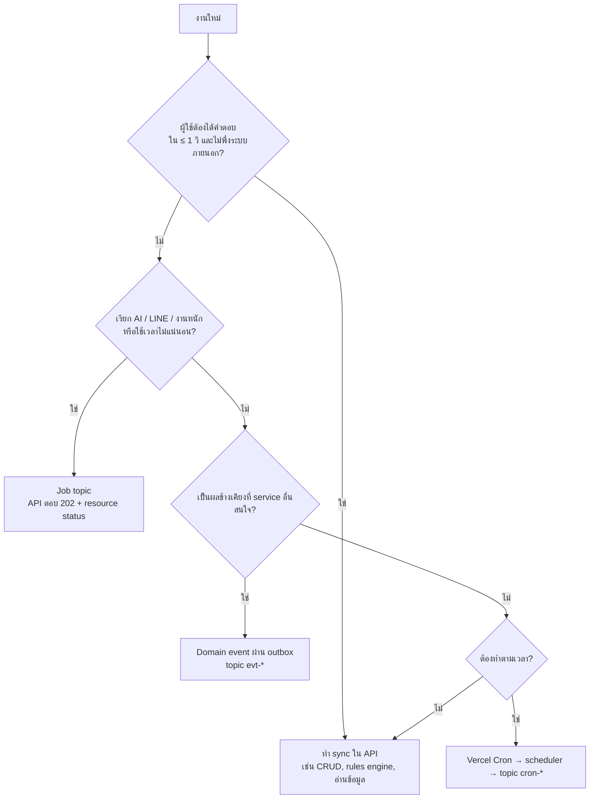

**ข้อยกเว้นสำคัญ**: กฎอาการฉุกเฉินทำงานแบบ **sync เสมอ** ในทุกคำตอบ เพื่อให้หน้าฉุกเฉินขึ้นทันทีโดยไม่รอคิวหรือ AI

### 8.3 Topic ทั้งหมด

การตั้งชื่อ (ตัวพิมพ์เล็กและขีดกลาง):
- `job-<domain>-<action>` = คำสั่งงาน มีผู้รับรายเดียว คือ worker ของ service เจ้าของ
- `evt-<domain>` = domain events ของ domain นั้นทั้งหมด (แยกด้วยฟิลด์ `type`) ผู้รับหลายราย
- `cron-<service>` = งานตั้งเวลาของ service นั้น (มาจาก scheduler)

#### (A) Job topics — 21 topics

| ID | Topic | Producer → Consumer | Payload | Idempotency key | Max deliveries | Backoff | Concurrency | เป้า p95 | เมื่อพังถาวร |
|---|---|---|---|---|---|---|---|---|---|
| J1 | `job-media-process` | media → media_worker | `{mediaId}` | `mediaId` | 5 | 5 วิ × 2ⁿ (≤ 2 นาที) | 20 | 10 วิ | `status=rejected` + DLQ |
| J2 | `job-health-vaccine-ocr` | health → health_worker | `{scanId}` | `scanId` | 4 | 5, 15, 45 วิ | 10 | 25 วิ | `failed` แล้ว UI เปิดฟอร์มกรอกเอง (รูปยังอยู่) |
| J3 | `job-pet-microchip-ocr` | pet → pet_worker | `{scanId}` | `scanId` | 4 | 5 วิ × 2ⁿ | 5 | 20 วิ | `failed` แล้วให้กรอกเอง |
| J4 | `job-triage-assess` | triage → triage_worker | `{sessionId}` | `sessionId` | 3 | 3, 10 วิ | 20 | 15 วิ (เส้นตาย 20 วิ) | **ปิดเซสชันแบบ degraded (rules-only, ขั้นต่ำ "นัดตรวจตามปกติ")** ผู้ใช้ไม่ค้าง ถ้าผล LLM มาทีหลังทำได้แค่ยกระดับ |
| J5 | `job-triage-photo-check` | triage → triage_worker | `{checkId}` | `checkId` | 3 | 3, 10 วิ | 10 | 20 วิ | `failed` แล้วชวนตอบคำถาม (Flow 4) |
| J6 | `job-triage-eval-run` | triage (admin/CI), triage_worker (จาก `cron-triage`) → triage_worker | `{runId}` | `runId` | 3 | 30 วิ | 1 | 2 นาที (สร้าง J7) | run `failed` |
| J7 | `job-triage-eval-case` | triage_worker → triage_worker | `{runId, caseId}` | `runId:caseId` | 4 | 10 วิ × 2ⁿ | 5 | — | นับเป็น "ไม่ผ่าน" |
| J8 | `job-petid-enroll` | biometric → biometric_worker | `{captureId}` | `captureId` | 4 | 5 วิ × 2ⁿ | 10 | 25 วิ | `failed` แล้วขอถ่ายใหม่ |
| J9 | `job-petid-identify` | biometric (API), lostfound_worker (รายงานพบเห็น — จำกัดเฉพาะน้องที่ประกาศหาย) → biometric_worker | `{requestId}` หรือ `{sightingId, mediaId}` (worker สร้าง request เอง) | `requestId` / `sighting:<id>` | 3 | 5, 20 วิ | 10 | 30 วิ | `error` แล้วชวนสร้างรายงานพบสัตว์ |
| J10 | `job-petid-verify` | biometric → biometric_worker | `{requestId}` | `requestId` | 3 | 5, 20 วิ | 5 | 25 วิ | ผล `uncertain` |
| J11 | `job-petid-reindex` | biometric (admin) → biometric_worker (ส่งต่อตัวเองทีละ batch) | `{runId, cursor, target}` | `runId:cursor` | 8 | 30 วิ × 2ⁿ | 2 | — | DLQ + หยุด run |
| J12 | `job-share-snapshot` | share → share_worker | `{summaryId}` | `summaryId` | 5 | 3 วิ × 2ⁿ | 10 | 5 วิ | `failed` + ปุ่มลองใหม่ |
| J13 | `job-notify-send` | ทุก service → notification_worker | `{dedupeKey, userIds[], template, vars, priority}` | `dedupeKey` | 6 | 10 วิ × 2ⁿ (≤ 30 นาที) | 20 | 60 วิ | ลง inbox + DLQ |
| J14 | `job-notify-digest` | notification_worker → notification_worker | `{kind, date, userIds[≤500]}` | `kind:date:batch` | 5 | 30 วิ × 2ⁿ | 5 | — | DLQ |
| J15 | `job-line-webhook` | notification (webhook) → notification_worker | `{webhookEventId}` (event ดิบเก็บใน `notify.webhook_events` 7 วัน) | `webhookEventId` | 5 | 2 วิ × 2ⁿ | 10 | 3 วิ | DLQ |
| J16 | `job-lost-alert-fanout` | lostfound → lostfound_worker | `{reportId, round}` | `reportId:round` | 5 | 10 วิ × 2ⁿ | 2 | 60 วิ | DLQ + แจ้งเจ้าของว่าส่งไม่ครบ |
| J17 | `job-clinic-due-reminders` | clinic → clinic_worker | `{clinicId, petIds[], requestedBy}` | `clinicId:date:hash` | 5 | 30 วิ × 2ⁿ | 2 | — | DLQ |
| J18 | `job-analytics-ingest` | analytics (API) → analytics_worker | `{batchId, events[≤100]}` | `batchId` | 8 | 10 วิ × 2ⁿ | 5 | — | DLQ |
| J19 | `job-privacy-export` | identity → identity_worker | `{requestId}` | `requestId` | 5 | 60 วิ × 2ⁿ | 2 | ภายใน 24 ชม. | แจ้งแอดมิน |
| J20 | `job-privacy-delete` | identity → identity_worker | `{requestId}` | `requestId` | 10 | 60 วิ × 2ⁿ | 2 | ภายใน 24 ชม. | แจ้งแอดมิน |
| J21 | `job-ops-dead-letter` | ทุก worker → analytics_worker | `{deadLetterId}` | `deadLetterId` | 10 | 30 วิ | 2 | — | log error |

#### (B) Event topics — 11 topics (pub/sub)

| Topic | Producer | Event types | Consumer groups |
|---|---|---|---|
| `evt-identity` | identity | `user.registered`, `user.updated`, `consent.changed`, `grant.created`, `grant.revoked`, `user.deletion_requested`, `privacy.export_requested` | ทุก worker (สำหรับ PDPA), notification, analytics |
| `evt-pet` | pet | `pet.created`, `pet.updated`, `pet.archived`, `pet.deleted`, `member.added`, `member.removed`, `microchip.set` | health, triage, biometric, lostfound, clinic, share, media, notification, analytics |
| `evt-health` | health | `vaccine.recorded`, `vaccine.updated`, `vaccine.deleted`, `treatment.changed`, `weight.recorded`, `weight.alert`, `checkin.completed` | clinic (due-list), notification (reminders), analytics |
| `evt-triage` | triage | `session.completed`, `photo_check.completed`, `followup.answered`, `review.submitted`, `ruleset.activated` | health (timeline), notification, analytics |
| `evt-biometric` | biometric | `enrollment.ready`, `match.found`, `match.possible`, `match.confirmed` | lostfound, notification, analytics |
| `evt-lost` | lostfound | `report.created`, `report.updated`, `report.resolved`, `sighting.created`, `relay.message_created` | biometric (เปิด/ปิดการค้นหา), share (โปสเตอร์), notification, analytics |
| `evt-clinic` | clinic | `clinic.updated`, `attribution.created`, `access.requested`, `appointment.requested`, `appointment.updated` | identity (สร้าง grant request), notification, analytics |
| `evt-share` | share | `summary.created`, `summary.viewed`, `summary.revoked`, `card.created` | clinic (insights), notification, analytics |
| `evt-media` | media | `media.ready`, `media.rejected`, `media.deleted` | pet, health, triage, biometric, lostfound |
| `evt-analytics` | analytics | `clinic.contact_clicked`, `pmf.responded` | clinic (insights) |
| `evt-privacy` | ทุก worker | `privacy.part_ready`, `privacy.data_deleted` | identity (ติดตาม saga) |

#### (C) Cron topics — 11 topics (`cron-<service>`)

scheduler รับ Vercel Cron (เวลาเป็น UTC เสมอ) แล้วส่งข้อความพร้อม `idempotencyKey = <job>:<เวลาตามรอบ>` เพราะ Vercel Cron **ไม่ retry และอาจยิงซ้ำหรือพลาดได้** ข้อความในคิวจึงได้ทั้งการ dedupe และการ retry

| Job | ไปที่ topic | Cron (UTC) | เวลาไทย | งาน |
|---|---|---|---|---|
| `outbox-sweep` | `cron-<ทุก service ที่มี outbox>` | `*/5 * * * *` | ทุก 5 นาที | ส่ง outbox ที่ค้าง (ทางหลักคือ `waitUntil` หลัง commit ส่วนตัวนี้เป็นตาข่ายนิรภัย) |
| `reminders-dispatch` | `cron-notification` | `0 1 * * *` | 08:00 | เตือนรวมรายวัน 1 ข้อความต่อคน |
| `monthly-digest` | `cron-notification` | `0 2 1 * *` | 09:00 วันที่ 1 | สรุปรายเดือน (แตกเป็น J14 ทีละ 500 คน ทยอยส่งราว 3 ชม. เพื่อไม่สร้าง peak เอง) |
| `line-quota-sync` | `cron-notification` | `5 * * * *` | ทุกชั่วโมง | ดึงยอดใช้โควตา LINE |
| `followups-dispatch` | `cron-triage` | `0 3,11 * * *` | 10:00 และ 18:00 | ติดตามผลหลังคัดกรอง (ระดับต่ำ 24–48 ชม. / ระดับ ≥ 24 ชม. 3 วัน) |
| `eval-canary` | `cron-triage` | `0 20 * * 0` | จันทร์ 03:00 | รัน eval ทุกสัปดาห์เพื่อจับ model drift |
| `media-gc` | `cron-media` | `0 19 * * *` | 02:00 | ลบไฟล์ค้าง/ไม่ถูกผูก/ถึงกำหนดลบ |
| `share-expiry` | `cron-share` | `30 19 * * *` | 02:30 | ปิดลิงก์หมดอายุ และลบ snapshot เก่า |
| `lost-maintenance` | `cron-lostfound` | `0 20 * * *` | 03:00 | ถามเจ้าของประกาศที่ค้าง 30 วัน และลบข้อความ relay ครบ 90 วัน |
| `petid-refresh` | `cron-biometric` | `0 4 * * 1` | จันทร์ 11:00 | ชวนถ่าย PetID ใหม่ (ลูกแมว/ลูกหมาอายุ < 1 ปี ทุก 3 เดือน เพราะหน้าตาเปลี่ยนเร็ว) |
| `due-list-rebuild` | `cron-clinic` | `0 22 * * *` | 05:00 | สร้าง read model รายชื่อใกล้ครบกำหนดใหม่ (กันกรณี event หลุด) |
| `metrics-rollup` | `cron-analytics` | `0 18 * * *` | 01:00 | สรุป KPI รายวัน และ refresh materialized views |
| `retention-purge` | `cron-<แต่ละ service>` | `0 21 * * *` | 04:00 | ลบข้อมูลตามนโยบาย retention ของแต่ละ schema |
| `session-cleanup` | `cron-identity` | `15 21 * * *` | 04:15 | ลบ session/grant ที่หมดอายุ |

#### (D) Consumer groups ต่อ worker (≤ 10 triggers ต่อ function)

| Worker | Triggers |
|---|---|
| `identity_worker` | J19, J20, `cron-identity`, `evt-clinic`, `evt-privacy` (5) |
| `pet_worker` | J3, `cron-pet`, `evt-identity`, `evt-media` (4) |
| `health_worker` | J2, `cron-health`, `evt-identity`, `evt-pet`, `evt-triage`, `evt-media` (6) |
| `triage_worker` | J4, J5, J6, J7, `cron-triage`, `evt-identity`, `evt-pet`, `evt-media` (8) |
| `biometric_worker` | J8, J9, J10, J11, `cron-biometric`, `evt-identity`, `evt-pet`, `evt-lost`, `evt-media` (9) |
| `lostfound_worker` | J16, `cron-lostfound`, `evt-identity`, `evt-pet`, `evt-biometric`, `evt-media` (6) |
| `clinic_worker` | J17, `cron-clinic`, `evt-identity`, `evt-pet`, `evt-health`, `evt-share`, `evt-analytics` (7) |
| `share_worker` | J12, `cron-share`, `evt-identity`, `evt-pet`, `evt-lost` (5) |
| `notification_worker` | J13, J14, J15, `cron-notification`, `evt-*` (5) |
| `media_worker` | J1, `cron-media`, `evt-identity`, `evt-pet` (4) |
| `analytics_worker` | J18, J21, `cron-analytics`, `evt-*` (4) |

### 8.4 Message envelope (มาตรฐานเดียวทุก topic)

```json
{
  "v": 1,
  "id": "0192a6f4-7b1e-7c3a-9d2e-5f7a1b2c3d4e",
  "topic": "evt-health",
  "type": "vaccine.recorded",
  "source": "health",
  "time": "2026-09-28T02:15:04.120Z",
  "subject": { "petId": "0192…", "userId": "0192…" },
  "correlationId": "req_01J9Z…",
  "causationId": "0192…",
  "traceparent": "00-4bf92f3577b34da6a3ce929d0e0e4736-00f067aa0ba902b7-01",
  "data": { "recordId": "0192…", "vaccineType": "FVRCP", "nextDueOn": "2027-03-12", "clinicId": null }
}
```

- `id` เป็น UUIDv7 ใช้เป็น event id และเป็น `idempotencyKey` ค่าเริ่มต้นตอน `send()` ส่วน job ใช้ key ตามตาราง 8.3 (A) (เก็บในคอลัมน์ `idempotency_key` ของ outbox)
- `data` มีแค่ ID และค่าที่จำเป็น **ห้ามมีชื่อคน เบอร์โทร ข้อความอิสระของผู้ใช้ หรือรูป** เพื่อลดข้อมูลส่วนบุคคลที่ค้างในคิวสูงสุด 7 วัน และให้ payload ต่ำกว่า 4 KiB
- ทุก `type` มี zod schema ใน `packages/contracts/events/*` และมี `v` สำหรับเปลี่ยนเวอร์ชัน (consumer รองรับเวอร์ชันเก่าอย่างน้อย 1 รุ่น)

### 8.5 Producer: transactional outbox

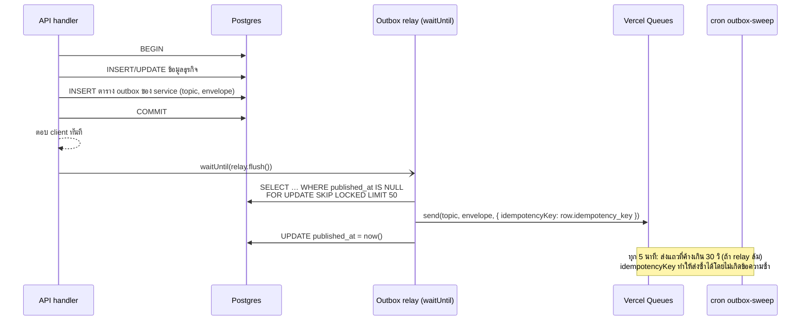

```ts
// packages/db/outbox.ts (ย่อ)
export async function publishViaOutbox(tx: Tx, topic: Topic, data: unknown, o: { key?: string; type?: string } = {}) {
  const env = makeEnvelope({ topic, type: o.type ?? 'job', data, source: SERVICE_NAME, ctx: currentContext() });
  await tx.insert(outboxTable).values({ id: env.id, topic, eventType: env.type, idempotencyKey: o.key ?? env.id, payload: env });
  afterCommit(() => waitUntil(relay.flush()));   // ปล่อยทันทีหลัง commit
  return env.id;
}
```

> งานที่ **ไม่ได้มาจากการเขียน DB** (เช่น scheduler แปลง cron หรือ worker ส่ง J7 ต่อ) เรียก `publish()` ตรงๆ ได้ ไม่ต้องผ่าน outbox

### 8.6 Consumer: idempotency, retry, dead-letter

```ts
// packages/queue/consumer.ts (ย่อ) — ทุก consumer สร้างผ่านตัวนี้เท่านั้น
export function defineConsumer<T>(c: {
  topic: string;
  schema: z.ZodType<T>;
  maxDeliveries: number;                 // ต้องตรงกับ vercel.json
  backoff: { baseSeconds: number; maxSeconds: number };
  mode: 'db' | 'external';               // db = ทำใน transaction เดียว, external = เรียก AI/LINE
  handle: (msg: T, ctx: ConsumerCtx) => Promise<void>;
  onFinalFailure?: (msg: T, err: unknown, ctx: ConsumerCtx) => Promise<void>;
}) { return c; }

// packages/queue/worker.ts (ย่อ)
export function createWorker(opts: { service: string; maxDurationSeconds: number; consumers: ConsumerDef[] }) {
  const byTopic = indexByTopic(opts.consumers);
  return handleCallback(
    async (message, metadata) => {
      const parsed = Envelope.safeParse(message);
      if (!parsed.success) return deadLetterRaw(opts.service, message, 'envelope_invalid', metadata.deliveryCount); // ถาวร → ack
      const env = parsed.data;
      const c = byTopic.match(env.topic);                 // รองรับ evt-* ด้วย
      if (!c) return;                                     // topic ที่ไม่สนใจ → ack
      const data = c.schema.safeParse(env.data);
      if (!data.success) return deadLetter(c, env, 'schema_invalid', metadata.deliveryCount); // ถาวร → ack
      try {
        await runWithContext(env, () => c.handle(data.data, ctxFor(env, c)));
      } catch (err) {
        if (isPermanent(err) || metadata.deliveryCount >= c.maxDeliveries) {
          await c.onFinalFailure?.(data.data, err, ctxFor(env, c));
          await deadLetter(c, env, err, metadata.deliveryCount);   // บันทึก ops.dead_letters + ส่ง J21
          return;                                                    // ack เพื่อไม่ให้หายเงียบ
        }
        throw err;                                                   // ให้คิว retry
      }
    },
    {
      visibilityTimeoutSeconds: opts.maxDurationSeconds + 30,   // เช่น triage = 150 ถ้า timeout จะได้ retry เร็ว
      retry: (_err, metadata) => ({ afterSeconds: backoffFor(metadata, byTopicOfMetadata(metadata)) }),
    },
  );
}
```

**Idempotency 2 แบบตามชนิดงาน**

| Mode | ใช้กับ | วิธี |
|---|---|---|
| `db` — งานที่เขียนแต่ DB | handler ของ events ส่วนใหญ่ (อัปเดต read model, timeline) | `INSERT INTO ops.inbox (consumer, message_id) ON CONFLICT DO NOTHING` **ใน transaction เดียวกับงาน** ถ้าแทรกไม่ได้แปลว่าทำไปแล้ว ให้ข้าม (ได้ผลแบบ exactly-once) |
| `external` — เรียก AI/LINE/Blob | J2, J4, J5, J8–J10, J13 | ① ตรวจสถานะ resource ก่อน (เช่น `scan.status='needs_review'` แล้ว = เสร็จแล้ว) ② เรียกระบบภายนอก **นอก transaction** (ไม่ถือ DB connection ระหว่างรอ LLM 10–30 วิ) ③ transaction สั้นๆ ตอนท้าย: เขียนผล + inbox + outbox ④ สำหรับ LINE ใช้ header `X-Line-Retry-Key` = UUIDv5(dedupeKey) กันส่งซ้ำ (LINE ตอบ 409 ถ้าซ้ำ) |

**จัดประเภท error**

| ประเภท | ตัวอย่าง | การจัดการ |
|---|---|---|
| Transient | timeout, 429, 5xx, network, DB serialization/deadlock, semaphore เต็ม | throw แล้ว retry ด้วย exponential backoff + jitter ±20% |
| Permanent | payload ไม่ตรง schema, 4xx (ยกเว้น 429), resource ถูกลบแล้ว, โมเดลปฏิเสธคำขอ | ไม่ retry → `onFinalFailure` → DLQ (หรือแค่ปิดงานถ้าคาดไว้แล้ว เช่น น้องถูกลบ) |
| Budget | งบ AI รายวันหมด, kill switch ปิด | ไม่ retry → ทางสำรองของฟีเจอร์ (เช่น triage แบบ rules-only) |

**Dead-letter** — เก็บที่ `ops.dead_letters` (payload, error, delivery count) แล้ว analytics_worker แจ้งเตือน
- admin-console มีหน้า Dead letters ให้กด **replay** (ส่ง envelope เดิมเข้า topic เดิมด้วย idempotency key ใหม่ `replay:<id>:<n>`) หรือ **discard** พร้อมเหตุผล

### 8.7 Backpressure, concurrency และ priority

- **Priority** ใช้ topic แยก: งานที่ผู้ใช้รอ (J2, J4, J5, J8, J9, J12) มี `maxConcurrency` สูง ส่วนงานเบื้องหลัง (J6, J7, J11, J14, J18) ต่ำ
- **โควตา OpenAI (ผ่าน AI Gateway)** ใช้ Redis semaphore 2 กอง เพื่อให้งานเบื้องหลังไม่แย่งโควตางานที่ผู้ใช้รอ
  - `sem:ai:interactive` = 40
  - `sem:ai:background` = 8
  - ถ้าได้ semaphore ไม่ทัน ให้ throw `RetryLater(5–15 วิ)`
  - ถ้าใช้เครดิตของ AI Gateway จะไม่มี rate limit ฝั่ง gateway (ข้อจำกัดของ provider ยังมีอยู่) ส่วนถ้าใช้ BYOK หรือเรียก OpenAI ตรง ให้อิง tier ของบัญชีเรา (Tier 1 = 500 RPM / 500K TPM) semaphore ยังจำเป็นเพื่อคุมต้นทุนและกันระบบรวน
- **LINE**: push 2,000 req/s, multicast 200 req/s (สูงเกินพอสำหรับเรา) ตัวจำกัดจริงคือ **งบโควตาข้อความรายเดือน** (ข้อ 14.2)
- **Self-chaining** สำหรับงานยาว (J11, J14; ส่วน J7 เป็น fan-out จาก J6): ทำทีละ batch แล้ว `send()` batch ถัดไป ทำให้ `maxDuration` ของ worker อยู่ที่ 120–300 วิ ถ้า delivery ใดหมดเวลา Vercel คิดเงินเต็ม `maxDuration` จึงไม่ควรตั้งยาวเกินจำเป็น

### 8.8 ลำดับ เวลา และสถานะงาน

- **ไม่พึ่งลำดับ** — event ที่เปลี่ยนสถานะมี `version` หรือ `occurredAt` ถ้า consumer เจอเวอร์ชันเก่ากว่าที่มีอยู่ให้ข้าม ส่วน state machine (เช่น lost report) ตรวจสถานะปัจจุบันก่อนเปลี่ยนเสมอ
- **งานที่นัดไว้ในอนาคต** — ถ้าผู้ใช้ยกเลิกได้/เห็นได้/นานกว่า 7 วัน (เตือนวัคซีน, ติดตามผล 3 วัน) ให้เก็บใน DB (`notify.reminders`, `triage.followups`) แล้ว cron ดึงไปทำแบบ **catch-up** ("ทุกอย่างที่ครบกำหนดตั้งแต่รอบล่าสุด" ไม่ใช่แค่ "วันนี้") ส่วน `delaySeconds` ใช้กับการหน่วงสั้นๆ ทางเทคนิคเท่านั้น
- **สถานะที่ UI เห็น** — ทุก job ผูกกับ resource ที่มี `status` (`queued → processing → needs_review|completed|failed`)
  - client poll `GET` ของ resource แบบ backoff 1 → 1.5 → 2 → 3 → 5 วิ นานสุด 30 วิ
  - ถ้าเกิน 30 วิ ให้แสดง "เสร็จแล้วจะแจ้งใน LINE/กล่องแจ้งเตือน" และ worker ส่ง J13 เมื่อเสร็จ

### 8.9 Sagas (งานหลายขั้นข้าม service)

**ขอลบบัญชี (PDPA)**

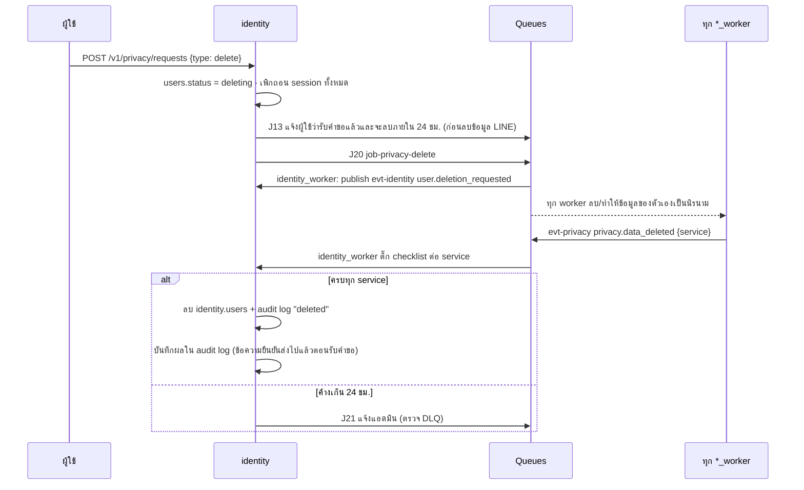

**Export ข้อมูล** — โครงเดียวกัน แต่ละ worker เขียนไฟล์ส่วนของตัวเอง (`exports/<requestId>/<service>.json`) ลง Blob private แล้วส่ง `privacy.part_ready` จากนั้น identity_worker รวมเป็น zip แล้วส่งลิงก์ signed URL (อายุ 24 ชม.)

**น้องหาย → มีคนพบ**

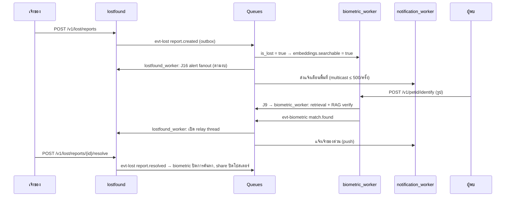

### 8.10 Monitoring คิว

| สัญญาณ | วัดอย่างไร | แจ้งเตือนเมื่อ |
|---|---|---|
| Queue lag | `now − envelope.time` ตอนเริ่ม handler (log เป็น `queue_lag_ms`) | p95 > 30 วิ สำหรับ interactive topics นาน 10 นาที |
| Retry rate | `deliveryCount > 1` / ทั้งหมด | > 10% ใน 15 นาที |
| DLQ | จำนวนแถวใหม่ใน `ops.dead_letters` | > 0 (ทุกครั้ง) |
| งานค้างสถานะ | resource ที่ `queued/processing` นานเกิน 5 นาที | > 0 |
| Outbox ค้าง | แถว `published_at IS NULL` ที่เก่ากว่า 10 นาที | > 0 |
| ต้นทุนคิว | Vercel usage dashboard | เกินงบรายเดือนที่ตั้ง |

### 8.11 การพัฒนาในเครื่องและการทดสอบ

- `vercel link` แล้วตามด้วย `vercel env pull` (ได้ OIDC token) แล้ว `vercel dev` ใช้ Vercel Queues จริงในเครื่องได้
- unit/integration test ใช้ `QUEUE_DRIVER=inline` ซึ่งเรียก consumer โดยตรง (ทดสอบ idempotency ด้วยการส่งซ้ำ 2 ครั้ง)
- contract test: ทุก producer ต้อง validate payload ด้วย schema เดียวกับ consumer ก่อน `send()`
- chaos test ก่อนเปิดใช้จริง: บังคับให้ AI ตอบ timeout, LINE ตอบ 500, DB ตอบช้า แล้วตรวจว่าทุก flow จบที่สถานะที่ผู้ใช้เข้าใจได้

---

## 9. AI Architecture

### 9.1 หลักการ

1. **กฎมาก่อน LLM เสมอ** — กฎอาการฉุกเฉินที่สัตวแพทย์อนุมัติเป็นตัวตัดสินขั้นต่ำ ส่วน LLM ทำได้แค่ "ยกระดับ" และ "อธิบาย"
2. **ห้าม LLM ลดระดับ** — `final = max(rules, llm, confidence_floor)` และมี CHECK constraint ใน DB กันพลาด
3. **ทุกคำตอบของ LLM เป็น JSON ตาม schema (Structured Outputs)** แล้ว validate ซ้ำด้วย zod และผ่าน safety filter ก่อนแสดงผล
4. **ทุก prompt มีเวอร์ชัน** และทุก request บันทึก `prompt_key@version`, ชื่อโมเดลที่ขอ, ชื่อ snapshot ที่ได้จริง, token และต้นทุน
5. **เปลี่ยน prompt/โมเดล/กฎ = ต้องผ่าน eval ก่อน** (ชุดทดสอบของหมอ ต้อง under-triage = 0)
6. **ออกแบบให้ AI ล่มได้** — ทุกฟีเจอร์มีทางออกเมื่อ AI ใช้ไม่ได้ (rules-only, กรอกเอง, ลองใหม่ทีหลัง)
7. **ส่งข้อมูลให้ LLM น้อยที่สุด** — ไม่ส่งชื่อ/เบอร์/LINE ID ของเจ้าของ ตัด EXIF (GPS) ออกจากรูปก่อนส่งทุกครั้ง
8. **คุมต้นทุนหลายชั้น** — โควตาต่อผู้ใช้ต่อวัน, งบต่อวันทั้งระบบ, kill switch แยกฟีเจอร์

### 9.2 การเลือกโมเดลต่อฟีเจอร์

| ฟีเจอร์ | โมเดล | ระดับการคิด / รายละเอียดภาพ | Timeout | ทางสำรองเมื่อพัง |
|---|---|---|---|---|
| คัดกรองอาการ (`triage.assess`) | `gpt-6-luna` | สูง | 45 วิ | ผล rules-only + ข้อความแม่แบบที่หมออนุมัติ |
| ส่องสุขภาพจากรูป (`vision.photo_check`) | `gpt-6-luna` | กลาง, รูปละเอียดสูง | 45 วิ | "ตอนนี้วิเคราะห์รูปไม่ได้" → พาไปตอบคำถาม (Flow 4) |
| อ่านสมุดวัคซีน (`ocr.vaccine_book`) | `gpt-6-luna` | ต่ำ–กลาง, รูปละเอียดสูง | 60 วิ | ฟอร์มกรอกเอง + เก็บรูปไว้ |
| อ่านเลขไมโครชิป (`ocr.microchip`) | ถอดบาร์โค้ดฝั่ง client ก่อน → `gpt-6-luna` (ต่ำ) | ต่ำ | 30 วิ | กรอกเอง |
| PetID สกัดลักษณะ (`petid.signature`) | `gpt-6-luna` | กลาง, รูปละเอียดสูง | 45 วิ | ให้ลองใหม่ภายหลัง |
| PetID เทียบภาพ (`petid.verify_pair`) | `gpt-6-luna` | สูง | 60 วิ | ผล "ไม่แน่ใจ" + ให้เจ้าของตัดสิน |
| Embedding (`embed.petid`) | `text-embedding-3-small` (1536 มิติ) | — | 15 วิ | retry ในคิว |

**ข้อเท็จจริงของ `gpt-6-luna`** (ตรวจ 28 ก.ย. 2569)
- OpenAI ปล่อยเมื่อ 22 ก.ย. 2569 เป็น reasoning model ที่รับข้อความ + รูป และรองรับ Structured Outputs
- context 1.05M tokens, output สูงสุด 128K
- reasoning effort มี `none`/`low`/`medium` (ค่าเริ่มต้น)/`high`/`xhigh`/`max` โดยระบบนี้ใช้ `low`/`medium`/`high` ตามตาราง
- ราคา input $0.10 / output $0.50 ต่อ 1M tokens (ข้อ 19)
- rate limit Tier 1 = 500 RPM / 500K TPM
- **ไม่มีชื่อ snapshot แบบมีวันที่ให้ pin** และ OpenAI แก้บั๊กการเข้ารหัสรูปของโมเดลนี้ไปเมื่อ 25 ก.ย. 2569 (แนะนำให้รัน eval รูปใหม่) พฤติกรรมจึงเปลี่ยนได้โดยไม่ต้องเปลี่ยนชื่อ ต้องพึ่ง eval canary (ข้อ 9.8)
- **เรียกผ่าน Vercel AI Gateway** ด้วย model id `openai/gpt-6-luna` และ `openai/text-embedding-3-small` ผ่าน endpoint แบบ OpenAI-compatible (`https://ai-gateway.vercel.sh/v1`) ราคาไม่บวกเพิ่ม มี budgets ต่อ project, observability (เก็บแค่ metadata ไม่เก็บ prompt) และ fallback ไป provider อื่นที่ให้บริการโมเดลเดียวกันได้
- **งาน safety-critical (triage) ให้จำกัด provider เป็น `openai` อย่างเดียว** เพื่อให้พฤติกรรมตรงกับที่ผ่าน eval มา ถ้า provider นั้นล่มให้ใช้ทางสำรอง rules-only แทนการสลับ provider เงียบๆ
- ชื่อโมเดลอยู่ใน env (`AI_MODEL_PRIMARY`, `AI_MODEL_EMBEDDING`) และ Global Config สลับได้โดยไม่ต้อง deploy เช่น ถ้า PetID ต้องการความสามารถมากขึ้นอาจลอง `gpt-6-sol` เฉพาะขั้นเทียบภาพ แต่ **การสลับทุกครั้งต้องผ่าน eval ก่อน** (ข้อ 9.8)

### 9.3 `packages/ai` — ชั้นกลางที่ทุก service ใช้

```
packages/ai/
├── client.ts          # OpenAI SDK ชี้ baseURL ไป Vercel AI Gateway (สลับเป็น OpenAI ตรงได้ด้วย env)
├── models.ts          # registry: feature → model, reasoning, image detail, timeout, max_completion_tokens, provider
├── prompts/           # prompt เป็นไฟล์ + เวอร์ชัน (triage.assess@3.md, petid.signature@2.md, ...)
├── schemas/           # zod schema ของ output ทุกฟีเจอร์ (ใช้ร่วมกับ packages/contracts)
├── run.ts             # runStructured({feature, input, images, schema}) → ครอบทุกอย่างด้านล่าง
├── budget.ts          # ตรวจโควตาผู้ใช้ + งบรายวัน (Redis) ก่อนเรียก → budget_blocked
├── images.ts          # โหลดจาก Blob → sharp: rotate, ตัด EXIF, resize, JPEG → data URL
├── safety.ts          # linter: ชื่อยา/ขนาดยา/คำวินิจฉัยฟันธง/ข้อมูลติดต่อ
├── cost.ts            # คำนวณต้นทุนจาก usage + ตารางราคา (อัปเดตได้)
└── log.ts             # เขียน ai_ops.requests (ทุกครั้ง ทั้งสำเร็จและล้มเหลว)
```

ลำดับการทำงานของ `runStructured()`

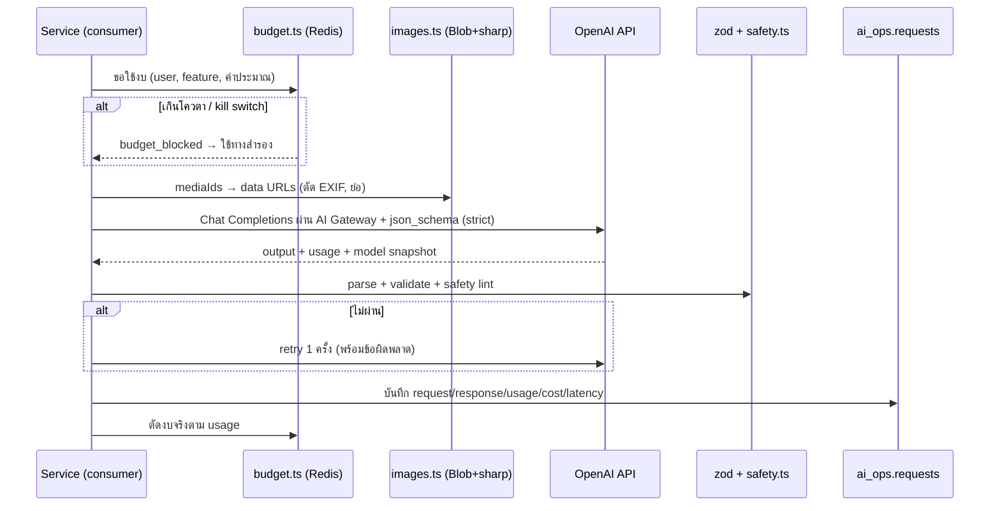

- ใช้ Chat Completions API แบบ OpenAI-compatible ผ่าน AI Gateway ร่วมกับ `response_format` แบบ `json_schema` (สร้างจาก zod ด้วย `zodResponseFormat`) และ `reasoning_effort` โค้ดเต็มอยู่ในภาคผนวก B.3
  - OpenAI แนะนำ Responses API สำหรับโมเดลนี้ ถ้าวันหนึ่งต้องใช้ความสามารถเฉพาะของ Responses API ให้เรียก OpenAI ตรงแล้วใช้ `zodTextFormat` + `responses.parse` พร้อมตั้ง `store: false`
- schema ของ Structured Outputs ต้องให้ทุกฟิลด์ required (ฟิลด์ที่ไม่บังคับให้ใช้ `nullable`), `additionalProperties: false` และ root ต้องเป็น object (ห้ามเป็น union)

### 9.4 Pipeline คัดกรองอาการ (Triage)

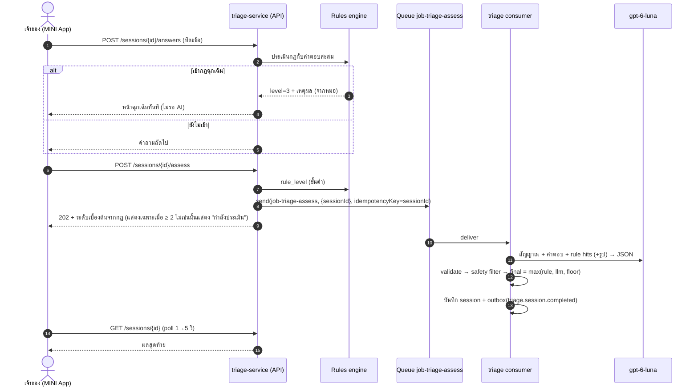

**กฎอาการฉุกเฉิน (DSL แบบ JSON — เก็บใน `triage.rule_sets`)** ตัวอย่างร่าง ซึ่งรายการจริงต้องให้สัตวแพทย์ที่ปรึกษาเขียนและอนุมัติ

```json
{
  "version": 1,
  "levels": { "0": "home_monitor", "1": "routine_appointment", "2": "vet_within_24h", "3": "emergency_now" },
  "rules": [
    {
      "id": "CAT_URETHRAL_OBSTRUCTION",
      "species": ["cat"],
      "level": 3,
      "when": { "all": [
        { "fact": "pet.sex", "op": "in", "value": ["male", "unknown"] },
        { "fact": "answers.urination", "op": "in", "value": ["straining_no_urine", "drops_only"] }
      ]},
      "reason_th": "แมวเพศผู้ที่เบ่งปัสสาวะไม่ออกอาจมีท่อปัสสาวะอุดตัน ซึ่งอันตรายถึงชีวิตได้ในเวลาไม่นาน",
      "while_travelling_th": ["อย่ากดหรือบีบบริเวณท้อง", "พาไปโรงพยาบาลสัตว์ทันที"]
    },
    { "id": "RESPIRATORY_DISTRESS", "species": ["cat","dog"], "level": 3,
      "when": { "any": [
        { "fact": "answers.breathing", "op": "in", "value": ["open_mouth", "labored", "blue_gums"] },
        { "fact": "text.keywords", "op": "includes_any", "value": ["อ้าปากหายใจ", "หายใจไม่ออก", "หอบ"] }
      ]}},
    { "id": "HIGH_RISE_FALL", "species": ["cat","dog"], "level": 3,
      "when": { "fact": "answers.trauma", "op": "includes_any", "value": ["fall_from_height", "hit_by_vehicle"] } },
    { "id": "TOXIN_EXPOSURE", "species": ["cat","dog"], "level": 3,
      "when": { "any": [
        { "fact": "answers.ingestion", "op": "includes_any", "value": ["lily", "human_medicine", "rodenticide", "insecticide", "chocolate", "xylitol"] },
        { "fact": "text.keywords", "op": "includes_any", "value": ["ลิลลี่", "พาราเซตามอล", "ยาเบื่อ", "ยาฆ่าแมลง"] }
      ]}},
    { "id": "SEIZURE_OR_COLLAPSE", "species": ["cat","dog"], "level": 3,
      "when": { "fact": "answers.neuro", "op": "includes_any", "value": ["seizure", "unconscious", "cannot_stand"] } },
    { "id": "VOMIT_BLOOD_OR_UNSTOPPABLE", "species": ["cat","dog"], "level": 3,
      "when": { "any": [
        { "fact": "answers.vomit_blood", "op": "eq", "value": true },
        { "fact": "answers.vomit_count_24h", "op": "gte", "value": 5 }
      ]}},
    { "id": "CAT_NOT_EATING_24H", "species": ["cat"], "level": 2,
      "when": { "fact": "answers.appetite_hours_since_last_meal", "op": "gte", "value": 24 } }
  ]
}
```

- engine เป็นโค้ด TypeScript ราว 150 บรรทัด (ops: `eq`, `in`, `gte`, `lte`, `includes_any`, `exists` + ตัวรวม `all`/`any`/`not`) ทำงานแบบ deterministic โดย fact ที่ไม่มีค่าหรือเป็น `unknown` ในกฎระดับ ≥ 2 ให้ถือว่าเข้าเงื่อนไข (fail-safe) และมี unit test ทุกกฎรวมกรณีนี้
- `text.keywords` มาจากการ normalize ข้อความอิสระที่ผู้ใช้พิมพ์ (ตัดช่องว่าง/สระซ้ำ ตัดคำด้วย `Intl.Segmenter('th')`) แต่ keyword ให้จับแบบ substring บนข้อความที่ normalize แล้ว (วลีอย่าง "หายใจไม่ออก" จะถูกตัดเป็นหลายคำ) เป็นตาข่ายนิรภัยชั้นที่สองก่อนถึง LLM
- กฎถูก **ประเมินทุกครั้งที่ได้คำตอบใหม่** เพื่อหยุดถามทันทีเมื่อเจอสัญญาณฉุกเฉิน
- rule set มี `checksum` และแก้ไม่ได้หลังอนุมัติ ถ้าต้องการเปลี่ยนให้สร้างเวอร์ชันใหม่

**Output schema ของ LLM (zod)**

```ts
export const TriageAssessment = z.object({
  urgency: z.enum(['emergency_now', 'vet_within_24h', 'routine_appointment', 'home_monitor']),
  confidence: z.enum(['low', 'medium', 'high']),
  observations_th: z.array(z.string()),          // สิ่งที่ประเมินจากข้อมูล (ไม่ใช่ชื่อโรค)
  reasoning_th: z.string(),                      // ทำไมถึงเป็นระดับนี้ (ภาษาง่าย)
  watch_for_th: z.array(z.string()),             // สิ่งที่ต้องสังเกตต่อ
  go_now_if_th: z.array(z.string()),             // ถ้าเกิดสิ่งเหล่านี้ให้ไปทันที (ต้องมีอย่างน้อย 1)
  tell_the_vet_th: z.array(z.string()),          // สิ่งที่ควรบอกหมอ
  missing_info_questions_th: z.array(z.string()),// คำถามที่ถ้าตอบจะช่วยให้ชัดขึ้น
  self_check: z.object({
    mentions_specific_disease: z.boolean(),
    mentions_medication_or_dose: z.boolean(),
  }),
});
```

> ข้อจำกัดความยาวหรือจำนวนรายการให้ตรวจด้วย zod ฝั่งเราอีกชั้น (ไม่พึ่ง keyword ของ JSON Schema ในโหมด strict ทั้งหมด)

**การรวมผลและ safety filter**

```ts
const LEVEL = { home_monitor: 0, routine_appointment: 1, vet_within_24h: 2, emergency_now: 3 } as const;

export function finalizeTriage(ruleLevel: number, llm: TriageAssessment | null) {
  // ไม่มีกฎเข้า ≠ ปลอดภัย: ถ้าไม่มีผลจาก LLM ขั้นต่ำคือ "นัดตรวจตามปกติ" เสมอ
  if (!llm) return { level: Math.max(ruleLevel, 1), degraded: true }; // AI ล่ม/เกินงบ/เกินเส้นตาย → rules-only
  const llmLevel = LEVEL[llm.urgency];
  const floor = llm.confidence === 'low' ? 1 : 0;                   // ไม่มั่นใจ → อย่างน้อย "นัดตรวจตามปกติ" (นโยบายที่หมออนุมัติ)
  return { level: Math.max(ruleLevel, llmLevel, floor), degraded: false };
}
```

- `safety.ts` ตรวจ output ที่จะแสดงผล
  - รูปแบบขนาดยา (`\d+\s?(mg|มก\.?|ml|มล\.?|cc|เม็ด|หยด)`)
  - รายชื่อยา/ยาคนที่อันตราย (เช่น พาราเซตามอล ไอบูโพรเฟน แอสไพริน) และคำวินิจฉัยฟันธง
  - `self_check` ที่เป็น `true`
- ถ้าเจอ ให้ retry 1 ครั้งพร้อมคำสั่งเพิ่ม ถ้ายังเจอ ให้แทนส่วนนั้นด้วยข้อความแม่แบบ และติดธงให้หมอรีวิว
- **degraded mode**: ถ้า AI ใช้ไม่ได้ ผู้ใช้ยังได้ระดับจากกฎ (ขั้นต่ำ "นัดตรวจตามปกติ") + ข้อความแม่แบบต่อระดับที่หมอเขียนไว้ + ปุ่มสร้างสรุปส่งหมอ และบันทึก `degraded=true` เพื่อไม่นับรวมใน accuracy ของ AI
- **เส้นตาย 20 วินาที**: ถ้า J4 ยังไม่เสร็จภายใน 20 วินาทีนับจาก `assess` ให้ API ปิดเซสชันแบบ degraded (idempotent ตอนที่ client poll) ถ้าผลจาก LLM มาทีหลัง ทำได้แค่ **ยกระดับ** (แล้วแจ้งผู้ใช้ทันที) ห้ามลดระดับ

### 9.5 Pipeline ส่องสุขภาพจากรูป

1. client ย่อรูป → อัปโหลด Blob → `POST /v1/triage/photo-checks` → คิว `job-triage-photo-check`
2. consumer เรียก `gpt-6-luna` ครั้งเดียวด้วย schema ที่มีทั้ง **คุณภาพภาพ** และ **สิ่งที่เห็น**
   - ถ้า `usable=false` ให้ตอบ `needs_retake` พร้อมเหตุผล และไม่ตัดโควตาผู้ใช้
3. แปลง `visual_red_flags` (enum) เป็นระดับตามกฎที่หมออนุมัติ เช่น `blue_or_gray_gums`, `eye_protrusion`, `deep_open_wound`, `active_bleeding` → ฉุกเฉิน แล้วใช้หลักห้ามลดระดับเหมือน triage
4. ถ้าเป็นรูปร่าง (body condition) ให้ประเมิน BCS 1–9 ได้ แต่แสดงเป็นช่วงคำ (ผอม/สมส่วน/อ้วน) พร้อมบอกความมั่นใจ
5. ผลลัพธ์แสดง "สิ่งที่เห็นในรูป" + ระดับ + ปุ่มตอบคำถามเพิ่ม (ส่งต่อเข้า Flow 4 พร้อม context)

```ts
export const PhotoCheck = z.object({
  quality: z.object({
    usable: z.boolean(),
    issues: z.array(z.enum(['blurry','too_dark','overexposed','too_far','obstructed','wrong_area','multiple_animals','not_an_animal'])),
    retake_tip_th: z.string().nullable(),
  }),
  area: z.enum(['eye','skin_coat','mouth','body_condition']),
  visible_findings_th: z.array(z.string()),
  visual_red_flags: z.array(z.enum(['eye_protrusion','eye_severe_swelling','cloudy_eye_sudden','active_bleeding','deep_open_wound','blue_or_gray_gums','yellow_gums','extreme_emaciation','none'])),
  urgency: z.enum(['emergency_now','vet_within_24h','routine_appointment','home_monitor']),
  bcs_estimate: z.number().int().nullable(),        // เฉพาะ body_condition
  follow_up_questions_th: z.array(z.string()),
  confidence: z.enum(['low','medium','high']),
});
```

### 9.6 Document AI — สมุดวัคซีนและเลขไมโครชิป

**สมุดวัคซีน**

- **ขั้นตอน**
  1. ส่ง 1–6 รูปในคำขอเดียว (ให้โมเดลเห็นหลายหน้าพร้อมกันเพื่อจับคู่ "ฉีดเมื่อ" กับ "นัดครั้งถัดไป")
  2. โมเดลตอบ JSON รายการวัคซีน
  3. normalize ชื่อยี่ห้อเป็น `vaccine_type` ด้วยตาราง `health.vaccine_products` (เช่น ยี่ห้อวัคซีนรวมแมว → `FVRCP`, วัคซีนพิษสุนัขบ้า → `RABIES`)
  4. ตรวจความสมเหตุสมผล
  5. แสดงให้ผู้ใช้ยืนยัน
- **คำสั่งสำคัญใน prompt**
  - ปีอาจเป็น พ.ศ. (รวมถึงแบบ 2 หลัก)
  - วันที่เป็น วัน/เดือน/ปี
  - ชื่อเดือนย่อภาษาไทย
  - **วัน EXP/MFG บนสติกเกอร์คือวันหมดอายุของล็อตวัคซีน ไม่ใช่วันนัด**
  - ให้คืนทั้งค่า `*_raw` (ตามที่เห็น) และค่าที่แปลงแล้ว
- **ตรวจความสมเหตุสมผลหลังได้ผล**
  - วันฉีดอยู่ในอนาคต → flag
  - วันนัดก่อนวันฉีด → flag
  - ห่างจากวันนี้เกิน 3 ปี → flag
  - ซ้ำกับรายการที่มีอยู่ → เสนอรวม
- **ห้ามเดาวันนัดครั้งถัดไป** ถ้าในสมุดไม่มี ให้ปล่อยว่างแล้วถามผู้ใช้ (ไม่คำนวณรอบวัคซีนเองจนกว่าหมอที่ปรึกษาจะอนุมัติตารางมาตรฐาน)

```ts
export const VaccineBookExtraction = z.object({
  calendar_system: z.enum(['buddhist','gregorian','mixed','unknown']),
  entries: z.array(z.object({
    vaccine_type_guess: z.enum(['FVRCP','FELV','RABIES','FIP','DHPP','LEPTO','KENNEL_COUGH','OTHER','UNKNOWN']),
    product_name_raw: z.string().nullable(),
    administered_on_raw: z.string().nullable(),
    administered_on: z.string().nullable(),      // YYYY-MM-DD (ค.ศ.)
    next_due_raw: z.string().nullable(),
    next_due_on: z.string().nullable(),
    lot_expiry_raw: z.string().nullable(),       // แยกออกมาชัดๆ เพื่อไม่ให้ปนกับวันนัด
    clinic_name_raw: z.string().nullable(),
    vet_name_raw: z.string().nullable(),
    page_index: z.number().int(),
    field_confidence: z.object({ vaccine_type: z.number(), administered_on: z.number(), next_due_on: z.number() }),
  })),
  unreadable_pages: z.array(z.number().int()),
  warnings_th: z.array(z.string()),
});
```

**เลขไมโครชิป**

- ถอดบาร์โค้ดบนเครื่องผู้ใช้ก่อนด้วย `zxing-wasm` (ฟรีและเร็ว ไม่เสียค่า AI) ถ้าไม่สำเร็จจึงส่งรูปให้ LLM อ่านตัวเลข
- ตรวจว่าเป็นตัวเลข 15 หลัก และ 3 หลักแรกเป็นรหัสประเทศตาม ISO 3166 (ไทย = `764`) หรือรหัสผู้ผลิต (`900`–`998`) ถ้าไม่ตรงให้เตือนแต่ไม่บล็อก
- ให้ผู้ใช้ยืนยันทุกครั้ง และเช็กเลขซ้ำในระบบ (ถ้าซ้ำ ให้เข้าคิวตรวจสอบ ไม่เปิดเผยว่าเป็นของใคร)

### 9.7 PetID — AI Pet Biometrics v0 (LLM + text-embedding + RAG)

#### 9.7.1 ตั้งความคาดหวังให้ถูกก่อน

`text-embedding-3-small` เป็นโมเดล **embedding ของข้อความ** รับรูปภาพโดยตรงไม่ได้ ดังนั้นวิธีที่เลือกคือ

1. ให้ `gpt-6-luna` "มองรูปแล้วบรรยาย" ออกมาเป็น **Visual Signature** (JSON ที่มีคำศัพท์ควบคุม)
2. แปลงเป็น **ข้อความมาตรฐาน (canonical text)** แยกตามมุมมอง (facet)
3. นำข้อความไป embed ด้วย `text-embedding-3-small` แล้วเก็บใน pgvector
4. เมื่อมีรูปใหม่ ให้ทำขั้น 1–3 เหมือนกัน ค้นหา candidate ที่ใกล้ที่สุด (**R**etrieval)
5. นำ **รูปอ้างอิงของ candidate + signature** ส่งให้ `gpt-6-luna` เทียบกับรูปใหม่แบบคู่ต่อคู่ (**A**ugmented **G**eneration) แล้วตัดสิน

**ข้อจำกัดที่ต้องยอมรับ** — ลักษณะที่ "บรรยายเป็นคำได้" ของแมวส้มลายสองตัวอาจเหมือนกันเกือบทุกคำ ทำให้ vector ใกล้กันมาก
- **ขั้น retrieval ทำได้แค่ "คัดตัวเลือก"** ตัวตัดสินจริงคือขั้นเทียบภาพด้วย vision LLM ซึ่งก็มีโอกาสผิดได้
- ระบบ v0 จึงเป็น **"ระบบช่วยค้นหา + ให้คนยืนยัน"** ไม่ใช่การพิสูจน์ตัวตนแบบ biometrics จริง
- ห้ามสื่อสารว่า "แม่นยำ 100%" หรือ "แทนไมโครชิปได้"
  - ใน กทม. มีข้อบัญญัติให้ขึ้นทะเบียนและฝังไมโครชิปสุนัข (ควรตรวจสอบข้อกำหนดล่าสุดอีกครั้ง)
  - จึงควรวาง PetID เป็น "ส่วนเสริมของไมโครชิป" สำหรับกรณีไม่มีเครื่องอ่านชิป

**ข้อดีของแนวทางนี้สำหรับ pilot**
- ไม่ต้องมีข้อมูลฝึกโมเดลเลย
- อธิบายได้ (มีหลักฐานเป็นคำ เช่น "จุดดำที่จมูกด้านซ้ายตรงกัน")
- เปลี่ยนโมเดล embedding ได้ถูกมาก เพราะเก็บ canonical text ไว้แล้ว embed ใหม่ได้โดยไม่ต้องเรียก vision
- ระหว่างนี้ได้ **สะสมรูปที่ติดป้ายตัวตนแล้ว (พร้อม consent)** ไว้ฝึกโมเดล biometrics จริงในเวอร์ชันถัดไป

#### 9.7.2 ภาพรวม pipeline

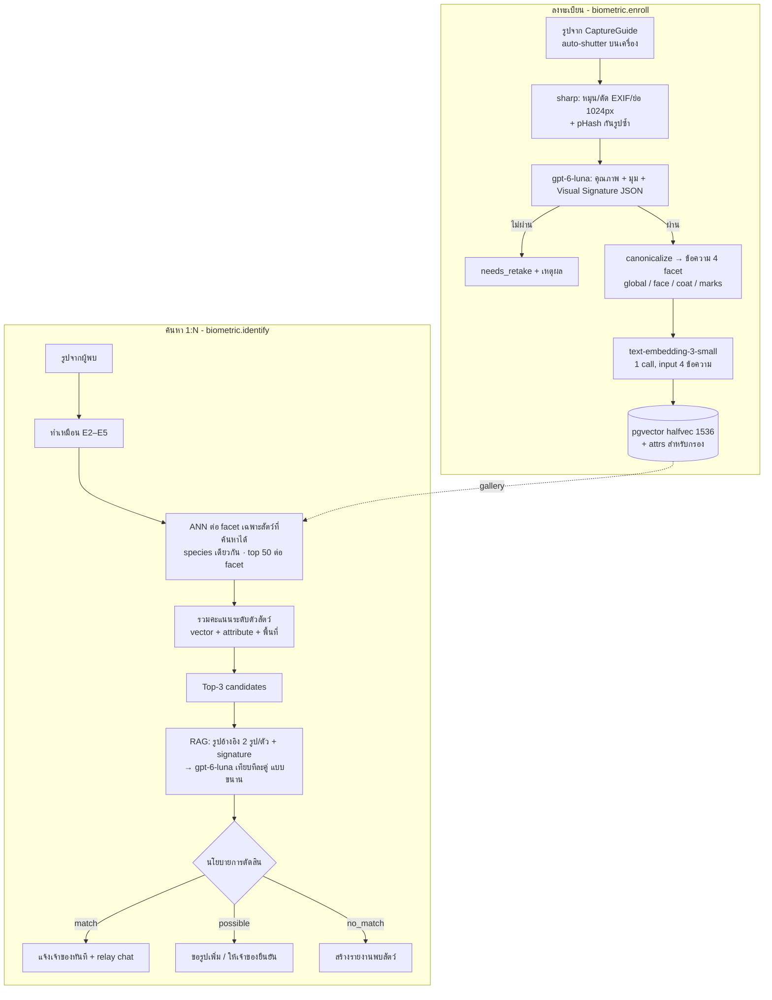

#### 9.7.3 การถ่ายรูป (ฝั่ง client)

- ใช้ `getUserMedia` แสดงกล้อง live + กรอบนำตามมุม และวัดคุณภาพบนเครื่องด้วย JavaScript ทุก ~150 ms บนภาพย่อ 256 px
  - **ความคม**: variance ของ Laplacian บนภาพ grayscale
  - **แสง**: ค่าเฉลี่ยและสัดส่วนพิกเซลที่ขาว/ดำจัด
  - **ความนิ่ง**: ผลต่างระหว่างเฟรม
- เมื่อผ่านเกณฑ์ต่อเนื่อง 500 ms ให้ถ่าย 3 เฟรมแล้วเลือกเฟรมที่คมที่สุด (auto-shutter แบบง่าย) ส่วนการตรวจจับหัว/จมูกด้วยโมเดลบนเครื่อง (YOLO/MobileNet) เก็บไว้ทำใน v2
- ถ้า `getUserMedia` ใช้ไม่ได้ ให้ fallback เป็น `<input type="file" accept="image/*" capture="environment">`
- มุมที่ต้องมี
  - แมว: `face_front`, `body_side`
  - หมา: `face_front`, `nose_closeup`, `body_side`
  - แนะนำเพิ่ม: `face_three_quarter`, `distinctive_mark`
  - รวมแล้วควรมีอย่างน้อย 3 รูปที่ผ่าน
- ควรมีรูปจาก **คนละวันหรือคนละแสง** อย่างน้อย 1 ชุด (ชวนเพิ่มตอนเช็กอินรายเดือน) เพื่อให้ gallery ทนต่อสภาพแสงที่ต่างกัน

#### 9.7.4 Visual Signature (schema v1)

```ts
export const VisualSignatureV1 = z.object({
  species: z.enum(['cat', 'dog']),
  view: z.enum(['face_front','face_three_quarter','nose_closeup','body_side','body_top','distinctive_mark','other']),
  quality: z.object({
    usable: z.boolean(),
    sharpness: z.enum(['good','fair','poor']),
    lighting: z.enum(['good','fair','poor']),
    occlusion: z.enum(['none','partial','heavy']),
    single_animal: z.boolean(),
    screen_or_print_suspected: z.boolean(),         // ถ่ายจากจอ/รูปพิมพ์ (กันการปลอม)
    retake_reason_th: z.string().nullable(),
  }),
  coat: z.object({
    length: z.enum(['short','medium','long','hairless','unknown']),
    base_colors: z.array(z.enum(['black','white','orange','cream','gray_blue','brown','chocolate','lilac','fawn','red','tan','silver','unknown'])),
    pattern: z.enum(['solid','bicolor','tuxedo','van','tabby_mackerel','tabby_classic','tabby_spotted','tabby_ticked','calico','tortoiseshell','colorpoint','brindle','merle','tricolor','other','unknown']),
    white_areas: z.array(z.enum(['chin','muzzle','chest','belly','front_paws','hind_paws','face_blaze','tail_tip','none'])),
    patches: z.array(z.object({ location: z.string(), color: z.string(), size: z.enum(['small','medium','large']) })),
  }),
  face: z.object({
    eye_left: z.enum(['amber','copper','yellow','green','hazel','blue','brown','unknown']),
    eye_right: z.enum(['amber','copper','yellow','green','hazel','blue','brown','unknown']),
    nose_leather_color: z.enum(['pink','black','brown','liver','gray','mottled','unknown']),
    nose_leather_spots: z.array(z.object({ location: z.string(), color: z.string() })),
    forehead_marking: z.enum(['m_mark_bold','m_mark_faint','blaze','spot','none','unknown']),
    ear_left: z.enum(['upright','folded','tipped_or_notched','torn','drooping','unknown']),
    ear_right: z.enum(['upright','folded','tipped_or_notched','torn','drooping','unknown']),
    muzzle_notes: z.string().nullable(),
  }),
  body: z.object({
    build: z.enum(['slim','medium','stocky','overweight','unknown']),
    tail: z.enum(['long','short','bobtail','kinked','curled','missing','not_visible']),
  }),
  distinctive_marks: z.array(z.object({
    type: z.enum(['scar','spot','patch','asymmetry','missing_part','other']),
    location: z.string(),                           // คำศัพท์ตำแหน่งมาตรฐาน เช่น 'left_cheek', 'right_eyebrow'
    description_en: z.string(),
  })),
  dog_nose_texture_en: z.string().nullable(),      // บรรยายลายจมูกหมา (ข้อมูลเสริม — LLM บรรยายลายละเอียดได้จำกัด)
  uncertain_fields: z.array(z.string()),
});
```

**Canonicalization (deterministic)** — แปลง JSON เป็นข้อความภาษาอังกฤษรูปแบบตายตัว เรียงฟิลด์เหมือนกันทุกครั้ง
- ตัดฟิลด์ที่เป็น `unknown` หรืออยู่ใน `uncertain_fields` ออก
- ใช้ภาษาอังกฤษเพราะ enum คงที่กว่าและ embedding เสถียรกว่า ส่วน UI แปลเป็นไทยเอง

```
[face] species cat. left eye amber. right eye amber. nose leather pink with black spot at upper left.
forehead bold M mark. left ear tipped or notched. right ear upright.
[coat] short coat. colors orange, white. pattern classic tabby. white areas chin, chest, front paws.
small black patch at left flank.
[marks] thin white scar above right eyebrow. kinked tail tip.
[global] = face + coat + marks + body build medium.
```

- **เวอร์ชัน**: `signature_version` (schema/prompt ของ vision) และ `model` (embedding) เก็บทุกแถว
- **ค้นหาได้เฉพาะเวอร์ชันเดียวกัน**
  - ถ้าเปลี่ยน *canonicalization* หรือ *embedding model* ให้ re-embed จาก JSON/ข้อความเดิมได้ทันที (ถูกมาก)
  - ถ้าเปลี่ยน *vision prompt/schema* ต้องเรียก vision ใหม่ทุก capture (แพง) จึงต้องล็อก schema v1 ให้นิ่งก่อนเปิดใช้จริง

#### 9.7.5 Embedding ด้วย text-embedding-3-small

```ts
import OpenAI from 'openai';

// ผ่าน Vercel AI Gateway (ถ้าเรียก OpenAI ตรง: ตัด baseURL ออก และใช้ model 'text-embedding-3-small')
const openai = new OpenAI({ baseURL: 'https://ai-gateway.vercel.sh/v1', apiKey: process.env.AI_GATEWAY_API_KEY });

export async function embedFacets(texts: Record<'global'|'face'|'coat'|'marks', string>) {
  // facet ที่ไม่มีข้อมูล (เช่น ไม่มีลักษณะเด่น) ไม่ต้อง embed — ข้อความว่างทำให้ API error และข้อความแทนที่ทำให้น้องที่ไม่มีจุดเด่นดูเหมือนกัน
  const facets = (Object.keys(texts) as Array<keyof typeof texts>).filter((f) => texts[f].trim() !== '');
  const res = await openai.embeddings.create({
    model: 'openai/text-embedding-3-small',
    input: facets.map((f) => texts[f]),   // ส่งครั้งเดียวได้หลายข้อความ
    encoding_format: 'float',
    // dimensions: 512,                   // ตัวเลือก: ลดมิติเพื่อประหยัด RAM ของ HNSW เมื่อ gallery ใหญ่ (ต้อง re-embed ทั้งฐาน)
  });
  return Object.fromEntries(res.data.map((d) => [facets[d.index], d.embedding]));  // facet ที่ขาด = ไม่มีใน object (ค้นหาข้าม facet นั้น)
}
```

- `text-embedding-3-small` ให้ vector 1536 มิติที่ normalize แล้ว (ยาว 1) ราคา $0.02 ต่อ 1M tokens รับได้ถึง 2,048 ข้อความต่อ request และ **รับเฉพาะข้อความ** (OpenAI ยังไม่มี image embedding)
- เก็บเป็น `halfvec(1536)` (ครึ่งหนึ่งของ `vector` โดย recall แทบไม่ต่าง) พร้อม partial HNSW index แยกตาม (species, facet) เฉพาะแถว `searchable`
- ใช้ **inner product** (`halfvec_ip_ops`, operator `<#>`) เพราะ vector normalize แล้ว ผลจัดอันดับเท่ากับ cosine แต่เร็วกว่าตามคำแนะนำของ pgvector (Supabase มี pgvector 0.8.x ที่รองรับ halfvec และ iterative index scan)
- ขนาดโดยประมาณ: 1 capture = 4 vectors × ~3 KB ≈ 12 KB ดังนั้นน้อง 10,000 ตัว × 4 captures ≈ 480 MB (+ index) ถ้าเริ่มหนักให้ใช้ `dimensions: 512` หรือเก็บเฉพาะ facet ที่ช่วยจริง (ดูจากผล eval)

#### 9.7.6 ค้นหา (1:N) — query ที่ใช้ partial index ได้จริง

partial HNSW index (ข้อ 10.4) จะถูกใช้ก็ต่อเมื่อเงื่อนไขใน query ตรงกับ predicate ของ index แบบ **ค่าคงที่** เพราะ Postgres พิสูจน์ predicate จาก parameter ของ function หรือค่าที่มาจาก lateral join ไม่ได้ ถ้าเขียนเป็น function ที่รับ `p_species`/`facet` เป็นตัวแปร จะกลายเป็น exact scan (ช่วง pilot ~5K vectors ยังเร็ว แต่ที่ ~240K vectors จะช้า)

จึงให้ **สร้าง SQL ในโค้ด** แบบ `union all` ทีละ facet โดยใส่ species/facet/model เป็น literal ที่มาจาก enum/ค่าคงที่ของเราเอง (ไม่ใช่ input ผู้ใช้) และส่งเฉพาะ vector เป็น parameter แล้วตรวจด้วย `EXPLAIN` ว่าแต่ละ branch ใช้ HNSW index ของตัวเอง

```ts
// backend/biometric/src/infra/search.ts
const FACETS = [
  { facet: 'global', w: 0.35 }, { facet: 'face', w: 0.30 },
  { facet: 'coat',   w: 0.20 }, { facet: 'marks', w: 0.15 },
] as const;

// species มาจาก enum ของเรา ('cat' | 'dog') ส่วน facet/model/version เป็นค่าคงที่ในโค้ด → interpolate ได้อย่างปลอดภัย
export function buildSearchSql(species: Species, present: Facet[]) {
  const used = FACETS.filter((f) => present.includes(f.facet));
  const branches = used.map((f, i) => `
    (select '${f.facet}'::text as facet, ${f.w}::real as w, e.pet_id,
            -(e.embedding <#> $${i + 1}::extensions.halfvec) as sim          -- <#> คืน inner product ติดลบ
       from biometric.embeddings e
      where e.species = '${species}' and e.facet = '${f.facet}' and e.searchable
        and e.model = '${EMBEDDING_MODEL}' and e.signature_version = ${SIGNATURE_VERSION}
      order by e.embedding <#> $${i + 1}::extensions.halfvec
      limit 50)`);
  return {
    text: `
      with hits as (${branches.join('\n      union all')}),
      per_pet as (select pet_id, facet, max(w) as w, max(sim) as best from hits group by pet_id, facet)
      select pet_id, sum(w * best)::real as vector_score,
             jsonb_object_agg(facet, round(best::numeric, 4)) as facet_scores
        from per_pet group by pet_id order by vector_score desc limit 20`,
    facets: used.map((f) => f.facet),   // ลำดับ parameter $1..$n = vector ของ facet ตามนี้
  };
}
```

- facet ที่รูปของผู้พบไม่มีข้อมูล (เช่น ไม่เห็นลักษณะเด่น) จะไม่ถูกค้น และไม่ถูกนับคะแนน
- `model`/`signature_version` ไม่อยู่ใน predicate ของ index จึงทำหน้าที่เป็นตัวกรองระหว่างสแกน ให้ตั้ง `set local hnsw.iterative_scan = relaxed_order` เพื่อไม่ให้ผลน้อยกว่าที่ขอ และช่วงที่มีหลายโมเดลอยู่พร้อมกัน (ระหว่างย้ายโมเดล) ให้สร้าง partial index ชุดใหม่ที่ใส่ `model` ใน predicate ด้วย

จากนั้น re-rank ในโค้ดด้วยคะแนนผสม

```
score = 0.60·vector_score + 0.30·attribute_score + 0.10·context_prior
```

- **attribute_score** — เทียบฟิลด์ enum ทีละตัวโดยให้น้ำหนักตามความหายาก
  - ลักษณะหายาก เช่น หูขลิบ, ตาสองสี, หางงอ ถ้าตรงกันได้คะแนนมาก แต่ถ้าขัดกันชัดเจน (เช่น ตัวหนึ่งหูขลิบ อีกตัวหูปกติ ทั้งที่เห็นหูชัดทั้งคู่) หักคะแนนหนัก
  - สีต้องจัดกลุ่มสีที่แสงทำให้เพี้ยนได้ (ส้ม↔ครีม, ดำ↔น้ำตาลเข้ม) ให้ถือว่าเข้ากันได้
- **context_prior** — ความใกล้ของพื้นที่ที่หายกับที่พบ และเวลาที่ผ่านไป (ใช้เฉพาะน้องที่ประกาศหาย)

#### 9.7.7 ขั้น RAG — เทียบภาพแบบคู่ต่อคู่

สำหรับ candidate อันดับ 1–3 จะเรียก `gpt-6-luna` แบบขนาน (candidate ละ 1 call) โดยใส่
- รูปจากผู้พบ 1 รูป
- รูปอ้างอิงของ candidate 2 รูปที่ facet ตรงกับมุมของรูปผู้พบที่สุด
- signature ของทั้งสองฝั่ง

สิ่งที่ prompt ต้องบอก
- ให้โฟกัสลักษณะเฉพาะตัวที่คงที่ (จุดบนจมูก ความไม่สมมาตรของลาย แผล หูขลิบ สีตา) ไม่ใช่ท่าทางหรือแสง
- ถ้ามุมไม่พอให้ตอบ `insufficient` แทนการเดา

```ts
export const PairVerdict = z.object({
  verdict: z.enum(['same_individual', 'different_individual', 'insufficient']),
  same_probability: z.number(),                   // 0..1 (ใช้หลัง calibrate)
  matching_evidence_en: z.array(z.string()),
  conflicting_evidence_en: z.array(z.string()),
  hard_conflict: z.boolean(),                     // ขัดกันในลักษณะที่เปลี่ยนไม่ได้ (สีตา หูขลิบ ลายจมูก)
  view_mismatch: z.boolean(),
});
```

#### 9.7.8 นโยบายการตัดสิน (เริ่มต้น ต้อง calibrate จาก eval)

| ผล | เงื่อนไข (ค่าเริ่มต้น) | สิ่งที่เกิดขึ้น |
|---|---|---|
| `match` | verdict = same, same_probability ≥ 0.85, score ≥ τ₁, ไม่มี hard_conflict, และหลักฐานที่ตรงกัน ≥ 2 ข้อที่เป็นลักษณะเฉพาะตัว | ถ้าน้องหาย: แจ้งเจ้าของทันที + เปิด relay chat ถ้าน้องไม่ได้หาย: ดูตารางด้านล่าง |
| `possible` | same_probability 0.6–0.85 หรือ score ระหว่าง τ₂–τ₁ หรือ view_mismatch | ขอรูปมุมเพิ่ม ถ้าเป็นน้องที่หาย ให้ส่งให้เจ้าของตัดสินว่า "ใช่/ไม่ใช่" |
| `no_match` | นอกเหนือจากนั้น | เสนอสร้างรายงานพบสัตว์ + แสดงประกาศใกล้เคียง |

- τ₁/τ₂ ตั้งจากชุดทดสอบให้ False Match Rate ≤ 1% ที่ระดับ `match`
- ทุกครั้งที่เจ้าของกด "ใช่/ไม่ใช่" จะกลายเป็น ground truth (`match_feedback`) สำหรับวัดผลและปรับ τ

#### 9.7.9 ความเป็นส่วนตัวและการกันการใช้ผิดทาง (ต่างจากไอเดียต้นฉบับโดยตั้งใจ)

ไอเดียต้นฉบับให้ "แสดงเบอร์โทรเจ้าของทันที" เมื่อ match ระบบนี้ **ไม่ทำ** เพราะ
1. **ความปลอดภัยของเจ้าของ** — ใครก็ถ่ายรูปแมวหน้าบ้านคนอื่นแล้วได้เบอร์โทรได้ (สะกดรอยตาม คุกคาม)
2. **มิจฉาชีพ "เจอน้องแล้ว โอนเงินมาก่อน"** เป็นรูปแบบหลอกลวงที่พบบ่อยกับคนทำสัตว์หาย การคุยผ่าน relay ช่วยให้เราเตือนและกรองได้
3. **ผลของ v0 ผิดได้** การเปิดเผยข้อมูลส่วนบุคคลจาก match ที่ผิดคือความเสียหายจริง
4. **PDPA** — การเปิดเผยข้อมูลเจ้าของให้บุคคลที่สามต้องมีฐานทางกฎหมายชัดเจน

| สถานการณ์ | ผู้พบเห็น | เจ้าของได้รับ |
|---|---|---|
| match กับน้องที่ **ประกาศหาย** | รูป/ชื่อ/ข้อความจากประกาศ + ปุ่มส่งข้อความ (+เบอร์ ถ้าเจ้าของเลือกแสดงในประกาศ) | แจ้งเตือนด่วน: รูปจากผู้พบ + พื้นที่หยาบ + ปุ่มตอบ |
| match กับน้องโหมด `always` (ไม่ได้หาย) | "น้องตัวนี้มีเจ้าของที่ลงทะเบียนไว้" + ปุ่มส่งข้อความ (ไม่แสดงชื่อน้อง/เจ้าของ) | "มีคนพบสัตว์ที่อาจเป็นน้อง X" + [ใช่] [ไม่ใช่] |
| น้องโหมด `lost_only` ที่ไม่ได้หาย | ไม่อยู่ในชุดค้นหาเลย | — |
| possible / no_match | ขอรูปเพิ่ม / สร้างรายงานพบสัตว์ | (possible กับน้องที่หาย) ให้เจ้าของตัดสิน |

**การกันการใช้ผิดทาง**
- ต้องล็อกอิน LINE ก่อน identify
- รายงานพบเห็นแบบไม่ล็อกอิน (sighting) จับคู่ได้เฉพาะกับน้องที่ประกาศหายอยู่ และ **ไม่คืนผลจับคู่ให้ผู้ส่ง** เจ้าของเป็นคนเห็นผลและตัดสินเอง
- จำกัด 10 ครั้งต่อวันต่อคน และ 3 ครั้งต่อนาที
- หน้า public ที่ส่งรูปได้ต้องผ่าน BotID
- บันทึกทุกคำขอ (ผู้ขอ เวลา ผล)
- ตรวจ pHash กันการใช้รูปจากอินเทอร์เน็ตหรือรูปซ้ำ และติด flag `screen_or_print_suspected`
- แจ้งเตือนแอดมินเมื่อบัญชีเดียวสแกนผิดปกติ

#### 9.7.10 Verify (1:1)

- ใช้เมื่อรู้ว่า "อ้างว่าเป็นตัวไหน" แล้ว เช่น คลินิกเช็กอินน้องที่มีสิทธิ์อยู่แล้ว (หรือประกันในอนาคต) จึงแม่นกว่า 1:N มาก
- ขั้นตอน: สร้าง signature ของรูปใหม่ → คำนวณ similarity กับ gallery ของตัวนั้น → ขั้นเทียบภาพแบบเดียวกับข้อ 9.7.7 กับรูปอ้างอิง 2–3 รูป → ได้ผล `verified` / `uncertain` / `mismatch` พร้อมหลักฐาน
- ผลเป็นข้อมูลประกอบเท่านั้น **ห้ามใช้บล็อกการรักษา**

#### 9.7.11 วัดผลอย่างไร

- **ชุดข้อมูล**: น้องที่มีรูปจากหลายวัน (เฉพาะผู้ที่ให้ consent `ai_improvement`)
  - คู่จริง (genuine) = รูปคนละวันของตัวเดียวกัน
  - คู่หลอก (impostor) = ตัวอื่นที่ชนิดเดียวกันและลักษณะคล้าย (hard negatives เช่น แมวดำล้วน แมวส้มลาย)
- **ตัวชี้วัด**
  - Identification: Top-1 / Top-5 accuracy (CMC)
  - Verification: False Match Rate (FMR) / False Non-Match Rate (FNMR) ที่ threshold ใช้งาน
  - อัตราตอบ `insufficient`
  - แยกผลตามกลุ่ม: สีล้วน, ลายยอดนิยม, หมาหน้าสั้น
  - latency, ต้นทุนต่อครั้ง
- **เกณฑ์ก่อนเปิดให้คนแปลกหน้าค้นหาได้ในวงกว้าง** (แนะนำ): Top-5 ≥ 90% ในชุดน้องที่ประกาศหาย และ FMR ≤ 1% ที่ระดับ `match` ถ้ายังไม่ถึง ให้คงโหมด "เจ้าของต้องยืนยันทุกครั้ง"
- **คาดการณ์ตรงๆ**: แมวดำล้วนและแมวส้มลายจะยากที่สุด การถ่ายรูปลักษณะเด่น (distinctive_mark) และลายจมูกจะช่วยมาก

#### 9.7.12 Roadmap ของ PetID

| เวอร์ชัน | ช่วงเวลา | เทคนิค | เป้าหมาย |
|---|---|---|---|
| **v0** | สัปดาห์ 7–10 (เก็บรูปลงทะเบียนตั้งแต่สัปดาห์ 5–6 แล้วประมวลผลย้อนหลังด้วย reindex) | LLM signature + text-embedding-3-small + LLM เทียบภาพ, ค้นหาเฉพาะน้องที่หาย, เจ้าของยืนยัน | ใช้กับน้องหายได้จริง + เก็บข้อมูลติดป้าย |
| **v0.5** | หลัง pilot | auto-shutter ดีขึ้น, hard-negative mining, ปรับ prompt และ weight ด้วย eval | ลด FMR/FNMR |
| **v1** | เมื่อมีน้องที่มีรูปหลายวัน ~2,000–5,000 ตัว | โมเดล visual embedding จริง (ViT/DINOv2 + ArcFace 512 มิติ) ที่ fine-tune ด้วยข้อมูลของเรา รัน GPU inference นอก Vercel หรือ ONNX บน CPU ถ้าโมเดลเล็กพอ แล้วเก็บใน pgvector คอลัมน์ `model` ใหม่ (shadow → สลับ) | biometrics ที่ใช้ภาพโดยตรง |
| **v2** | หลังจากนั้น | ตรวจจับหัว/จมูกบนเครื่อง (YOLO-nano ผ่าน ONNX Runtime Web) + nose-print หมาแบบมาโคร และอาจต้องมีแอป native เพื่อ 30–60 FPS | ประสบการณ์แบบ Petnow |
| **B2B/B2G** | เมื่อ v1 ผ่านเกณฑ์ | Verify API สำหรับประกัน (1:1, API key, audit), ระบบทะเบียนร่วมกับ อปท./กทม., คอนโด (ต้องมีฮาร์ดแวร์กล้อง) | แหล่งรายได้ตามไอเดียต้นฉบับ |

> **ข้อควรทำตั้งแต่วันแรก**: แยก consent "ใช้รูปพัฒนา AI" ให้ชัด และเก็บรูปต้นฉบับ (ที่ตัด EXIF แล้ว) ไว้ใน Blob แบบ private เพราะ v1 ต้องใช้รูปจริงในการฝึก ถ้าไม่ได้เก็บตั้งแต่ตอนนี้จะต้องเริ่มสะสมใหม่หมด

### 9.8 Evals และการคุมคุณภาพ AI

| ชุดทดสอบ | อยู่ที่ | ขนาดเริ่มต้น | เกณฑ์ผ่าน (gate) | รันเมื่อ |
|---|---|---|---|---|
| Triage (หมอเขียนเฉลย) | `evals/triage/cases.jsonl` + ตาราง `triage.eval_cases` | 50–100 เคส | under-triage = 0 ในเคสฉุกเฉิน, exact match ≥ 85% | ทุก PR ที่แก้ prompt/rules/model, ทุกสัปดาห์ (canary), ก่อนอนุมัติ rule set |
| Photo check | `evals/photo/` | 50+ รูป | ไม่มี under-triage ใน red flag | แก้ prompt/model |
| Vaccine OCR | `evals/ocr/` (สมุดจริงที่ได้รับอนุญาต + ปิดข้อมูล) | 30+ หน้า | field accuracy ≥ 90%, ไม่สลับวันนัดกับ EXP | แก้ prompt/model |
| PetID | `evals/petid/pairs.jsonl` | เริ่ม 200 คู่ แล้วโตตามข้อมูล | FMR/FNMR ไม่แย่ลงกว่า baseline | แก้ prompt/weights/model |

- CI (GitHub Actions) เรียก `POST /v1/admin/triage/eval-runs` บน preview deployment แล้วรอผล ถ้าไม่ผ่านให้ block merge
- เก็บผล eval ทุกครั้งพร้อม `prompt_version`, `model_resolved`, `rule_set_version` เพื่อย้อนดูได้ว่าอะไรทำให้แย่ลง
- `gpt-6-luna` ไม่มี snapshot ให้ pin จึงรับมือ model drift ดังนี้
  - canary รายสัปดาห์
  - รัน eval ทันทีเมื่อ OpenAI ประกาศเปลี่ยน (เช่น การแก้การเข้ารหัสรูปเมื่อ 25 ก.ย. 2569) โดยติดตาม changelog ของ OpenAI และ AI Gateway
  - ถ้าผลแย่ลงให้ใช้ kill switch ปิดฟีเจอร์รูป หรือสลับโมเดลที่ผ่าน eval แล้ว
  - เมื่อผู้ให้บริการมี snapshot แบบมีวันที่ ให้ pin ทันที

### 9.9 การคุมต้นทุน AI

| ชั้น | กลไก | ค่าเริ่มต้น |
|---|---|---|
| ต่อผู้ใช้ | `@upstash/ratelimit` sliding window ต่อ feature | เช็กอาการ 10/วัน, ส่องรูป 10/วัน, สแกนสมุด 5/วัน, PetID identify 10/วัน |
| ต่อวันทั้งระบบ | ตัวนับ `ai:cost:{yyyy-mm-dd}` (หน่วย micro-USD) | เกิน 80% → แจ้งเตือน, เกิน 100% → ปิดฟีเจอร์ที่ไม่ critical (triage ยังทำงานแบบ rules-only) |
| ต่อฟีเจอร์ | kill switch ใน Vercel Flags (`ai-photo-check=false`) | เปิด/ปิดได้ทันทีโดยไม่ deploy |
| ต่อ request | `max_completion_tokens`, ย่อรูป, ใช้รายละเอียดภาพสูงเฉพาะที่จำเป็น | ตาม registry |
| ไม่จ่ายซ้ำ | ก่อนเรียก AI ใน consumer ให้เช็กว่ามีผลของ `jobId` นี้แล้วหรือยัง (กัน redelivery ของคิว) | — |
| ระดับบัญชี | ตั้ง budget ใน AI Gateway แยก dev/prod (และที่ OpenAI project เมื่อใช้ BYOK หรือเรียกตรง) | — |

---

## 10. Data Architecture (Supabase Postgres)

### 10.1 หลักการ

1. **ใช้ Supabase project เดียว (region Singapore) และแยก schema ตาม service** — ได้ความเป็นเจ้าของข้อมูลแบบ microservice โดยไม่ต้องดูแลหลายฐานข้อมูลในช่วง pilot
2. **service หนึ่งเขียนได้เฉพาะ schema ของตัวเอง** ทำให้เป็นกฎที่ DB บังคับ ไม่ใช่แค่ข้อตกลง ด้วยการให้แต่ละ service ต่อ DB ด้วย role ของตัวเอง (`svc_pet`, `svc_health`, …) ซึ่งมีสิทธิ์ `INSERT/UPDATE/DELETE` เฉพาะ schema ตัวเอง
3. **service อื่นอ่านข้อมูลผ่าน internal API (Bindings) เท่านั้น** ห้าม `SELECT` ตารางของ schema อื่น
   - ข้อยกเว้นมี 2 กรณี และต้องเป็น view/function ที่มีเวอร์ชัน (read contract):
     - function `authz.*` ที่ RLS ของทุก schema ใช้
     - view สำหรับรายงานที่ analytics-service อ่าน (`*.v_analytics_*_v1`)
4. **ไม่มี foreign key ข้าม schema** อ้างอิงกันด้วย UUID แล้วใช้ event ในการ cleanup (เช่น `pet.deleted`) เพื่อให้แยกฐานข้อมูลในอนาคตได้โดยไม่ต้องรื้อ
5. **RLS เปิดทุกตารางที่มีข้อมูลผู้ใช้** เป็นชั้นป้องกันที่สองต่อจาก authorization ในโค้ด (defense in depth) ถ้าโค้ดลืมเช็กสิทธิ์ DB จะไม่คืนแถวของคนอื่น
6. **เวลาเก็บเป็น `timestamptz` (UTC) ส่วนวันที่ทางสุขภาพเก็บเป็น `date`** แสดงผลตาม `Asia/Bangkok`
7. **ID เป็น UUIDv7** (เรียงตามเวลา ช่วยเรื่อง index locality) และสร้างฝั่งแอปด้วย `uuidv7()` จาก `packages/db`

### 10.2 Schema map

| Schema | เจ้าของ | ตารางหลัก | Read contract ที่เปิดให้ (ข้อยกเว้นตามข้อ 3) |
|---|---|---|---|
| `identity` | identity-service | `users`, `sessions`, `consents`, `grants`, `grant_requests`, `privacy_requests`, `staff_roles`, `audit_log` | `identity.v_analytics_users_v1` |
| `authz` | identity-service | *(ไม่มีตาราง มีแต่ function)* | `authz.current_user_id()`, `authz.is_system()`, `authz.accessible_pet_ids(perm)` (ทุก schema ใช้ใน RLS) |
| `pets` | pet-service | `pets`, `pet_members`, `invites`, `microchip_scans` | `pets.pet_members` อ่านได้เฉพาะโดย `authz.*` (security definer) · `pets.v_analytics_pets_v1` |
| `health` | health-service | `vaccine_records`, `vaccine_scans`, `vaccine_products`, `treatments`, `weights`, `checkins` | `health.v_analytics_health_v1` |
| `triage` | triage-service | `rule_sets`, `flows`, `sessions`, `photo_checks`, `followups`, `vet_reviews`, `eval_cases`, `eval_runs` | `triage.v_analytics_triage_v1` |
| `biometric` | biometric-service | `enrollments`, `captures`, `embeddings`, `identify_requests`, `verify_requests`, `match_feedback` | `biometric.v_analytics_petid_v1` |
| `lostfound` | lostfound-service | `lost_reports`, `sightings`, `relay_threads`, `relay_messages`, `alert_subscriptions`, `alert_dispatches`, `abuse_reports` | `lostfound.v_analytics_lost_v1` |
| `clinic` | clinic-service | `clinics`, `clinic_staff`, `clinic_qr_codes`, `attributions`, `appointment_requests`, `access_requests`, `due_list` (read model), `leads`, `lois` | `clinic.v_analytics_clinics_v1` |
| `share` | share-service | `summaries`, `summary_views`, `cards`, `posters` | `share.v_analytics_views_v1` |
| `notify` | notification-service | `line_accounts`, `preferences`, `reminders`, `calendar_feeds`, `deliveries`, `inbox`, `quota_ledger`, `webhook_events` | `notify.v_analytics_delivery_v1` |
| `media` | media-service | `objects` | — |
| `analytics` | analytics-service | `events` (partition รายเดือน), `daily_metrics`, `survey_responses` | — |
| `ai_ops` | shared (`packages/ai`) | `requests`, `prompts` | ทุก service INSERT ได้อย่างเดียว · analytics อ่านได้ |
| `ops` | shared (`packages/service-kit`) | `outbox_<svc>` (ต่อ service), `inbox`, `dead_letters` | analytics อ่านได้ (หน้า DLQ) |

### 10.3 ER diagram (ความสัมพันธ์เชิงตรรกะ)

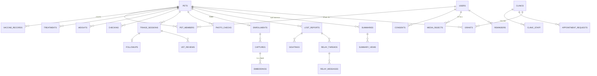

### 10.4 DDL ของตารางสำคัญ (ตัวอย่างสำหรับเริ่มทำ migration)

```sql
-- ============ identity ============
create schema if not exists identity;

create table identity.users (
  id              uuid primary key,                 -- UUIDv7 สร้างฝั่งแอป
  line_user_id    text unique not null,             -- sub จาก LINE ID token (U + 32 hex)
  display_name    text,
  picture_url     text,
  district_code   text,                             -- เขต กทม. (ไม่บังคับ) ใช้วัด KPI "แมวใน กทม."
  locale          text not null default 'th',
  status          text not null default 'active' check (status in ('active','suspended','deleting','deleted')),
  is_internal     boolean not null default false,   -- บัญชีทีมงาน/ทดสอบ (ตัดออกจาก KPI)
  created_at      timestamptz not null default now(),
  last_seen_at    timestamptz,
  deleted_at      timestamptz
);

create table identity.consents (
  id              uuid primary key,
  user_id         uuid not null references identity.users(id),
  purpose         text not null check (purpose in ('service','ai_improvement','location_alerts','marketing'))  -- การแชร์ให้คลินิกใช้ grants เป็นความยินยอม,
  granted         boolean not null,
  notice_version  text not null,                    -- เวอร์ชันประกาศความเป็นส่วนตัวที่ผู้ใช้เห็น
  evidence        jsonb not null default '{}',      -- ช่องทาง, ข้อความที่แสดง, ip_hash, ua_hash
  created_at      timestamptz not null default now()
);
-- เก็บเป็น append-only log และหา "สถานะปัจจุบัน" ด้วย view
create view identity.v_current_consents as
  select distinct on (user_id, purpose) user_id, purpose, granted, notice_version, created_at
  from identity.consents order by user_id, purpose, created_at desc;

create table identity.grants (                      -- สิทธิ์ที่เจ้าของให้คลินิก (consent ต่อการแชร์)
  id              uuid primary key,
  pet_id          uuid not null,
  granted_by      uuid not null references identity.users(id),
  grantee_type    text not null check (grantee_type in ('clinic')),
  grantee_id      uuid not null,                    -- clinic_id
  scopes          text[] not null,                  -- {'summary.read','vaccines.write','identity.verify','due_list.read'}
  expires_at      timestamptz,                      -- null = จนกว่าเจ้าของจะเพิกถอน
  revoked_at      timestamptz,
  created_at      timestamptz not null default now()
);
create index on identity.grants (grantee_id, pet_id) where revoked_at is null;

-- ============ pets ============
create schema if not exists pets;

create table pets.pets (
  id              uuid primary key,
  public_code     text unique not null,             -- เลข PetID สำหรับบัตร เช่น 'TH-C-7F3K9Q' (Crockford base32)
  species         text not null check (species in ('cat','dog')),
  name            text not null check (char_length(name) between 1 and 40),
  sex             text not null check (sex in ('male','female','unknown')),
  birth_date      date,                             -- ถ้าทราบ
  age_estimate_months int,                          -- ถ้าไม่ทราบวันเกิด
  neutered        text not null check (neutered in ('yes','no','unknown')),
  breed           text,
  coat_desc       text,
  microchip_no    text check (microchip_no ~ '^[0-9]{15}$'),  -- ไม่ unique: เลขซ้ำเข้าคิวตรวจสอบ (ไม่บอกว่าเป็นของใคร)
  microchip_source text check (microchip_source in ('ocr','barcode','manual','clinic')),
  avatar_media_id uuid,
  status          text not null default 'active' check (status in ('active','archived','deceased')),
  created_by      uuid not null,
  created_at      timestamptz not null default now(),
  updated_at      timestamptz not null default now(),
  deleted_at      timestamptz
);

create table pets.pet_members (
  pet_id          uuid not null references pets.pets(id) on delete cascade,
  user_id         uuid not null,
  role            text not null check (role in ('owner','carer','viewer')),
  invited_by      uuid,
  created_at      timestamptz not null default now(),
  primary key (pet_id, user_id)
);
create index on pets.pet_members (user_id);

-- ============ health ============
create schema if not exists health;

create table health.vaccine_records (
  id                  uuid primary key,
  pet_id              uuid not null,
  vaccine_type        text not null,                -- FVRCP | FELV | RABIES | DHPP | LEPTO | ... | OTHER
  product_name_raw    text,
  administered_on     date not null,
  next_due_on         date,
  clinic_id           uuid,                         -- ถ้า map ได้กับ directory
  clinic_name_raw     text,
  lot_no              text,
  source              text not null check (source in ('ocr','manual','clinic_verified')),
  verified_by_clinic  uuid,
  scan_id             uuid,
  source_media_id     uuid,                         -- รูปต้นฉบับเป็นหลักฐาน
  created_by          uuid not null,
  created_at          timestamptz not null default now(),
  updated_at          timestamptz not null default now(),
  deleted_at          timestamptz
);
create index on health.vaccine_records (pet_id, administered_on desc) where deleted_at is null;
create index on health.vaccine_records (next_due_on) where deleted_at is null and next_due_on is not null;

create table health.vaccine_scans (
  id              uuid primary key,
  pet_id          uuid not null,
  media_ids       uuid[] not null,
  status          text not null check (status in ('queued','processing','needs_review','confirmed','failed')),
  draft           jsonb,                            -- ผลจาก AI ก่อนผู้ใช้ยืนยัน
  ai_request_id   uuid,
  error_code      text,
  created_by      uuid not null,
  created_at      timestamptz not null default now(),
  confirmed_at    timestamptz
);

-- ============ triage ============
create schema if not exists triage;

create table triage.rule_sets (
  id              uuid primary key,
  version         int not null unique,
  status          text not null check (status in ('draft','approved','active','retired')),
  rules           jsonb not null,                   -- DSL (ดูข้อ 9.4)
  checksum        text not null,                    -- sha256 ของ rules (กันแก้หลังอนุมัติ)
  eval_run_id     uuid,                             -- eval ที่ผ่านก่อนอนุมัติ
  approved_by     uuid,                             -- user_id ของสัตวแพทย์ที่ปรึกษา
  approved_at     timestamptz,
  created_at      timestamptz not null default now()
);

create table triage.sessions (
  id              uuid primary key,
  pet_id          uuid not null,
  user_id         uuid not null,
  species         text not null,
  status          text not null check (status in ('in_progress','assessing','completed','failed')),
  chief_complaint text not null,
  answers         jsonb not null default '[]',
  rule_set_version int not null,
  rule_hits       jsonb not null default '[]',
  rule_level      smallint,                         -- 0=home 1=routine 2=within_24h 3=emergency
  llm_level       smallint,
  final_level     smallint,
  result          jsonb,                            -- สิ่งที่แสดงต่อผู้ใช้ (หลังผ่าน safety filter)
  ai_request_id   uuid,
  degraded        boolean not null default false,   -- true = ใช้ rules อย่างเดียว (AI ล่ม/เกินงบ)
  created_at      timestamptz not null default now(),
  completed_at    timestamptz,
  check (final_level is null or (final_level between 0 and 3
         and final_level >= coalesce(rule_level, 0) and final_level >= coalesce(llm_level, 0)))  -- ห้ามลดระดับ บังคับถึงระดับ DB
);
create index on triage.sessions (pet_id, created_at desc);

-- ============ biometric (PetID) ============
create schema if not exists biometric;
create extension if not exists vector with schema extensions;

create table biometric.enrollments (
  pet_id          uuid primary key,
  species         text not null,
  search_mode     text not null default 'lost_only' check (search_mode in ('lost_only','always','off')),
  is_lost         boolean not null default false,   -- sync จาก lost.* events
  views_done      text[] not null default '{}',
  ready           boolean not null default false,
  updated_at      timestamptz not null default now()
);

create table biometric.captures (
  id              uuid primary key,
  pet_id          uuid not null references biometric.enrollments(pet_id) on delete cascade,
  media_id        uuid not null,
  declared_view   text not null,
  detected_view   text,
  quality         jsonb,
  accepted        boolean,
  signature       jsonb,                            -- Visual Signature (ดูข้อ 9.7)
  signature_version int,
  phash           bit(64),                          -- กันรูปซ้ำ/รูปที่นำมาจากที่อื่น
  ai_request_id   uuid,
  created_at      timestamptz not null default now(),
  deleted_at      timestamptz
);

create table biometric.embeddings (
  id              uuid primary key,
  capture_id      uuid not null references biometric.captures(id) on delete cascade,
  pet_id          uuid not null,
  species         text not null,
  facet           text not null check (facet in ('global','face','coat','marks')),
  model           text not null,                    -- 'openai/text-embedding-3-small'
  dims            int not null,                     -- 1536
  signature_version int not null,
  canonical_text  text not null,                    -- ข้อความที่ถูก embed (เก็บไว้ re-embed ได้ถูก)
  embedding       extensions.halfvec(1536) not null,
  searchable      boolean not null default false,   -- denormalize จาก enrollments เพื่อ partial index
  created_at      timestamptz not null default now()
);
-- partial HNSW index ต่อ (species, facet) เฉพาะแถวที่ค้นหาได้ ให้ผลตรงกับ filter จริงและ recall สูง
-- query ต้องใส่ species/facet เป็น literal จึงจะใช้ index นี้ได้ (ดูข้อ 9.7.6)
create index emb_cat_face_hnsw on biometric.embeddings
  using hnsw (embedding extensions.halfvec_ip_ops)   -- vector normalize แล้ว → inner product (<#>)
  where species = 'cat' and facet = 'face' and searchable;
-- ...ทำซ้ำสำหรับ (cat|dog) × (global|face|coat|marks) = 8 index
-- ถ้ามีเงื่อนไขกรองเพิ่มนอก predicate ของ index ให้ตั้ง: set local hnsw.iterative_scan = relaxed_order;
-- ถ้าเปลี่ยนโมเดล embedding ให้สร้างชุด index ใหม่ที่มีเงื่อนไข model = '<ใหม่>' แล้วค่อยสลับ

-- ============ share ============
create schema if not exists share;

create table share.summaries (
  id              uuid primary key,
  pet_id          uuid not null,
  created_by      uuid not null,
  token_hash      bytea unique not null,            -- sha256(token) ใช้ค้นหาตอนมีคนเปิดลิงก์
  token_enc       bytea not null,                   -- AES-GCM ของ token ไว้แสดงลิงก์/QR ให้เจ้าของดูซ้ำ
  sections        text[] not null,
  status          text not null check (status in ('building','ready','failed','revoked','expired')),
  snapshot        jsonb,                            -- ข้อมูล ณ เวลาที่สร้าง (immutable)
  expires_at      timestamptz not null,
  revoked_at      timestamptz,
  created_at      timestamptz not null default now()
);

create table share.summary_views (
  id              bigint generated always as identity primary key,
  summary_id      uuid not null references share.summaries(id) on delete cascade,
  viewed_at       timestamptz not null default now(),
  clinic_id       uuid,                             -- ถ้าผู้เปิดล็อกอิน clinic-portal หรือมาจาก QR คลินิก
  ip_hash         bytea,                            -- hash + salt รายเดือน (ไม่เก็บ IP ดิบ)
  ua_family       text,
  referrer_host   text
);

-- ============ media ============
create schema if not exists media;

create table media.objects (
  id              uuid primary key,
  owner_user_id   uuid,                             -- null = ผู้พบที่ไม่ล็อกอิน (purpose='sighting' เท่านั้น)
  pet_id          uuid,
  purpose         text not null check (purpose in ('avatar','vaccine_book','microchip','symptom','photo_check','petid','checkin','lost','sighting','relay','vet_note')),
  blob_pathname   text not null unique,
  content_type    text not null,
  bytes           int not null,
  width           int, height int,
  sha256          bytea,
  status          text not null check (status in ('pending','uploaded','ready','rejected','deleted')),
  attached_to     text,                             -- เช่น 'health.vaccine_scans:<id>'
  ai_consent      boolean not null default false,   -- snapshot ของ consent ai_improvement ตอนอัปโหลด
  variants        jsonb not null default '{}',
  created_at      timestamptz not null default now(),
  deleted_at      timestamptz
);

-- ============ ai_ops ============
create schema if not exists ai_ops;

create table ai_ops.requests (
  id              uuid primary key,
  service         text not null,
  feature         text not null,                    -- triage.assess | vision.photo_check | ocr.vaccine_book | ocr.microchip | petid.signature | petid.verify_pair | embed.petid
  model_requested text not null,                    -- 'gpt-6-luna'
  model_resolved  text,                             -- ชื่อ snapshot ที่ API ตอบกลับมา
  prompt_key      text not null,
  prompt_version  int not null,
  schema_version  int,
  input_hash      bytea not null,                   -- sha256 ของ input หลัง redact (ไว้ dedupe/debug)
  media_ids       uuid[],
  output          jsonb,
  tokens_in       int, tokens_out int, tokens_cached int, images int,
  cost_usd        numeric(10,6),
  latency_ms      int,
  status          text not null check (status in ('ok','refused','invalid_output','timeout','error','budget_blocked')),
  error           text,
  user_id         uuid, pet_id uuid,
  correlation_id  text,
  created_at      timestamptz not null default now()
);
create index on ai_ops.requests (feature, created_at desc);

-- ============ ops (ใช้ร่วมผ่าน service-kit) ============
create schema if not exists ops;

create table ops.outbox_health (                     -- 1 ตารางต่อ service: outbox_pets, outbox_triage, ...
  id              uuid primary key,
  topic           text not null,
  event_type      text not null,
  idempotency_key text not null,                    -- key ที่ใช้ตอน send() (ค่าเริ่มต้น = id)
  payload         jsonb not null,
  created_at      timestamptz not null default now(),
  published_at    timestamptz,
  attempts        int not null default 0,
  last_error      text
);
create index on ops.outbox_health (created_at) where published_at is null;

create table ops.inbox (                              -- idempotency ฝั่ง consumer (exactly-once effect)
  consumer        text not null,                     -- 'health-service:vaccine-ocr'
  message_id      text not null,
  processed_at    timestamptz not null default now(),
  primary key (consumer, message_id)
);

create table ops.dead_letters (
  id              uuid primary key,
  service         text not null,
  topic           text not null,
  consumer        text not null,
  message_id      text not null,
  payload         jsonb not null,
  error           text not null,
  delivery_count  int not null,
  created_at      timestamptz not null default now(),
  resolved_at     timestamptz,
  resolution      text                               -- replayed | discarded | fixed_manually
);
```

### 10.5 Row Level Security

**แนวคิด**: service ต่อ DB ด้วย role ของตัวเอง แล้วใน transaction ของทุก request จะตั้งค่า claims ของผู้ใช้ที่ verify แล้ว ส่วน policy อ่านค่าจาก claims นั้น

```sql
-- ===== authz helpers (identity-service เป็นเจ้าของ) =====
create schema if not exists authz;

create or replace function authz.claims() returns jsonb
language sql stable as $$
  select coalesce(nullif(current_setting('request.jwt.claims', true), ''), '{}')::jsonb
$$;

create or replace function authz.current_user_id() returns uuid
language sql stable as $$ select nullif(authz.claims() ->> 'sub', '')::uuid $$;

create or replace function authz.is_system() returns boolean
language sql stable as $$ select coalesce(authz.claims() ->> 'act', '') = 'system' $$;

-- คืน pet_id ทั้งหมดที่ผู้เรียกมีสิทธิ์ perm (สมาชิกตามบทบาท หรือคลินิกที่มี grant ที่ยังไม่หมดอายุ)
create or replace function authz.accessible_pet_ids(perm text) returns uuid[]
language sql stable security definer set search_path = '' as $$
  select coalesce(array_agg(distinct pet_id), '{}') from (
    select m.pet_id from pets.pet_members m
     where m.user_id = authz.current_user_id()
       and case
             when perm like '%.read' or perm in ('triage.use', 'petid.verify') then true  -- ทุกบทบาท
             when perm in ('pet.manage', 'petid.manage')       then m.role = 'owner'
             else m.role in ('owner', 'carer')
           end
    union all
    select g.pet_id from identity.grants g
     where g.grantee_type = 'clinic'
       and g.grantee_id = nullif(authz.claims() ->> 'clinic_id', '')::uuid
       and g.revoked_at is null and (g.expires_at is null or g.expires_at > now())
       and (case perm                                   -- แปลง perm ของระบบเป็น scope ของ grant
              when 'pet.read'       then 'summary.read'
              when 'health.read'    then 'summary.read'
              when 'vaccines.write' then 'vaccines.write'
              when 'petid.verify'   then 'identity.verify'
            end) = any (g.scopes)
  ) s
$$;

-- ===== ตัวอย่าง policy ใน health =====
alter table health.vaccine_records enable row level security;

create policy vr_select on health.vaccine_records for select to svc_health
  using ( (select authz.is_system()) or pet_id = any ((select authz.accessible_pet_ids('health.read'))) );

create policy vr_write on health.vaccine_records for insert to svc_health
  with check ( (select authz.is_system()) or pet_id = any ((select authz.accessible_pet_ids('vaccines.write'))) );  -- คลินิกที่มี grant vaccines.write เขียนได้
-- update/delete ทำแบบเดียวกัน
```

> ห่อ function ด้วย `(select …)` เพื่อให้ Postgres ประเมินครั้งเดียวต่อ statement (InitPlan) แทนที่จะประเมินทุกแถว ช่วยเรื่อง performance ของ RLS

**ฝั่งแอป** (`packages/db`): ทุก request handler เรียกฐานข้อมูลผ่าน `withUser(claims, tx => …)` ซึ่งตั้งค่าภายใน transaction

```sql
select set_config('request.jwt.claims', $1, true),      -- true = มีผลเฉพาะ transaction นี้
       set_config('request.jwt.claim.sub', $2, true);   -- เผื่อใช้ auth.uid() ของ Supabase (อ่านคีย์นี้ก่อน)
```

- ใช้ได้กับ Supavisor transaction mode เพราะค่าเหล่านี้อยู่แค่ใน transaction
- ใช้ `pg` (node-postgres) ไม่ใช้ `postgres.js` เพราะ Supabase เตือนว่า pipelining ของ postgres.js กับ transaction mode ทำให้ query ค้างหรือได้แถวผิดได้ (ดูภาคผนวก B.2)

ส่วน queue consumer ที่ทำงานแทนระบบใช้ `withSystem(tx => …)` ซึ่งตั้ง `{"act":"system"}` และต้องเรียกใช้แบบ explicit เท่านั้น (lint rule ห้ามใช้ใน HTTP handler)

**ทดสอบ RLS** ด้วย pgTAP ใน `supabase/tests/` เช่น "ผู้ใช้ A อ่านวัคซีนของน้องผู้ใช้ B ไม่ได้" และ "คลินิกที่ grant หมดอายุอ่านไม่ได้" แล้วรันใน CI ทุก PR

### 10.6 Migration และการเปลี่ยน schema

- ใช้ Supabase CLI: `supabase/migrations/<timestamp>_<service>_<desc>.sql` เป็นแหล่งความจริงเดียว ส่วน Drizzle schema ในแต่ละ service ใช้แค่ type-safe query (`drizzle-kit introspect/pull` หรือเขียนตรงกัน แล้วมี test เทียบ)
- ใช้กลยุทธ์ **expand → migrate → contract** สำหรับทุกการเปลี่ยนที่ไม่ backward-compatible เพราะ migration รันก่อน deploy โค้ด, Instant Rollback ไม่ย้อน DB และ worker ของ deployment เก่ายังประมวลผลข้อความค้างในคิว
- CI รัน `supabase db reset` บน DB ชั่วคราว + pgTAP + ตรวจว่า migration ใหม่ไม่ลบคอลัมน์ที่ read contract ใช้อยู่

### 10.7 นโยบายการเก็บรักษาข้อมูล (ร่าง — ต้องให้ที่ปรึกษากฎหมายตรวจ)

| ข้อมูล | เก็บนานเท่าไร | เหตุผล/หมายเหตุ |
|---|---|---|
| โปรไฟล์น้อง ประวัติสุขภาพ | จนกว่าผู้ใช้ลบ | เป็นแกนของบริการ |
| รูปที่ผูกกับข้อมูลสุขภาพ | จนกว่าผู้ใช้ลบ | เป็นหลักฐาน (เช่น สมุดวัคซีน) |
| รูปที่อัปโหลดแต่ไม่ถูกผูก | 24 ชม. | cron `media-gc` |
| ผลคัดกรอง + `ai_ops.requests` ของ triage | 2 ปี | audit ความปลอดภัยของ AI และวัด accuracy |
| `ai_ops.requests` ของฟีเจอร์อื่น | 180 วัน | debug + ต้นทุน |
| PetID captures + embeddings | จนกว่าเจ้าของถอน PetID หรือลบน้อง | ลบ vector พร้อม capture |
| ข้อความ relay น้องหาย | 90 วันหลังปิดประกาศ | ลดความเสี่ยงข้อมูลติดต่อรั่ว |
| ตำแหน่ง | เก็บแค่ geohash หยาบ (≈ 5 กม. สำหรับ alert, ≈ 1.2 กม. สำหรับ sighting) | ไม่เก็บพิกัดละเอียด |
| รูปจากผู้พบ (sighting) และรูปคำขอ identify ที่ไม่ match | 30 วัน | ลดข้อมูลบุคคลที่สามที่ติดมาในรูป |
| LINE webhook events ดิบ (`notify.webhook_events`) | 7 วัน | มีข้อความอิสระของผู้ใช้ |
| `share.summary_views` | 1 ปี | ตัวชี้วัดคลินิก |
| analytics events ดิบ | 13 เดือน แล้วเหลือแต่ aggregate | เทียบรายปีได้ |
| บัญชีที่ขอลบ | purge ภายใน 30 วัน | backup ของ Supabase (7 วัน) และ dump ใน Blob (≤ 35 วัน) หมุนหายเองตามรอบ |

---

## 11. Authentication & Authorization

### 11.1 ผู้ใช้แต่ละแบบและวิธียืนยันตัวตน

| ผู้ใช้ | ล็อกอินด้วย | Token ที่ได้ | อายุ | เก็บที่ไหน |
|---|---|---|---|---|
| เจ้าของ (MINI App) | LIFF: `liff.getIDToken()` (อายุ 1 ชม.) หรือ `liff.getAccessToken()` (12 ชม.) แล้วแลกเป็น token ของเรา | Access JWT (ES256) | 60 นาที | หน่วยความจำ (ไม่เก็บลง storage) ถ้าหมดอายุให้แลกใหม่ด้วย LIFF |
| พนักงานคลินิก | LINE Login (web, OAuth 2.0 + PKCE) ผ่าน BFF ของ clinic-portal | Access JWT 15 นาที + refresh token (opaque, หมุนทุกครั้ง) 30 วัน | ตามนั้น | httpOnly Secure cookie บน `clinic.<domain>` |
| แอดมิน / สัตวแพทย์ที่ปรึกษา | LINE Login + allowlist (+ TOTP สำหรับงานเสี่ยง) | เหมือนคลินิก แต่ session สูงสุด 12 ชม. | ตามนั้น | httpOnly cookie บน `admin.<domain>` |
| ผู้พบสัตว์ (ไม่ล็อกอิน) | ไม่มี ใช้ thread token | capability token (สุ่ม 128 บิต) | 30 วัน | URL/localStorage ของผู้พบ |
| Service ↔ Service | Vercel OIDC token (`getVercelOidcToken({ audience })`) | JWT RS256 ออกโดย Vercel | ≤ 2 ชม. | runtime |
| Vercel Cron | `Authorization: Bearer $CRON_SECRET` | — | — | env |
| LINE webhook | `x-line-signature` (HMAC-SHA256 ของ raw body ด้วย channel secret) | — | — | env |
| Blob upload callback | ลายเซ็นของ Vercel Blob (ตรวจใน `handleUpload`) | — | — | env |

### 11.2 Flow ล็อกอินของ MINI App

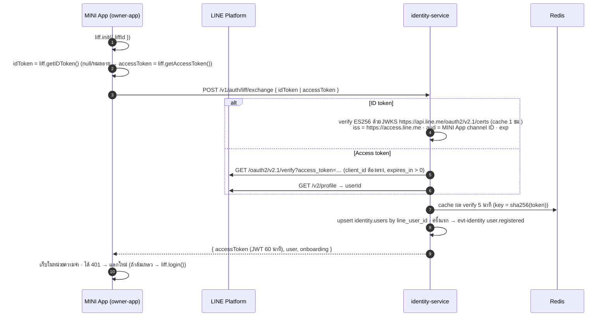

**ข้อควรระวังจากเอกสาร LINE**
- **ห้ามส่งข้อมูลจาก `liff.getProfile()` / `liff.getDecodedIDToken()` มาเป็นตัวยืนยันตัวตน** ให้ส่ง ID token หรือ access token แล้วตรวจที่ server เท่านั้น
- URL/fragment ของ LIFF มี token จึงห้าม log URL เต็ม และตั้ง `Referrer-Policy: strict-origin-when-cross-origin` (หน้า token ใช้ `no-referrer`)
- **MINI App channel, LINE Login channel (ของคลินิก/แอดมิน) และ Messaging API channel ต้องอยู่ใต้ provider เดียวกัน** เพราะ userId ของ LINE ต่างกันตาม provider
- ประเทศไทยตั้ง channel consent simplification ไม่ได้ ผู้ใช้ใหม่จะเห็นหน้าขอสิทธิ์ของ LINE 1 ครั้ง จึงต้องรวมเวลานี้ในเป้า onboarding ≤ 60 วินาที
- ตั้ง **Add friend option** ของ MINI App channel ให้ชวนเพิ่มเพื่อน OA ตอนขอสิทธิ์ เพราะ push ส่งถึงได้เฉพาะคนที่เป็นเพื่อน

### 11.3 JWT ของระบบ

```json
{
  "iss": "https://api.<domain>/identity",
  "aud": "pettech-api",
  "sub": "0192a6f4-…",
  "sid": "0192a6f5-…",
  "act": "user",
  "roles": ["owner"],
  "clinic_id": null,
  "amr": ["line_liff"],
  "role": "authenticated",
  "iat": 1790000000,
  "exp": 1790003600
}
```

- เซ็นด้วย **ES256** (P-256) มี `kid`
  - private key เก็บเป็น sensitive env var ของ identity หมุนทุก 90 วันโดยมีช่วงที่ key เก่าและใหม่ใช้ได้พร้อมกัน
  - อีกทางเลือกคือ **Vercel KMS (beta)** ที่เซ็น JWT ได้โดยไม่ต้องถือ private key
- service อื่น verify ด้วย `jose.createRemoteJWKSet('<identity>/.well-known/jwks.json')` ซึ่ง cache ในหน่วยความจำ ไม่ต้องเรียก identity ทุก request
- ตรวจ `sid` กับ denylist ใน Redis (`jwt:deny:{sid}`) บนทุก request (ใช้เวลา ~1–2 ms)
- **(ทางเลือก)** import public/private key เดียวกันเข้า **Supabase JWT signing keys** (Supabase รองรับการ import key และ ES256) token ของเราจะใช้กับ Supabase Data API/Realtime ได้ด้วยถ้าวันหนึ่งต้องการ ส่วน `role: "authenticated"` มีไว้เพื่อความเข้ากันได้

### 11.4 Web login ของ clinic-portal / admin-console (BFF)

1. ผู้ใช้กด "เข้าสู่ระบบด้วย LINE" → BFF สร้าง `state` + PKCE `code_verifier` (เก็บใน cookie ชั่วคราว)
2. LINE redirect กลับมาที่ `/auth/callback` ของ BFF → BFF ส่ง `code` + `code_verifier` ไป `POST /v1/auth/line-login/exchange`
3. identity แลก code กับ LINE แล้ว verify ID token (web login เซ็นแบบ HS256 ด้วย channel secret หรือตรวจผ่าน `POST /oauth2/v2.1/verify`) แล้วตรวจสิทธิ์
   - คลินิก: ต้องมีแถวใน `clinic_staff`
   - แอดมิน: ต้องอยู่ใน allowlist
4. ออก access (15 นาที) + refresh (30 วัน, หมุนทุกครั้ง พร้อม **reuse detection** ถ้าใช้ refresh token ซ้ำ ให้เพิกถอนทั้ง family)
5. BFF เก็บใน httpOnly Secure `SameSite=Lax` cookie แล้วแนบ `Authorization` เองเมื่อเรียก API จาก server

### 11.5 Authorization model

| บทบาท | ระดับ | ได้สิทธิ์อะไร |
|---|---|---|
| `owner` | ต่อน้อง | ทุกอย่างของน้อง รวมถึงเชิญ/ลบสมาชิก, ให้สิทธิ์คลินิก, ประกาศหาย, ตั้งค่า PetID, ลบน้อง |
| `carer` | ต่อน้อง | อ่าน/บันทึกสุขภาพ, เช็กอาการ, สร้างสรุป, ประกาศหาย (ลบน้องหรือจัดการสมาชิกไม่ได้) |
| `viewer` | ต่อน้อง | อ่านอย่างเดียว + ดูสรุป |
| `clinic_staff` (`admin`/`vet`/`staff`) | ต่อคลินิก | เข้า Clinic Lite ของคลินิกตัวเอง ส่วนข้อมูลน้องเข้าถึงได้ **เฉพาะเมื่อมี grant** ตาม scope (`summary.read`, `vaccines.write`, `due_list.read`, `identity.verify`) |
| `vet_reviewer` | global flag | ดูเคสที่ปิดข้อมูลเจ้าของแล้วเพื่อรีวิวผล AI |
| `vet_advisor` | global flag | + อนุมัติ rule set และเคสทดสอบ |
| `admin` | global | หลังบ้าน (ทุก action บันทึก audit log พร้อมเหตุผล) |

**Permission (perm) ที่ใช้ในโค้ดและ RLS**

| Perm | ใครได้ |
|---|---|
| `pet.read` | owner, carer, viewer |
| `pet.write` | owner, carer |
| `pet.manage` | owner |
| `health.read` | owner, carer, viewer, คลินิก (`summary.read`) |
| `health.write` | owner, carer |
| `vaccines.write` | owner, carer, คลินิก (`vaccines.write`) |
| `triage.use` | owner, carer, viewer (เรื่องฉุกเฉินต้องไม่ถูกบล็อกด้วยบทบาท) |
| `share.create` | owner, carer |
| `lost.manage` | owner, carer |
| `petid.manage` | owner |
| `petid.verify` | owner, carer, viewer, คลินิก (`identity.verify`) |

**บังคับใช้ 3 ชั้น**
1. middleware ตรวจ JWT, role และ rate limit
2. use case เรียก `requirePetAccess(user, petId, perm)` ซึ่งใช้ ACL ที่ cache ใน Redis 60 วินาที และล้าง cache เมื่อมี `member.*` / `grant.*` event
3. **RLS** ใน Postgres เป็นชั้นสุดท้ายกันบั๊ก (ข้อ 10.5)

**การให้สิทธิ์คลินิก = consent ต่อการแชร์**
- คลินิกขอ (`access-requests`) → เจ้าของได้ข้อความ LINE ที่มีปุ่มเปิด MINI App ไปหน้าอนุมัติ → เลือก scope และระยะเวลา (ครั้งนี้ 7 วัน / จนกว่าจะยกเลิก) → `POST /v1/grants/requests/{id}/decision`
- เพิกถอนได้ทุกเมื่อ และทุกการเข้าถึงของคลินิกถูกบันทึกลง audit log

### 11.6 Service-to-service

```ts
// ผู้เรียก (เช่น share_worker → pet)
import { getVercelOidcToken } from '@vercel/oidc';
const token = await getVercelOidcToken({ audience: 'pettech-internal:pet' });
const res = await fetch(new URL(`internal/v1/pets/${petId}/profile`, process.env.PET_URL), {
  headers: { authorization: `Bearer ${token}`, 'x-request-id': ctx.requestId },
});

// ผู้รับ (service-kit middleware บน /internal/v1/*)
const JWKS = createRemoteJWKSet(new URL(`https://oidc.vercel.com/${TEAM_SLUG}/.well-known/jwks`));
const { payload } = await jwtVerify(token, JWKS, {
  issuer: `https://oidc.vercel.com/${TEAM_SLUG}`,
  audience: `pettech-internal:${SERVICE_NAME}`,
});
// ตรวจ payload.sub = owner:<team>:project:pettech-backend:environment:<env ตรงกับตัวเอง>
// หมายเหตุ: ใน topology A ทุก service อยู่ project เดียวกัน sub จึงเหมือนกันทุกตัว → ยืนยันได้ว่า "มาจาก backend ของเรา"
// แต่แยกไม่ได้ว่า service ไหน จึงส่ง header x-caller-service ไว้ log/allowlist ตาม convention
```

> **ข้อจำกัด**: custom audience ช่วยให้ token ใช้ได้กับปลายทางที่ตั้งใจเท่านั้น แต่ใน topology A ผู้รับแยกไม่ได้ว่าผู้เรียกเป็น service ไหน (ทุกตัวใช้ project เดียวกันและ env ร่วมกัน) ขอบเขตความปลอดภัยจริงจึงเป็น "ภายใน backend project" ส่วนการจำกัดรายตัวเป็นแค่ convention ถ้าต้องแยกจริงให้ใช้ topology B ซึ่ง `sub` บอกชื่อ project ของผู้เรียก ⚠️ ทดสอบใน spike ข้อ 5.8 #5
>
> ใช้วิธีนี้แม้เรียกผ่าน Bindings ซึ่งเป็น URL ภายในแล้วก็ตาม เพราะ Bindings ข้าม Firewall/Deployment Protection และไม่ได้ยืนยันตัวตนให้ และวิธีเดียวกันนี้ใช้ต่อได้ทันทีถ้าต้องแยก project (ข้อ 5.2)

---

## 12. Storage & Media (Vercel Blob)

### 12.1 Blob stores

Blob กำหนด public/private ต่อ store และเปลี่ยนภายหลังไม่ได้ จึงแยกเป็น 2 store โดยสร้างที่ region **`sin1`** ทั้งคู่ (region ของ store ก็เปลี่ยนภายหลังไม่ได้เช่นกัน)

| Store | Access | เก็บอะไร | ใครเขียน | การอ่าน |
|---|---|---|---|---|
| `pettech-private` | **private** | รูปทุกรูปของผู้ใช้ (สมุดวัคซีน, อาการ, ส่องรูป, PetID, เช็กอิน, พบเห็น, relay), ไฟล์ export PDPA, backup DB (เข้ารหัส) | media-service (ผ่าน client upload), worker สำหรับ variants/exports | **signed URL อายุสั้น** (`issueSignedToken` + `presignUrl`) หรือ `get()` ใน function |
| `pettech-public` | public | โปสเตอร์น้องหายและการ์ดแชร์ที่ผู้ใช้ตั้งใจเผยแพร่, โลโก้คลินิก, รูป OG ทั่วไป | share-service (รับรูปที่ render ฝั่ง client) | URL ตรง (CDN cache, path แบบ immutable) |

**Path convention**

```
pettech-private:
  u/{userId}/{purpose}/{yyyy}/{mm}/{mediaId}/original.jpg
  u/{userId}/{purpose}/{yyyy}/{mm}/{mediaId}/display.webp     (ด้านยาว 1600)
  u/{userId}/{purpose}/{yyyy}/{mm}/{mediaId}/thumb.webp       (320)
  u/{userId}/{purpose}/{yyyy}/{mm}/{mediaId}/ai.jpg           (1024, ใช้ส่ง AI)
  exports/{requestId}/{service}.json · exports/{requestId}/bundle.zip
  backups/db/{yyyy-mm-dd}.sql.age
pettech-public:
  posters/{reportId}/{format}-{contentHash}.png
  cards/{publicId}-{contentHash}.png
  clinics/{clinicId}/logo-{contentHash}.webp
```

### 12.2 Flow อัปโหลด

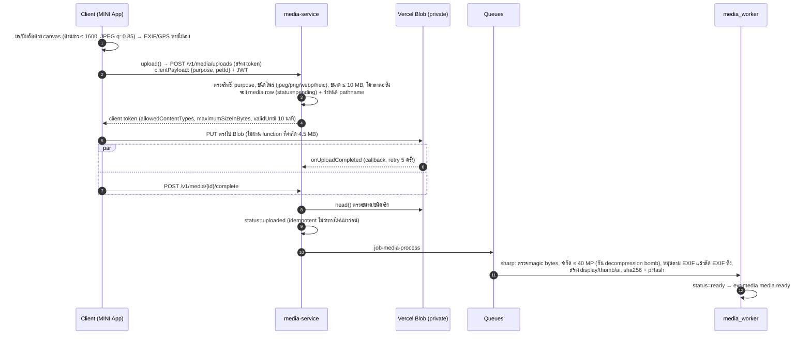

- **ทำไมมีทั้ง callback และ `complete`**: callback ไม่ทำงานบน localhost และอาจมาช้า ส่วน `complete` ทำให้ UX เร็วและทดสอบในเครื่องได้ ทั้งสองทางเรียก use case เดียวกันแบบ idempotent
- `handleUpload` ต้องใช้ `BLOB_READ_WRITE_TOKEN` ถ้าต้องการใช้ OIDC ล้วน มีทางเลือก `handleUploadPresigned` + `uploadPresigned` ⚠️ ต้องยืนยันรายละเอียด API ตอน spike
- ถ้าเป็นไฟล์ HEIC จาก iPhone ให้แปลงเป็น JPEG ใน worker (`sharp` รองรับเมื่อ build พร้อม libheif) หรือแปลงฝั่ง client ตอนวาด canvas ซึ่งง่ายกว่าและเป็นทางหลัก
- **AI worker ไม่อ่านไฟล์ original** ใช้ variant `ai.jpg` ที่ตัด EXIF แล้วเท่านั้น

### 12.3 การแสดงรูป

- **owner-app**: API คืน `url` แบบ signed อายุ 15 นาทีมากับข้อมูล (หรือเรียก `GET /v1/media/{id}/url`) แล้ว browser โหลดตรงจาก Blob โดยไม่ผ่าน function
- **หน้าสรุปก่อนพบหมอ / Clinic Lite**: share/clinic ขอ signed URL แบบ batch ผ่าน `POST /internal/v1/media/sign` อายุไม่เกิน 60 นาทีต่อการเปิดหน้า (ไม่ฝัง URL อายุยาวใน snapshot)
- **`next/image` ใช้กับ private Blob ไม่ได้** (optimizer ไม่ส่ง header ยืนยันตัวตน) จึงสร้าง variants ไว้ล่วงหน้าตอนอัปโหลด (ใช้ `sharp` หรือ `putImage()` ของ Blob ที่ทำ optimize ตอนเขียน)
- response ที่ stream รูป private ผ่าน function (ถ้าจำเป็น) ต้องตั้ง `Cache-Control: private, no-store`

### 12.4 วงจรชีวิตไฟล์และการลบ

| เหตุการณ์ | สิ่งที่เกิด |
|---|---|
| อัปโหลดแล้วไม่ถูกผูกกับ resource ภายใน 24 ชม. | `media-gc` ลบ |
| ผู้ใช้ลบรูป/ข้อมูลที่ผูกรูป | `status=deleted` ทันที (ไม่แสดงอีก) แล้วลบไฟล์จริงหลัง 7 วัน (ช่วงกู้คืน) |
| ขอลบบัญชี (PDPA) | ลบไฟล์ของผู้ใช้ทั้งหมดทันทีใน saga (ข้อ 8.9) |
| ประกาศน้องหายปิดแล้ว | ลบโปสเตอร์ใน public store หลัง 30 วัน (ป้องกันข้อมูลค้างในอินเทอร์เน็ต) |
| ถอน consent `ai_improvement` | ไฟล์ยังอยู่เพื่อให้บริการ แต่ถูกตัดออกจากชุดข้อมูลฝึก/eval ทันที (`media.objects.ai_consent=false`) |

- การเขียนทับหรือลบใน Blob อาจใช้เวลาถึง ~60 วินาทีกว่า CDN จะเห็น จึงใช้ **path แบบ immutable** (มี hash) ไม่เขียนทับไฟล์เดิม

---

## 13. Cache, Rate limit และ Redis

### 13.1 เลือกเครื่องมือให้ตรงงาน

| งาน | ใช้ | เหตุผล |
|---|---|---|
| กัน burst / bot ต่อ IP หรือต่อผู้ใช้ (หน้าต่าง ≤ 10 นาที) | **Vercel Firewall** (WAF rate limit rules) + `checkRateLimit()` จาก `@vercel/firewall` (ระบุ `rateLimitKey` = userId) | block ที่ edge ก่อนถึง function และ traffic ที่ถูก block ไม่ถูกคิดเงิน |
| โควตารายวันต่อผู้ใช้ (เช่น เช็กอาการ 10 ครั้ง/วัน) | **Upstash Redis** + `@upstash/ratelimit` | Firewall ใช้หน้าต่างได้สูงสุด 10 นาที จึงทำโควตารายวันไม่ได้ |
| งบ AI รายวัน, semaphore, idempotency, denylist, lock, cache | **Upstash Redis** (`ap-southeast-1`, ติดตั้งผ่าน Marketplace อยู่แล้ว) | Vercel ไม่มี Redis ของตัวเอง |
| ข้อมูล public ที่อ่านบ่อย (flows, รายชื่อคลินิก) | **Vercel CDN** (`s-maxage` + `stale-while-revalidate`) | ไม่ต้องรัน function |
| kill switch / config ที่เปลี่ยนไม่บ่อย | **Vercel Flags** / **Global Config** | อ่านเร็ว เปลี่ยนได้โดยไม่ deploy |

### 13.2 Vercel Firewall rules (เริ่มต้น)

| Rule | เงื่อนไข | Action |
|---|---|---|
| `auth-exchange` | `POST /v1/auth/*` | 20 req/นาที/IP |
| `public-forms` | `POST /v1/lost/public/*`, `POST /v1/lost/sightings`, `POST /v1/clinics/leads` | 5 req/นาที/IP + ต้องผ่าน BotID |
| `share-public` | `GET /v1/share/public/*` | 60 req/นาที/IP (กันการไล่เดา token) |
| `petid-identify` | `POST /v1/petid/identify` | 3 req/นาที/ผู้ใช้ (`checkRateLimit` + key = userId) |
| `admin` | `/v1/admin/*` | 120 req/นาที/IP และ challenge ถ้าไม่มี header จาก BFF |
| `global` | ทุก path | 300 req/นาที/IP |
| `geo` (ทางเลือก) | ทุก path | log-only นอกประเทศไทยในช่วงแรก (ไม่ block เพราะผู้ใช้อาจอยู่ต่างประเทศ) |

> ถ้า frontend เรียก API ข้ามโดเมน BotID ต้องตั้ง `extraAllowedHosts` ให้ `api.<domain>`

### 13.3 Redis key catalog

| Key | ชนิด | TTL | เจ้าของ | ใช้ทำอะไร |
|---|---|---|---|---|
| `rl:{feature}:{userId}` | ratelimit (sliding window) | อัตโนมัติ | ทุก service (service-kit) | โควตารายวันต่อผู้ใช้ต่อฟีเจอร์ |
| `ai:cost:{yyyymmdd}` | counter (micro-USD) | 3 วัน | `packages/ai` | งบ AI รายวันทั้งระบบ |
| `ai:cost:{feature}:{yyyymmdd}` | counter | 3 วัน | `packages/ai` | งบแยกฟีเจอร์ |
| `sem:ai:interactive` / `sem:ai:background` | sorted set (lease) | lease 120 วิ | `packages/ai` | จำกัดการเรียก AI พร้อมกัน |
| `idem:{service}:{userId}:{key}` | hash (status, body) | 24 ชม. | service-kit | Idempotency-Key ของ API |
| `jwt:deny:{sid}` | string | จนถึง exp ของ token | identity | เพิกถอน session |
| `line:verify:{sha256(token)}` | string (userId) | 5 นาที | identity | cache ผลตรวจ LIFF token |
| `acl:{userId}` | hash (petId → role) | 60 วิ | pet (ล้างเมื่อมี event) | ตรวจสิทธิ์เร็วใน use case |
| `grant:{clinicId}:{petId}` | set (scopes) | 60 วิ | identity | สิทธิ์คลินิก |
| `dir:clinics:{hash(query)}` | JSON | 5 นาที | clinic | ผลค้นหาคลินิก (เสริม CDN) |
| `quota:line:{yyyymm}` | hash (used, reserved, limit) | 40 วัน | notification | งบข้อความ LINE |
| `alert:area:{geohash5}:{yyyymmdd}` | counter | 2 วัน | lostfound | จำกัดการแจ้งเตือนต่อพื้นที่ต่อวัน |
| `lock:{name}` | string (`SET NX PX`) | ≤ 5 นาที | ทุก worker | กันงานซ้อน (เช่น digest, reindex) |
| `job:{jobId}` | hash | 1 ชม. | worker | (ทางเลือก) สถานะงานให้ poll เร็วขึ้น ลดการอ่าน DB |

### 13.4 เมื่อ Redis ใช้ไม่ได้

| ส่วน | นโยบาย |
|---|---|
| Rate limit / idempotency | **fail-open** (Firewall ยังกันชั้นนอกอยู่) และ log เตือน |
| งบ AI / semaphore | **fail-closed สำหรับงานเบื้องหลัง**, งานที่ผู้ใช้รอให้ใช้เพดานสำรองในหน่วยความจำของ instance แทน, triage ยังได้ผล rules-only เสมอ |
| denylist ของ JWT | fail-open (token อายุสั้นอยู่แล้ว) ยกเว้น endpoint admin ที่ fail-closed |
| cache อื่นๆ | อ่านจาก DB ตรง |

---

## 14. Notifications, Reminders และ LINE

### 14.1 ช่องทางแจ้งเตือนและต้นทุน (ตรวจ ณ 28 ก.ย. 2569)

| ช่องทาง | ต้นทุน | เงื่อนไข | ใช้กับ |
|---|---|---|---|
| **ปฏิทินมือถือ (.ics)** | ฟรีไม่จำกัด | ผู้ใช้ subscribe 1 ครั้ง | วันครบกำหนดทุกอย่าง (วัคซีน, ยาถ่ายพยาธิ, เห็บหมัด, เช็กอิน) |
| **Reply message** | **ฟรี ไม่นับโควตา** (ประกาศทางการ LINE Thailand: Reply API ไม่นับ) | ต้องตอบ event จาก webhook ด้วย reply token ภายในเวลาสั้นๆ | ตอบปุ่ม postback ใน Flex ("ฉีดแล้ว ✓"), ตอบแชท, ข้อความต้อนรับเมื่อเพิ่มเพื่อน |
| **Service message ของ MINI App** | ฟรี (เอกสาร LINE ระบุว่า "free of charge" และส่งผ่าน API แยกไปห้อง "LINE MINI App Notice") ⚠️ ยังไม่มีเอกสารที่เขียนตรงๆ ว่าไม่กินโควตา OA | **MINI App ต้อง verified** (ต้องเป็นนิติบุคคลไทย), template ผ่านการรีวิว (รองรับภาษาไทย), ส่งเพื่อตอบ action ของผู้ใช้ใน MINI App เท่านั้น (ห้ามโฆษณา), ≤ 5 ข้อความต่อ action, token อายุ 1 ปี | ยืนยันการทำรายการ, เตือนนัดที่ผู้ใช้ตั้งเอง (เข้าข่าย "reminder" ของ booking) — เปิดใช้หลังจดบริษัทและ verified |
| **OA push / multicast** | **นับโควตาต่อผู้รับ** แผนไทย (ไม่รวม VAT 7%): Free 0 บาท/300 ข้อความ, Basic 1,280 บาท/15,000 (+0.10 บาท/ข้อความ), Pro 1,780 บาท/35,000 (+0.06 บาท) | ผู้รับต้องเป็นเพื่อนกับ OA | สรุปเตือนรายวัน (รวม 1 ข้อความ/คน), สรุปรายเดือน, เรื่องด่วน (มีคนพบน้อง, คลินิกขอสิทธิ์, ติดตามผล 3 วัน) |
| **Inbox ในแอป** | ฟรี | ผู้ใช้เปิดแอป | fallback ของทุกอย่าง |
| **Email** (ทางเลือก) | ตามผู้ให้บริการ (มีใน Vercel Marketplace) | มีอีเมลคลินิก | คำขอนัดสำหรับคลินิกที่ไม่ใช้ LINE |

> LINE Notify ปิดบริการไปแล้วตั้งแต่ 31 มี.ค. 2568 ห้ามใช้ทำ alert ของระบบ (ใช้ข้อ 16.4 แทน)

### 14.2 งบโควตาข้อความ LINE

- **ต่อผู้ใช้ต่อเดือน**: เรื่องทั่วไป ≤ 4 ข้อความ (เตือนรวมรายวันจะส่งเฉพาะวันที่มีเรื่อง) ส่วนเรื่องด่วนไม่จำกัดแต่มีเพดานกันระบบรวน (≤ 10/วัน)
- **แบ่งงบรายเดือน**: ด่วน 30% · เตือน 50% · สรุปรายเดือน 20% ถ้าหมวดใดหมดให้ลงไป inbox + .ics แทน และแจ้งแอดมินเมื่อใช้ถึง 80%
- **Quiet hours** 21:00–08:00 น.: เลื่อนข้อความทั่วไปไปส่ง 08:00 ส่วนเรื่องด่วน (มีคนพบน้อง) ส่งทันที
- **เมื่อไหร่ต้องขยายแผน**

| จำนวนข้อความ/เดือน | แผนที่คุ้ม | รองรับผู้ใช้ประมาณ (~3 ข้อความ/คน/เดือน) |
|---|---|---|
| ≤ 300 | Free | ~100 คน (ช่วงทดลองวงปิด) |
| 300 – 20,000 | Basic 1,280 บาท (+0.10 บาท ส่วนเกิน 15,000) | ~100–6,500 คน |
| > 20,000 | Pro 1,780 บาท (+0.06 บาท ส่วนเกิน 35,000) | > 6,500 คน |

> จุดคุ้มทุน: Basic + ส่วนเกิน = Pro ที่ประมาณ 20,000 ข้อความ/เดือน

- `line-quota-sync` ดึงยอดจาก `GET /v2/bot/message/quota` และ `/quota/consumption` ทุกชั่วโมง (ค่าที่ได้เป็นค่าประมาณและรวมที่ส่งจาก OA Manager ด้วย) แล้ว reconcile กับ `notify.quota_ledger`

### 14.3 Pipeline การส่ง (`job-notify-send`)

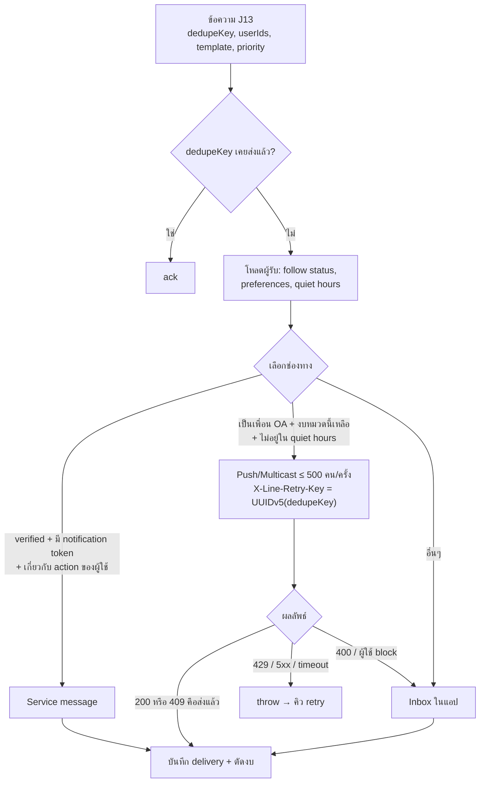

- `notify.deliveries.dedupe_key` เป็น unique เช่น `reminder-digest:{userId}:{2026-09-28}`, `lost-match:{identifyRequestId}:{ownerId}`
- `X-Line-Retry-Key` มีอายุ 24 ชม. ถ้าส่งซ้ำ LINE ตอบ 409 ซึ่งถือว่าสำเร็จ จึงไม่มีข้อความซ้ำแม้คิวส่งซ้ำ
- ปุ่มใน Flex ใช้ 2 แบบ
  - **postback**: webhook ตอบด้วย reply ซึ่งฟรี เช่น "ฉีดแล้ว ✓" → บันทึก → ตอบ "บันทึกแล้ว"
  - **deep link** เข้า MINI App (`https://miniapp.line.me/{liffId}/…`) สำหรับเรื่องที่ต้องใช้หน้าจอ

### 14.4 Reminder engine

| รายการ | สร้างจาก | เตือนเมื่อ |
|---|---|---|
| วัคซีน | `evt-health vaccine.*` (`next_due_on`) | D-7 และ D-1 (ใน digest) + วันจริงในปฏิทิน |
| ยาถ่ายพยาธิ / เห็บหมัด / หนอนหัวใจ | `evt-health treatment.changed` (รอบที่ผู้ใช้/หมอกำหนด) | D-1 |
| เช็กอินรายเดือน | วันที่เช็กอินล่าสุด + 30 วัน | D0 (อยู่ใน digest) |
| ติดตามผลหลังคัดกรอง | `triage.followups.due_at` — **ทุกระดับ**: ระดับ "ดูแลที่บ้าน/นัดตรวจ" ถามใน 24–48 ชม. ว่าอาการแย่ลงไหม, ระดับ ≥ "พบหมอภายใน 24 ชม." ถามใน 3 วัน | 10:00 หรือ 18:00 |
| คลินิกขอให้เตือน | J17 | ตามที่คลินิกกด (ต้องมี grant `due_list.read` และผู้ใช้ยินยอม) |

- `reminders-dispatch` (08:00) ดึงทุกรายการที่ `remind_at ≤ now()` และยังไม่ส่ง (**catch-up** ถ้ารอบก่อนพลาด) รวมเป็น **1 ข้อความต่อผู้ใช้** (ทุกน้อง) แล้วส่ง J13
- รายการที่ผู้ใช้กด "ทำแล้ว/เลื่อน" จะไม่ถูกเตือนซ้ำ ถ้ากด "ฉีดแล้ว" ระบบชวนสแกนหน้าใหม่ของสมุดเพื่อปิดวงจรข้อมูล

### 14.5 ปฏิทิน .ics

```
BEGIN:VCALENDAR
VERSION:2.0
PRODID:-//PetTech//Reminders//TH
CALSCALE:GREGORIAN
METHOD:PUBLISH
X-WR-CALNAME:น้องๆ ของฉัน – PetTech
X-WR-TIMEZONE:Asia/Bangkok
REFRESH-INTERVAL;VALUE=DURATION:PT6H
X-PUBLISHED-TTL:PT6H
BEGIN:VEVENT
UID:rem-0192a6f4-7b1e@pettech
DTSTAMP:20260928T021504Z
DTSTART;VALUE=DATE:20270312
DTEND;VALUE=DATE:20270313
SUMMARY:💉 ถั่วเหลือง: ครบกำหนดวัคซีนรวมแมว
DESCRIPTION:เปิดสมุดวัคซีน: https://miniapp.line.me/<liffId>/pets/…/vaccines
BEGIN:VALARM
ACTION:DISPLAY
DESCRIPTION:พรุ่งนี้ถึงกำหนดวัคซีนของถั่วเหลือง
TRIGGER:-PT15H
END:VALARM
END:VEVENT
END:VCALENDAR
```

- `TRIGGER:-PT15H` สำหรับ event ทั้งวันคือ 09:00 ของวันก่อนหน้า
- UID คงที่ต่อ reminder ทำให้แก้หรือเลื่อนแล้วปฏิทินอัปเดตตาม
- ใส่แค่ชื่อน้อง ไม่มีข้อมูลเจ้าของ
- feed token สุ่ม 128 บิต เก็บเป็น hash หมุน/ยกเลิกได้ และ response ตั้ง `Cache-Control: private, max-age=900`
- **ข้อจำกัดที่ต้องออกแบบรับ** (ควรทดสอบกับเครื่องจริง)
  - แอปปฏิทิน refresh ฟีดที่ subscribe ไว้ตามรอบของตัวเอง ซึ่งอาจนานหลายชั่วโมง
  - บางแอป/บางการตั้งค่าไม่แสดง alert จากปฏิทินที่ subscribe เช่น iOS มีตัวเลือกตัด alert ของ subscription และ Google Calendar ใช้การแจ้งเตือนเริ่มต้นของปฏิทินนั้นแทน `VALARM`
  - จึงมี 3 อย่างรองรับ
    1. หน้า "ทดสอบการแจ้งเตือน" หลัง subscribe
    2. ปุ่ม "เพิ่มนัดนี้ลงปฏิทิน" เป็นไฟล์ .ics เดี่ยว (import แล้ว alert ติดไปด้วย)
    3. digest ใน LINE เป็นทางสำรอง
- **ลิงก์ subscribe**
  - iOS: `webcal://api.<domain>/v1/calendar/feeds/{token}.ics`
  - Android: `https://calendar.google.com/calendar/r?cid=` + URL-encoded `webcal://…`
  - ทั้งสองแบบเปิดด้วย `liff.openWindow({ url, external: true })`

### 14.6 LINE webhook

1. `POST /v1/line/webhook` ตรวจ `x-line-signature` บน **raw body** (ห้าม parse/แก้ body ก่อนตรวจ)
2. ถ้าเป็น event ที่ต้องตอบด้วย reply ภายในเวลาสั้น (เช่น postback ที่ตอบสั้นๆ) ให้ตอบทันทีใน handler (fast path)
3. ส่งทุก event เข้า `job-line-webhook` (idempotency key = `webhookEventId` ของ LINE) แล้วตอบ 200 ทันที
4. worker จัดการ
   - `follow`: `followed=true` + reply ต้อนรับ (ฟรี)
   - `unfollow`: `followed=false`
   - `postback`: action
   - `message`: ตอบเมนูด้วย reply

### 14.7 Rich menu และ Flex templates

- **Rich menu** (6 ช่อง): เช็กอาการ · สมุดวัคซีน · รพ. 24 ชม. · สรุปก่อนพบหมอ · น้องหาย · เปิดแอป ทุกช่องเป็น deep link เข้า MINI App
- **Flex templates** (อยู่ใน `packages/line/templates`)

| Template | Priority | ช่องทาง |
|---|---|---|
| `reminder_digest` | ปกติ | push (หรือ service message เมื่อ verified) |
| `monthly_summary` | ต่ำ | push |
| `followup_3d` | ปกติ | push + ปุ่ม postback/quick reply (คำตอบใช้ reply ฟรี) |
| `lost_match_found` | ด่วน | push ทันที (ไม่สน quiet hours) |
| `lost_area_alert` | ปกติ | multicast (ตามงบพื้นที่) |
| `relay_new_message` | ปกติ | push (รวมถ้ามีหลายข้อความใน 10 นาที) |
| `clinic_access_request` | ด่วน | push |
| `appointment_request_to_clinic` | ด่วน | push ถึงพนักงานคลินิก (+อีเมล) |
| `job_done` (สแกนเสร็จ/ผลพร้อม) | ต่ำ | inbox เป็นหลัก ส่ง push เฉพาะงานที่เกิน 30 วิ และผู้ใช้ออกจากแอปแล้ว |

### 14.8 แผนสถานะ MINI App

| ช่วง | สถานะ | ได้อะไร/ขาดอะไร |
|---|---|---|
| สัปดาห์ 1–16 (บุคคลธรรมดา) | **Unverified** (ตั้งแต่ 11 มี.ค. 2569 สร้าง channel สำหรับไทยและเผยแพร่แบบ unverified ได้) | ใช้ LIFF API ได้ครบ, share target picker, permanent link, add friend option, กล้อง/ตำแหน่ง · **ไม่มี** service messages, การค้นหาใน LINE, shortcut หน้าจอ, custom path และ header แสดงโดเมนแทนชื่อแอป |
| หลังจดบริษัท | Certified provider (ยื่น DBD + บัตรผู้มีอำนาจ, 5–7 วันทำการ) → Verified (รีวิว 5–7 วันทำการตามหน้าไทย / 1–2 สัปดาห์ตามเอกสาร global) | ได้ service messages (ลดการใช้โควตา push), ค้นหาใน LINE, shortcut, custom path |

> การแก้ชื่อ ไอคอน scopes endpoint URL หรือ template หลัง verified ต้องรีวิวใหม่ จึงควรนิ่งเรื่องเหล่านี้ก่อนยื่น

---

## 15. Security & Privacy (PDPA)

### 15.1 การจัดชั้นข้อมูล

| ชั้น | ตัวอย่าง | การป้องกันขั้นต่ำ |
|---|---|---|
| **C1 สาธารณะ** | รายชื่อคลินิก, โปสเตอร์ที่เจ้าของเผยแพร่, การ์ดแชร์ | CDN cache ได้, ลบได้เมื่อเจ้าของปิด |
| **C2 ภายใน** | KPI รวม, ต้นทุน AI, log ที่ไม่มี PII | เฉพาะทีมงาน |
| **C3 ข้อมูลส่วนบุคคล** | LINE userId, ชื่อที่แสดง, เขตที่อยู่, ข้อมูลน้องที่ผูกกับเจ้าของ, รูป, ผลคัดกรอง, ข้อความ relay | RLS, signed URL, audit, ลบได้ตามคำขอ, ไม่ส่งให้ LLM ถ้าไม่จำเป็น |
| **C4 อ่อนไหวสูง** | ตำแหน่ง (เก็บแค่แบบหยาบ), เบอร์โทร (ถ้าเจ้าของเลือกแสดง), ใบอนุญาตสัตวแพทย์, คนที่ติดมาในรูป | เข้ารหัสระดับฟิลด์ (เบอร์โทร) ด้วย key ใน env, ไม่ log, เปิดเผยตามความยินยอมเท่านั้น |

> ข้อมูลอัตลักษณ์ของ "สัตว์" ไม่ใช่ข้อมูลชีวภาพ (biometric) ของบุคคลตามมาตรา 26 ของ PDPA แต่ผูกกับเจ้าของ จึงถือเป็นข้อมูลส่วนบุคคล (C3) และรูปอาจติดใบหน้า/มือ/บ้านของคนด้วย จึงจัดการด้วยความระมัดระวังระดับเดียวกัน (ควรให้ที่ปรึกษากฎหมายยืนยัน)

### 15.2 Threat model (สรุป)

| ภัย | ตัวอย่าง | การป้องกัน |
|---|---|---|
| ปลอมตัวผู้ใช้ | ส่ง LINE userId ปลอมมาเอง | รับเฉพาะ ID/access token ที่ verify ที่ server (`aud` = channel ID) และไม่เชื่อ profile ที่ client ส่งมา |
| IDOR | เปลี่ยน `petId` ใน URL เพื่อดูน้องของคนอื่น | `requirePetAccess` ทุก use case + RLS + test อัตโนมัติ |
| เดา token ลิงก์ | ไล่เดาลิงก์สรุป/ฟีดปฏิทิน | token สุ่ม 128 บิต เก็บเป็น hash, หมดอายุ, rate limit, `noindex`, เพิกถอนได้ |
| รั่วผ่าน Referer/log | token ติดไปกับ Referer หรือ log | `Referrer-Policy: no-referrer` บนหน้า token, redact path ก่อน log |
| ไฟล์อันตราย | SVG มีสคริปต์, decompression bomb, ไฟล์ปลอมนามสกุล | allowlist ชนิด, ตรวจ magic bytes ด้วย sharp, จำกัดพิกเซล, ไม่รับ SVG, เสิร์ฟจาก Blob domain แยก |
| Prompt injection | รูปสมุดวัคซีนมีข้อความ "ignore instructions…" หรือผู้ใช้พิมพ์สั่งให้บอกขนาดยา | Structured Outputs (ตอบได้แค่ schema), ไม่ให้ LLM ใช้ tools/เปิดเว็บ, ถือ output เป็นข้อมูลไม่น่าเชื่อ, safety filter, กฎหมอเป็นตัวตัดสิน |
| ใช้ AI จนเปลืองเงิน | สคริปต์ยิง identify/triage | ต้องล็อกอิน, โควตาต่อผู้ใช้, Firewall/BotID, งบรายวัน + kill switch |
| สะกดรอยผ่านระบบน้องหาย | ถ่ายแมวหน้าบ้านคนอื่นเพื่อหาเจ้าของ | ค้นหาได้เฉพาะน้องที่ประกาศหาย (ค่าเริ่มต้น), relay แทนเปิดเบอร์, ตำแหน่งหยาบ, log ผู้ค้นหา (ข้อ 9.7.9) |
| มิจฉาชีพน้องหาย | "เจอน้องแล้ว โอนค่าเดินทางมาก่อน" | relay chat ตรวจจับเลขบัญชี/พร้อมเพย์/ลิงก์ แล้วขึ้นคำเตือน, ปุ่มรายงาน, บล็อกผู้ส่ง |
| ปลอมเป็นคลินิก | สมัครเป็นคลินิกเพื่อดูข้อมูลน้อง | คลินิกต้องได้รับการยืนยันจากทีมก่อนเปิด Clinic Lite, ทุกการเข้าถึงต้องมี grant จากเจ้าของ |
| Webhook ปลอม | ยิง LINE webhook ปลอม | ตรวจ HMAC บน raw body, ตอบ 401 ถ้าไม่ผ่าน |
| Secret รั่ว | key หลุดใน repo/log | Vercel sensitive env vars, secret scanning ใน CI, หมุน key ตามรอบ, key ของ AI Gateway แยก dev/prod พร้อม budget (และ OpenAI project key เมื่อใช้ BYOK) |
| Supply chain | package ถูกแทรกโค้ด | lockfile, Renovate/Dependabot, `pnpm audit`, CodeQL, pin GitHub Actions ด้วย SHA |
| คนในทีม/แอดมินใช้สิทธิ์เกิน | ดูข้อมูลผู้ใช้โดยไม่มีเหตุ | mask PII ใน admin, ต้องใส่เหตุผลทุกครั้ง, audit log แก้ไม่ได้ (append-only) |

### 15.3 PDPA — กิจกรรมการประมวลผลและฐานทางกฎหมาย (ร่าง)

| กิจกรรม | ข้อมูล | ฐานทางกฎหมาย | หมายเหตุ |
|---|---|---|---|
| ให้บริการหลัก (โปรไฟล์ สมุดสุขภาพ เตือน คัดกรอง) | C3 | สัญญา (การให้บริการ) | consent `service` เป็นการยอมรับเงื่อนไข |
| ประมวลผลรูป/ข้อความด้วย AI เพื่อให้บริการ | C3 | สัญญา + แจ้งการส่งข้อมูลไปต่างประเทศ | ระบุผู้ให้บริการและประเทศในประกาศ |
| ใช้รูป/ข้อมูลพัฒนา AI (ชุดทดสอบ, ฝึก PetID v1) | C3 | **ความยินยอม `ai_improvement`** แยกต่างหาก ไม่ติ๊กไว้ก่อน | ถอนได้และมีผลทันทีกับการใช้ในอนาคต |
| แชร์ข้อมูลให้คลินิก | C3 | **ความยินยอมต่อครั้ง/ต่อคลินิก** (grant) | เพิกถอนได้ และบันทึกทุกการเข้าถึง |
| แจ้งเตือนน้องหายในพื้นที่ | C4 (ตำแหน่งหยาบ) | **ความยินยอม `location_alerts`** | ไม่เก็บพิกัดละเอียด |
| รายงานพบเห็นจากผู้ไม่ล็อกอิน (รูป + พื้นที่หยาบ) | C3 (อาจติดบุคคลที่สาม) | ประโยชน์โดยชอบด้วยกฎหมาย (ช่วยหาสัตว์) + แจ้งบนฟอร์มว่ารูปถูกประมวลผลด้วย AI นอกประเทศไทย | เก็บ 30 วันถ้าไม่ match |
| Relay chat ผู้พบ ↔ เจ้าของ | C3/C4 | ประโยชน์โดยชอบด้วยกฎหมาย (ช่วยหาสัตว์) + ความยินยอมเมื่อจะเปิดเบอร์ | เก็บ 90 วันหลังปิดประกาศ |
| ความปลอดภัยระบบ, กันการใช้ผิดทาง | log, IP hash | ประโยชน์โดยชอบด้วยกฎหมาย | เก็บเท่าที่จำเป็น |
| การตลาด | C3 | **ความยินยอม `marketing`** | แยกจากการแจ้งเตือนสุขภาพ |

**สิทธิ์ของเจ้าของข้อมูล**
- ขอสำเนา/โอนย้าย (export JSON + รูปเป็น zip)
- ขอลบ
- ขอแก้ไข (แก้ได้เองในแอป)
- ถอนความยินยอม
- คัดค้าน

ระบบทำเสร็จอัตโนมัติภายใน 24 ชม. ผ่าน saga (ข้อ 8.9) ซึ่งเร็วกว่ากรอบเวลาตามกฎหมาย และบอกผู้ใช้ตรงๆ ว่า backup ของ Supabase (7 วัน) และ dump ใน Blob (≤ 35 วัน) จะหมุนหายไปเองตามรอบ

**การส่ง/โอนข้อมูลไปต่างประเทศ** (ต้องระบุในประกาศความเป็นส่วนตัว)

| ผู้ประมวลผล | ข้อมูล | ที่ตั้งการประมวลผล/จัดเก็บ |
|---|---|---|
| Vercel (Functions, Blob, Queues, Firewall, Observability) | ทุกอย่างที่ผ่านระบบ | function/Blob/Queues ที่สิงคโปร์ (`sin1`) และ edge network ทั่วโลก |
| Supabase | ฐานข้อมูล | สิงคโปร์ (`ap-southeast-1`) |
| Upstash | cache/counter (ไม่มีเนื้อหาสุขภาพ) | สิงคโปร์ |
| OpenAI (ผ่าน Vercel AI Gateway) | ข้อความคัดกรอง (ไม่มีชื่อ/เบอร์เจ้าของ), รูปที่ตัด EXIF แล้ว | ประมวลผลนอกภูมิภาค (AI Gateway รองรับ regional inference แค่ `us`/`eu`) · API ไม่นำข้อมูลไปฝึกโดยค่าเริ่มต้น · OpenAI เก็บ log ตรวจการใช้ผิดทางได้ถึง 30 วัน (ขอ Zero Data Retention ได้เมื่อได้รับอนุมัติ) |
| LINE (LY Corporation) | userId, ข้อความที่ส่ง | ตามนโยบายของ LINE |
| ผู้ให้บริการสำรองของ AI Gateway (ถ้าเปิด fallback เช่น Azure/Bedrock) | เหมือน OpenAI | ต้องระบุเพิ่ม ถ้าต้องการให้ประกาศเรียบง่าย ให้จำกัดเฉพาะ provider `openai` |

**เมื่อข้อมูลรั่ว** — ตาม runbook `data-breach.md`
1. ปิดช่องโหว่
2. ประเมินความเสี่ยง
3. แจ้งสำนักงานคณะกรรมการคุ้มครองข้อมูลส่วนบุคคลภายใน 72 ชั่วโมง (เมื่อมีความเสี่ยงต่อสิทธิของบุคคล)
4. แจ้งเจ้าของข้อมูลถ้าเสี่ยงสูง
5. บันทึกเหตุการณ์

### 15.4 Security controls checklist

- [ ] HTTPS ทุกที่ + HSTS (`max-age=63072000; includeSubDomains; preload`)
- [ ] Security headers จาก service-kit/Next.js: `Content-Security-Policy` (อนุญาต `static.line-scdn.net` สำหรับ LIFF SDK), `X-Content-Type-Options: nosniff`, `Referrer-Policy`, `Permissions-Policy` (เปิด camera/geolocation เฉพาะหน้าที่ใช้)
- [ ] zod validate ทุก input, จำกัดความยาวข้อความอิสระ, ตัดอักขระควบคุม
- [ ] ห้าม server fetch URL ที่ผู้ใช้ส่งมา (กัน SSRF) รูปทุกรูปต้องมาจาก Blob ของเราเท่านั้น
- [ ] DB role แยกต่อ service + RLS ทุกตารางที่มีข้อมูลผู้ใช้ + pgTAP tests
- [ ] `statement_timeout` (API 5 วิ, worker 30 วิ)
- [ ] เข้ารหัสฟิลด์อ่อนไหว (เบอร์โทร) ด้วย AES-GCM ผ่าน key ใน env (envelope ด้วย key version)
- [ ] Audit log (append-only) สำหรับ: การเข้าถึงของคลินิก, action ของแอดมิน, การอนุมัติ rule set, DSR
- [ ] Secret scanning + CodeQL + dependency review ใน CI
- [ ] Backup เข้ารหัส (age) ก่อนเก็บ Blob
- [ ] Pen test แบบเบา (OWASP ZAP baseline) ก่อนเปิดสาธารณะ และทุกครั้งที่เพิ่ม endpoint สาธารณะ
- [ ] นโยบายเปิดเผยช่องโหว่ (`/.well-known/security.txt`)

---

## 16. Observability & Operations

### 16.1 Logging

- ใช้ **pino** แบบ JSON บรรทัดเดียว ฟิลด์มาตรฐานคือ `ts`, `level`, `service`, `vercelService`, `env`, `deploymentId`, `region`, `requestId`, `traceId`, `userIdHash`, `petId`, `route`, `status`, `durationMs`, `topic`, `deliveryCount`, `queueLagMs`, `aiFeature`, `aiCostUsd`, `errorCode`
- **redact** อัตโนมัติ: `authorization`, `cookie`, token ใน path, ข้อความอิสระของผู้ใช้, เบอร์โทร, LINE userId (ใช้ hash)
- **Retention บน Vercel**
  - Pro แบบพื้นฐานเก็บ log แค่ 1 วัน
  - **Observability Plus** เก็บ 30 วัน ราคา $1.20 ต่อ 1 ล้าน events (เปิดเป็นค่าเริ่มต้นสำหรับทีมที่เป็น Paid Pro ตั้งแต่ 3 เม.ย. 2569) แนะนำให้เปิด
  - ถ้าต้องเก็บนานกว่านั้น ใช้ **Log Drains** ($0.50/GB) ไปยังที่เก็บภายนอก
- **ข้อมูลที่ต้อง audit ได้นานเป็นปี** (AI, การเข้าถึงของคลินิก, DSR) เก็บในตาราง Postgres ไม่พึ่ง log

### 16.2 Tracing และ correlation

- `@vercel/otel` ในทุก service
- `X-Request-Id` → `requestId` ใน log → `correlationId` ใน envelope ของคิว → `ai_ops.requests.correlation_id` ทำให้ไล่ย้อนได้ว่า "ผู้ใช้กด A แล้วเกิดอะไรขึ้นบ้างในทุก service"
- ใส่ `traceparent` ใน envelope เพื่อต่อ trace ข้ามคิว

### 16.3 Dashboards

| Dashboard | แหล่ง | ดูอะไร |
|---|---|---|
| Vercel Observability | Vercel | error rate, duration, invocations ต่อ service/route, cold start |
| Queue health | log (`queueLagMs`, `deliveryCount`) + `ops.dead_letters` + outbox ค้าง | lag, retry, DLQ |
| AI Ops | `ai_ops.requests` (หน้า admin) + AI Gateway | ต้นทุน/วัน/ฟีเจอร์, p95 latency, error/refusal, `model_resolved`, `invalid_output` rate |
| Safety | `triage.*` | สัดส่วนแต่ละระดับ, degraded rate, safety filter hits, ผล eval ล่าสุด, ความตรงกับหมอ |
| KPI Scorecard | analytics | 7 ตัวชี้วัดของ pilot (ข้อ 20) |
| LINE quota | `notify.quota_ledger` | ใช้/เหลือ/คาดการณ์สิ้นเดือน |
| Database | Supabase reports | CPU, RAM, connections, slow queries, ขนาด index ของ pgvector |

### 16.4 Alerts

ช่องทาง: อีเมล + webhook ไป Slack/Discord ส่วนเหตุ P1 ส่ง push LINE ถึงผู้ดูแลเอง (ใช้โควตา 1 ข้อความ)

| Alert | เงื่อนไข | ระดับ |
|---|---|---|
| API error rate | 5xx > 2% ใน 10 นาที | P1 |
| หน้าฉุกเฉิน/รายชื่อ รพ. 24 ชม. ผิดปกติ | synthetic check ล้มเหลว 2 ครั้งติด | P1 |
| AI degraded | triage แบบ degraded > 20% ใน 30 นาที | P1 |
| Queue lag | p95 > 30 วิ (interactive topics) นาน 10 นาที | P2 |
| Dead letter | มีแถวใหม่ | P2 |
| Outbox ค้าง | > 10 นาที | P2 |
| งบ AI | ถึง 80% / 100% ของงบรายวัน | P2 / P1 |
| โควตา LINE | ถึง 80% ของเดือน | P2 |
| DB | connections > 80% หรือ CPU > 80% นาน 15 นาที | P2 |
| Eval canary | ผลแย่กว่า baseline หรือมี under-triage | P1 (หยุด rollout และตรวจทันที) |
| Security | 401/403 พุ่ง, BotID block พุ่ง, identify ถี่ผิดปกติ | P2 |

### 16.5 SLOs

| SLO | เป้า (30 วัน) |
|---|---|
| API availability (ไม่นับ 4xx) | 99.5% |
| API latency p95 (อ่าน / เขียน) | < 300 / 600 ms |
| Triage จบภายใน 20 วิ (รวม degraded ตามเส้นตาย) | 99% |
| OCR จบภายใน 25 วิ | 95% |
| Reminder digest ส่งภายใน 09:00 | 99% ของวัน |

### 16.6 Runbooks (`docs/runbooks/`)

`ai-outage.md` · `ai-behavior-change.md` (OpenAI ปรับโมเดล → รัน eval → rollback prompt/สลับโมเดล) · `line-quota-exhausted.md` · `queue-backlog.md` · `dead-letter-triage.md` · `db-connection-saturation.md` · `bad-deploy-rollback.md` (Vercel Instant Rollback ย้อนทั้ง backend พร้อมกัน) · `data-breach.md` · `abuse-spike.md` · `key-rotation.md` · `restore-from-backup.md`

### 16.7 งานประจำของผู้ดูแล (≤ 2 ชม./สัปดาห์)

- **รายสัปดาห์**: ดู DLQ, ต้นทุน AI, ผล eval canary, เคสที่ safety filter จับได้, feedback จาก OpenChat
- **รายเดือน**: อัปเดต dependencies, ตรวจ LINE quota และแผน, ตรวจรายชื่อคลินิก/รพ. 24 ชม. (โทรยืนยันเวลาทำการ)
- **รายไตรมาส**: ทดสอบ restore backup ไป staging, หมุน keys, ทบทวนสิทธิ์แอดมิน, ทบทวน retention

---

## 17. Environments, CI/CD และ Testing

### 17.1 สภาพแวดล้อม

| Env | Frontend | Backend | Database | LINE | ใช้ทำอะไร |
|---|---|---|---|---|---|
| **Local** | `next dev` | `vercel dev` ที่ `backend/` (ใช้ Queues จริงผ่าน OIDC ของ dev) หรือ `QUEUE_DRIVER=inline` | Supabase CLI (Docker) + `seed.sql` | OA/MINI App ของ dev (endpoint ชี้ URL tunnel) | พัฒนา |
| **Preview** (ต่อ PR) | preview ของแต่ละ frontend (Related Projects ชี้ backend preview ของ branch เดียวกัน) | preview deployment ของ `pettech-backend` | Supabase project `pettech-staging` (หรือ Branching ถ้าต้องแยกต่อ PR) | MINI App channel ของ dev ช่อง "Developing" | รีวิว, E2E, eval gate |
| **Production** | `app.` / `clinic.` / `admin.<domain>` | `api.<domain>` | Supabase `pettech-prod` (Pro, สิงคโปร์) | OA + MINI App จริง | ผู้ใช้จริง |

- **แยก LINE OA/MINI App ของ dev ออกจากของจริงเสมอ** เพื่อไม่ให้ข้อความทดสอบหลุดถึงผู้ใช้
- **preview อยู่หลัง Deployment Protection**: ตั้ง Protection Bypass for Automation (`x-vercel-protection-bypass`) ให้ CI, eval gate และ Playwright ส่วน MINI App ของ dev ให้ใส่ `x-vercel-protection-bypass` + `x-vercel-set-bypass-cookie=true` ใน endpoint URL หรือปิด protection เฉพาะ project ที่ใช้ทดสอบ
- ส่วน provider ของ dev แยกจาก prod ได้ (userId จะต่างกันซึ่งเป็นเรื่องดี)
- `pettech-staging` บนแผน Free จะถูกพักถ้าไม่มีการใช้งาน 1 สัปดาห์ ถ้า PR ห่างกันนานให้ใช้ Pro project ที่สอง ($10/เดือน) หรือ seed ใหม่อัตโนมัติ
- Supabase Branching คิด $0.01344 ต่อ branch-hour เหมาะเมื่อ migration ซับซ้อนจนต้องแยก DB ต่อ PR

### 17.2 Pipeline (GitHub Actions + Vercel Git integration)

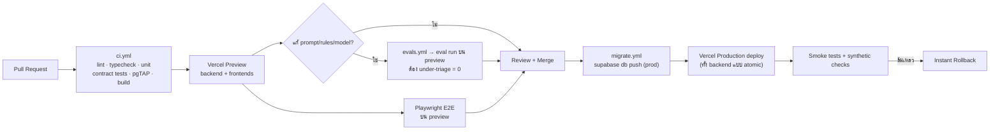

- **Migration ก่อนโค้ด** โดยทุก migration เป็นแบบ expand/contract จึงเข้ากับโค้ดทั้งเวอร์ชันเก่าและใหม่
  - Git integration ของ Vercel deploy ขนานกับ `migrate.yml` จึงต้องปิดการผูก production domain อัตโนมัติของ `pettech-backend` แล้วให้ workflow สั่ง promote หลัง `migrate.yml` สำเร็จ ลำดับจึงจะเป็นตามแผนภาพจริง
- ถ้าต้องลบคอลัมน์ ให้ทำใน PR ถัดไปหลังโค้ดเลิกใช้แล้ว
- **Build ของ backend**: Turborepo + remote cache (ฟรีบน Vercel) และ bundle แต่ละ service ด้วย esbuild ผ่าน build ของ Vercel ⚠️ ต้องวัดเวลา build ของ 23 services ใน spike (ข้อ 5.8)
- **Feature flags** (Vercel Flags) ใช้เปิดฟีเจอร์ใหม่ทีละกลุ่ม เช่น PetID beta ให้ 10% หรือเฉพาะกลุ่ม OpenChat และใช้เป็น kill switch เมื่อเกิดปัญหา

### 17.3 กลยุทธ์การทดสอบ

| ชั้น | เครื่องมือ | ครอบคลุม | เป้า |
|---|---|---|---|
| Unit | Vitest | `domain/` ทุก service, rules engine, canonicalization ของ PetID, คำนวณวันครบกำหนด, แปลง พ.ศ./ค.ศ. | rules engine และ domain ครอบ 100% ของ branch |
| Integration | Vitest + Supabase local | use cases + DB + RLS + outbox | ทุก use case หลัก |
| DB security | pgTAP | policy ทุกตาราง (ข้ามผู้ใช้/หมดอายุ grant) | ทุกตารางที่มี RLS |
| Contract | zod schema ร่วม + OpenAPI diff | API ไม่ breaking, event payload ตรง schema | ทุก PR |
| Queue | `QUEUE_DRIVER=inline` | idempotency (ส่งซ้ำ 2 ครั้ง), ไม่เรียงลำดับ, final failure → DLQ | ทุก consumer |
| E2E | Playwright (mock LIFF) | onboarding, สแกนวัคซีน, triage (รวมเส้นฉุกเฉิน), สรุปก่อนพบหมอ, น้องหาย, Clinic Lite | flow หลักทั้งหมด |
| AI evals | `evals/` + eval API | triage, photo, OCR, PetID | gate ตามข้อ 9.8 |
| Load | k6 | 50 rps API + 100 AI jobs พร้อมกัน (mock AI) | ก่อนเปิดวงกว้าง |
| Security | ZAP baseline, CodeQL, secret scan | endpoint สาธารณะ | ก่อนเปิดวงกว้างและทุกไตรมาส |
| Chaos | ปิด AI/LINE/Redis จำลอง | ทุก flow จบที่สถานะที่เข้าใจได้ | ก่อนเปิดวงกว้าง |

---

## 18. Reliability, Scalability และ Performance

### 18.1 เมื่อบางส่วนของระบบล่ม (graceful degradation)

| สิ่งที่ล่ม | ผู้ใช้ยังทำอะไรได้ | ระบบทำอะไร |
|---|---|---|
| OpenAI / AI Gateway | เช็กอาการได้ (ผลจากกฎ + ข้อความแม่แบบของหมอ), หน้าฉุกเฉินปกติ, กรอกวัคซีนเอง, สร้างสรุปได้ | งาน OCR/PetID รอในคิวแล้ว retry, triage ปิดแบบ degraded หลังครบ retry |
| LINE Messaging API | ใช้แอปได้ปกติ, เห็นเตือนใน inbox/ปฏิทิน | `job-notify-send` retry ด้วย retry key แล้วลง inbox |
| Redis | ใช้งานได้ (limit เป็น fail-open) | งาน AI เบื้องหลังหยุดชั่วคราว (fail-closed ตามงบ) |
| Vercel Queues | CRUD ได้ปกติ, งาน AI แสดง "กำลังประมวลผล" | outbox เก็บ event ไว้ แล้ว sweep ส่งเมื่อคิวกลับมา (ไม่มีอะไรหาย) |
| Supabase | หน้าฉุกเฉิน + รายชื่อ รพ. 24 ชม. จาก cache ของ CDN/อุปกรณ์ | API ตอบ 503 พร้อมข้อความที่เข้าใจได้ |
| Blob | ดูข้อมูลได้ (ไม่มีรูป), อัปโหลดไม่ได้ | แสดงข้อความ "ลองอีกครั้ง" |
| deploy ใหม่มีบั๊ก | — | Instant Rollback ทั้ง backend (atomic) |

### 18.2 Timeout และ retry ต่อ dependency

| Dependency | Timeout | Retry ใน request | Retry ในคิว |
|---|---|---|---|
| OpenAI ผ่าน AI Gateway (chat) | 45–60 วิ ตามฟีเจอร์ | 0 | ตาม topic (ข้อ 8.3) |
| AI Gateway (embeddings) | 15 วิ | 1 | ✓ |
| LINE API | 10 วิ | 0 | ✓ (retry key) |
| Postgres | statement 5 วิ (API) / 30 วิ (worker), connect 3 วิ | 1 (เฉพาะ serialization/connect error) | ✓ |
| Blob | 30 วิ | 1 | ✓ |
| Internal HTTP (Bindings) | 5 วิ | 1 (GET เท่านั้น) | ✓ |
| Redis | 500 ms | 0 | — (ใช้นโยบาย fail-open/closed) |

### 18.3 Connection budget ของ Postgres

- ใช้ Supavisor **transaction mode (6543)** กับ `pg` Pool แบบ `max: 3`, `idleTimeoutMillis: 5000` และ `attachDatabasePool(pool)` ต่อ instance
- ไม่ใช้ `postgres.js` กับ transaction mode เพราะ Supabase เตือนว่า pipelining ทำให้ query ค้างหรือได้แถวผิด
- **ประมาณการ**: 23 services × instance ที่ทำงานพร้อมกัน (pilot ~1–2) × 3 ≈ 70–140 connections เทียบกับเพดาน pooler client ของ Micro ที่ 200 → **ขยายเป็น Small (400) เมื่อเริ่มแตะ 70%**
- ถ้าต้องการเพิ่มโดยไม่ขยาย compute ให้ลด `max` ของ worker ที่งานน้อยเป็น 1

### 18.4 เส้นทางการขยายระบบ

| เมื่อถึง | ทำอะไร |
|---|---|
| ~1,000 ผู้ใช้ | ตั้งดัชนีจาก slow query log, เปิด Observability Plus เต็ม, LINE Basic |
| ~5,000 ผู้ใช้ / vectors ~50K | Supabase Small compute, ทบทวนน้ำหนัก facet ของ PetID, LINE Basic (ขึ้น Pro เมื่อเกิน ~20K ข้อความ/เดือน) |
| ~20,000 ผู้ใช้ | partition `analytics.events`/`ai_ops.requests` รายเดือน + archive, read replica สำหรับ analytics, PITR |
| ~100,000 ผู้ใช้ | แยก analytics ไป warehouse (ผ่าน Drains/ETL), พิจารณาแยก DB ของ biometric (pgvector โหลดหนัก), PetID v1 (image embedding จริง), แยก project ของ identity (secret isolation) |

### 18.5 Backup และ Disaster Recovery

| ข้อมูล | กลไก | RPO | RTO |
|---|---|---|---|
| Postgres (Pro) | daily backup เก็บ 7 วัน (มีใน Pro) | 24 ชม. | ~2–4 ชม. |
| Postgres (เมื่อพร้อมจ่าย) | PITR add-on ($100/เดือนต่อ 7 วัน ต้องใช้ compute ≥ Small) | ~2 นาที | ~1–2 ชม. |
| Postgres (สำรองนอก Supabase) | GitHub Actions `pg_dump` รายสัปดาห์ → เข้ารหัสด้วย `age` → Blob private · เก็บ 5 ชุดล่าสุด (≈ 35 วัน) แล้วลบอัตโนมัติ | 7 วัน | ~4 ชม. |
| Blob | durability ของ Blob + path แบบ immutable (ไม่เขียนทับ) | — | — |
| Config/Flags | Global Config มี backup 90 วัน, flags ถูก embed ตอน build | — | นาที |
| โค้ด/infra | Git + `vercel.json` + migrations (สร้างใหม่ได้ทั้งหมด) | 0 | ~1 ชม. |

- ทุกไตรมาสให้ซ้อมกู้คืนไป `pettech-staging` แล้วรัน smoke test และบันทึกเวลาที่ใช้จริง

### 18.6 Performance budget และเทคนิค

- **owner-app**
  - แยก chunk ต่อ route
  - LIFF SDK โหลดเฉพาะ `(liff)`
  - subset ฟอนต์ไทย
  - prefetch ข้อมูลหน้าแรกด้วย TanStack Query จาก cache เดิม (stale-while-revalidate)
  - ย่อรูปก่อนอัปโหลด
  - แคชหน้าฉุกเฉินและรายชื่อ รพ. ใน `localStorage`
- **API**
  - ทุก function อยู่ `sin1` ติด DB
  - JWKS cache ในหน่วยความจำ
  - query ใช้ index (pet_id + เวลา)
  - response เล็กและไม่ N+1 (Drizzle relational query)
- **Public pages**: SSR + `s-maxage` เฉพาะหน้าที่ไม่อ่อนไหว (landing, `/lost/[slug]` ขณะ active) ส่วน `/s/[token]` ห้าม cache
- **PetID**
  - partial HNSW index ต่อ (species, facet)
  - เปิด `hnsw.iterative_scan = relaxed_order` เมื่อมีเงื่อนไขกรองเพิ่ม
  - เทียบภาพ top-3 แบบขนาน
  - ย่อรูปอ้างอิงเป็น 768 px

---

## 19. ประมาณการต้นทุน

> ราคา ณ 28 ก.ย. 2569 (region `sin1` ของ Vercel สูงกว่า `iad1` ราว 25%) · 1 USD ≈ 34 บาท · ตัวเลขการใช้งานเป็นสมมติฐานสำหรับวางแผน ต้องเทียบกับ usage จริงทุกเดือน

### 19.1 ราคาต่อหน่วยที่ใช้คำนวณ

| บริการ | ราคา |
|---|---|
| `gpt-6-luna` (ตรงหรือผ่าน AI Gateway ซึ่งไม่บวกเพิ่ม) | input $0.10 / 1M tokens · cached input $0.01 · output (รวม reasoning) $0.50 / 1M · Batch/Flex ลด 50% |
| `text-embedding-3-small` | $0.02 / 1M tokens |
| Vercel Pro | $20/ที่นั่ง/เดือน (รวมเครดิต usage $20) |
| Functions (`sin1`) | Active CPU $0.160/ชม. · Provisioned memory $0.0133/GB-ชม. · Invocations $0.60/1M |
| Queues (`sin1`) | $0.8544 / 1M operations (คิดทุก 4 KiB; ส่งแบบมี idempotency key นับ 2 เท่า) |
| Blob (`sin1`) | Storage $0.025/GB-เดือน · Simple ops $0.40/1M · Advanced ops $5/1M · Blob transfer $0.053/GB |
| Firewall rate limiting (`sin1`) | $0.65 / 1M requests ที่ผ่าน rule (custom rules ฟรี, BotID Basic ฟรี) |
| Observability Plus | $1.20 / 1M events |
| Web Analytics | $0.03 / 1K events |
| Vercel Flags / Global Config | $0.03 / 1K flag requests · $3 / 1M reads |
| Service Requests (Bindings) | $0.65 / 1M + Fast Origin Transfer $0.27/GB |
| Supabase | Free $0 (หยุดเมื่อไม่มีการใช้งาน 7 วัน, ไม่มี backup) · Pro $25 (รวมเครดิต compute $10 = Micro) · compute Small ~$15 · PITR $100 ต่อ 7 วัน |
| Upstash Redis | Free 500K commands/เดือน · PAYG $0.20/100K · Fixed เริ่ม $10/เดือน |
| LINE OA (ไทย, ไม่รวม VAT 7%) | Free 0 บาท/300 ข้อความ · Basic 1,280 บาท/15,000 · Pro 1,780 บาท/35,000 |

### 19.2 ต้นทุน AI ต่อครั้ง (ประมาณ)

สมมติว่ารูป 1 รูปขนาดราว 1024 px ≈ 1,230 tokens ⚠️ อ้างอิงกติกาที่ OpenAI ประกาศสำหรับโมเดลใกล้เคียงกัน เพราะยังไม่มีตารางของ `gpt-6-luna` โดยตรง และรวม reasoning tokens ตามระดับการคิดที่ตั้งไว้ในข้อ 9.2

| งาน | Input tokens | Output tokens (รวม reasoning) | USD/ครั้ง | บาท/ครั้ง |
|---|---:|---:|---:|---:|
| เช็กอาการ (0–1 รูป) | ~3,600 | ~3,900 | 0.0023 | 0.08 |
| ส่องสุขภาพจากรูป (1–2 รูป) | ~3,500 | ~2,100 | 0.0014 | 0.05 |
| อ่านสมุดวัคซีน (3 หน้า) | ~5,200 | ~2,000 | 0.0015 | 0.05 |
| อ่านเลขชิป (เมื่อถอดบาร์โค้ดไม่ได้) | ~2,700 | ~600 | 0.0006 | 0.02 |
| PetID ลงทะเบียน 1 รูป (signature + embedding 4 facet) | ~2,700 + 400 | ~1,800 | 0.0012 | 0.04 |
| PetID ค้นหา 1:N (signature + เทียบภาพ 3 คู่) | ~19,800 | ~12,600 | 0.0083 | 0.28 |
| Eval triage 100 เคส | ~360K | ~390K | 0.23 | 7.8 |

> **ข้อสังเกต**: ต้นทุน AI ต่ำกว่าแผนเดิมมาก (แผนเดิม $8–16 ต่อ 1,000 ครั้ง ตอนนี้ ~$2.3 ต่อ 1,000 ครั้งสำหรับ triage) ช่วง pilot **ค่า eval จะมากกว่าค่าที่ผู้ใช้ใช้จริง** ซึ่งเป็นการลงทุนที่คุ้มเพราะเป็นตัวกันความเสี่ยงหลัก ถ้าต้องประหยัดให้ใช้ Batch กับ canary รายสัปดาห์ (ช้าได้ถึง 24 ชม.) และ Flex กับ gate ของ PR (ลด 50%) ⚠️ ต้องยืนยันว่า AI Gateway รองรับ ไม่เช่นนั้นเรียก OpenAI ตรงเฉพาะงานนี้

### 19.3 ต้นทุนรายเดือนตามช่วง

| รายการ | พัฒนา (สัปดาห์ 1–2) | Pilot เปิดใช้ (≤ 300 ผู้ใช้) | ปีที่ 1 (~10,000 ผู้ใช้) |
|---|---:|---:|---:|
| Vercel Pro (1 ที่นั่ง) + usage | $20 | $20 (usage อยู่ในเครดิต) | ~$40 (functions ~$10, Blob ~$15, Observability ~$6, queues/firewall/analytics ~$7, หักเครดิต $20) |
| Supabase | $0 (Free) | $25 (Pro, Micro) | $30–75 (Small–Medium ตามขนาด HNSW; +$100 ถ้าเปิด PITR) |
| Upstash Redis | $0 | $0 (Free tier) | ~$10–16 |
| OpenAI (AI Gateway) | ~$1 | ~$5 (ส่วนใหญ่เป็น eval) | ~$33 |
| LINE OA | 0 บาท (Free) | 1,370 บาท (Basic + VAT; ช่วงทดลองวงปิดใช้ Free ได้) | 1,905 บาท (Pro + VAT) |
| โดเมน | ~40 บาท | ~40 บาท | ~40 บาท |
| **รวมโดยประมาณ** | **≈ 750 บาท** (ส่วนใหญ่คือที่นั่ง Vercel ที่จ่ายอยู่แล้ว) | **≈ 3,100 บาท** | **≈ 5,800–7,500 บาท** (≈ 0.6–0.75 บาท/ผู้ใช้/เดือน) |

### 19.4 คันโยกลดต้นทุน

1. รวมเตือนเป็น 1 ข้อความ/คน/วัน, ใช้ .ics/inbox เป็นหลัก, ใช้ reply (ฟรี) ตอบปุ่ม และเปลี่ยนเป็น service messages เมื่อ verified
2. ใช้ Batch/Flex ของ OpenAI กับงานที่ไม่ด่วน (eval, reindex) ซึ่งลด 50%
3. ตั้ง reasoning effort ให้พอดีงาน (OCR = low, triage = high) และตั้ง `max_completion_tokens`
4. prompt ส่วนที่คงที่ (system prompt ยาว) ให้อยู่ต้นข้อความเพื่อได้ cached input ($0.01)
5. ย่อรูปก่อนส่ง AI (1024 px) และใช้รายละเอียดสูงเฉพาะงานที่ต้องเห็นรายละเอียด (ตา, จมูก, สติกเกอร์)
6. เก็บเฉพาะ variants ที่ใช้จริงใน Blob และลบไฟล์ค้างทุกวัน
7. ถอด integration ที่ไม่ได้ใช้ (Neon, Exa, Parallel) ออกจากทีม

---

## 20. KPI และ Analytics

### 20.1 แหล่งข้อมูล

- **Server events**: analytics_worker ฟัง `evt-*` ทั้งหมดแล้วเก็บลง `analytics.events` (เป็นแหล่งความจริงของ KPI เพราะไม่โดน ad-blocker และไม่หายเมื่อปิดแอป)
- **Client events**: `POST /v1/events` (batch ผ่าน `navigator.sendBeacon`) สำหรับสิ่งที่ server ไม่เห็น เช่น กดโทร/นำทาง, เปิดหน้าฉุกเฉิน, กดแชร์
- **Vercel Web Analytics**: page views และ Web Vitals (ไม่ใช้ cookie)
- ตัดข้อมูลบัญชีทดสอบ (`users.is_internal = true`) ออกเสมอ และใช้ขอบวันตาม `Asia/Bangkok`

### 20.2 Event taxonomy (หลัก)

| Event | ที่มา | Properties สำคัญ | ใช้กับ KPI |
|---|---|---|---|
| `user.registered` | server | `source` (rich_menu/clinic_qr/share_card/poster/invite), `clinicId?` | การได้มาของผู้ใช้, attribution |
| `pet.created` | server | `species` | KPI 1, 2 |
| `vaccine.recorded` | server | `source` (ocr/manual/clinic_verified) | KPI 2, คุณค่าต่อคลินิก |
| `triage.session.completed` | server | `level`, `degraded`, `ruleHit` | KPI 2, 5 |
| `photo_check.completed` | server | `area`, `level`, `retake` | KPI 2 |
| `summary.created` / `summary.viewed` | server | `summaryId`, `clinicId?`, `via` (clinic_portal/appointment/qr/unknown) | KPI 4 |
| `checkin.completed` | server | `weightAlert` | KPI 3 |
| `lost.report.created` / `.resolved` | server | `resolution`, `daysOpen`, `foundVia` (petid/poster/alert) | การเติบโต, คุณค่า PetID |
| `petid.match.found` / `match.confirmed` | server | `decision`, `ownerConfirmed` | ความแม่นยำ PetID |
| `member.added` | server | `role` | viral/retention |
| `appointment.requested` | server | `clinicId` | KPI 6 |
| `followup.answered` | server | `wentToVet`, `vetLevelHint` | KPI 5 (ข้อมูลจริง) |
| `pmf.responded` | server | `answer` (very/somewhat/not) | KPI 7 |
| `clinic_call_clicked` / `clinic_nav_clicked` | client | `clinicId`, `context` (emergency/directory) | คุณค่าต่อคลินิก |
| `emergency_screen_viewed` | client | `ruleId` | ความปลอดภัย |
| `share_clicked` | client | `kind`, `target` (line/fb/copy) | viral |
| `calendar_subscribed` / `calendar_test_confirmed` | client/server | `os` | ความสำเร็จของระบบเตือน |

### 20.3 นิยาม KPI 7 ตัวของ pilot

```sql
-- KPI 1: สัตว์ที่ลงทะเบียน (เน้นแมวใน กทม.)
select count(*)                                                          as pets_total,
       count(*) filter (where species = 'cat')                            as cats,
       count(*) filter (where species = 'cat' and owner_district like 'BKK-%') as cats_bkk
from analytics.v_pets_current;               -- view รวมข้อมูลปัจจุบันจาก events

-- KPI 2: ทำขั้นแรกครบภายใน 7 วัน (≥ 50%)
with cohort as (
  select user_id, min(occurred_at) as t0
  from analytics.events where name = 'pet.created' group by user_id
  having min(occurred_at) < now() - interval '7 days'
)
select avg( (exists (
         select 1 from analytics.events e
         where e.user_id = c.user_id
           and e.name in ('vaccine.recorded','triage.session.completed','photo_check.completed')
           and e.occurred_at between c.t0 and c.t0 + interval '7 days'))::int ) as activation_7d
from cohort c;

-- KPI 3: กลับมาใช้ในเดือนที่ 2 (≥ 25%) — นับเฉพาะ action ที่มีความหมาย ไม่นับแค่เปิดแอป
with cohort as (
  select id as user_id, created_at as t0 from analytics.v_users
  where created_at < now() - interval '60 days'
)
select avg( (exists (
         select 1 from analytics.events e
         where e.user_id = c.user_id and e.is_meaningful
           and e.occurred_at between c.t0 + interval '30 days' and c.t0 + interval '60 days'))::int ) as m2_retention
from cohort c;

-- KPI 4: ลิงก์สรุปถูกเปิด (≥ 100, และ ≥ 20 ที่คลินิกพาร์ทเนอร์)
select count(*)                                                   as views_total,
       count(*) filter (where clinic_id in (select id from analytics.v_partner_clinics)) as views_partner
from analytics.events where name = 'summary.viewed';
```

**นิยามของ KPI ที่เหลือ**
- **KPI 5 — AI ตรงกับสัตวแพทย์**
  - % ระดับที่ตรงกันใน `vet_reviews` (เป้า ≥ 85%)
  - จำนวน under-triage ใน eval ชุดล่าสุด (ต้องเป็น 0)
  - ข้อมูลเสริม: follow-up ที่ "หมอบอกว่าด่วนกว่าที่แอปบอก"
- **KPI 6 — คลินิกนำร่อง**: คลินิกที่ `partner_status = 'pilot'` (เป้า 3–5) และ LOI ที่เซ็นแล้วใน `clinic.lois` (เป้า ≥ 2)
- **KPI 7 — PMF**: สัดส่วน `very` ใน `pmf.responded` (เป้า ≥ 40%) ต้องมีผู้ตอบ ≥ 40 คนจึงนับว่ามีนัยสำคัญพอ และถามเฉพาะคนที่ใช้งานมาแล้ว ≥ 2 สัปดาห์

**การระบุว่าการเปิดลิงก์สรุปเกิดที่คลินิกไหน** (สำคัญต่อ KPI 4 และการคุยกับคลินิก) นับเมื่อเข้าเงื่อนไขข้อใดข้อหนึ่ง
1. เปิดผ่าน Clinic Lite (รู้ `clinicId` จาก session)
2. ลิงก์ถูกสร้างเพื่อแนบคำขอนัดของคลินิกนั้น
3. เปิดจากอุปกรณ์ที่เคยล็อกอิน clinic-portal (cookie)
4. พนักงานกด "ยืนยันว่าเปิดที่คลินิก" บนหน้าสรุป (1 คลิก หลังล็อกอิน LINE)

### 20.4 Dashboard ที่ admin-console ต้องมี

1. **Scorecard** — 7 KPI เทียบเป้า + แนวโน้มรายสัปดาห์ (ไฟเขียว/เหลือง/แดง)
2. **Funnel** — เปิดแอป → consent → สร้างโปรไฟล์ → ขั้นแรกที่มีคุณค่า → subscribe ปฏิทิน → กลับมาในสัปดาห์ที่ 2
3. **Cohort** — retention รายสัปดาห์ตามช่องทางที่มา (QR คลินิก / โปสเตอร์ / การ์ด / เพื่อนชวน)
4. **Clinic report** — ต่อคลินิก: ผู้ใช้ในเขตเดียวกัน, สรุปที่ถูกเปิด, กดโทร/นำทาง, ผู้ใช้ที่ผูกผ่าน QR, % กลับมาฉีดตามนัด (ชุดตัวเลขสำหรับคุยกับคลินิกตามแผน)
5. **AI & Safety** — ต้นทุน/ผู้ใช้, latency, degraded rate, ความตรงกับหมอ, safety filter hits
6. **PetID** — จำนวนน้องที่ลงทะเบียนครบ, คำขอ identify, match ที่เจ้าของยืนยัน, FMR/FNMR โดยประมาณ, น้องที่ได้กลับบ้าน

---

## 21. Roadmap 16 สัปดาห์ (ฝั่งเทคนิค)

หลักคิดเดียวกับแผน pilot: ทุกงานต้อง **ดึงผู้ใช้ใหม่ / ทำให้กลับมาซ้ำ / สร้างคุณค่าให้คลินิก** ส่วน microservice ให้ "เปิด" เฉพาะที่เฟสนั้นใช้ (โฟลเดอร์ที่ยังไม่ถึงคิวยังไม่ต้องสร้าง)

| สัปดาห์ | Backend (services · APIs · queues) | Frontend / UX | AI / Safety | Ops / อื่นๆ | ต้องได้เมื่อจบช่วง |
|---|---|---|---|---|---|
| **1** | **Spike** ตามข้อ 5.8 · โครง monorepo · `service-kit`, `db`, `queue`, `auth`, `contracts` · scheduler | โครง owner-app + LIFF init | — | Vercel projects, Supabase (Pro, SG), Blob 2 stores, Upstash, AI Gateway, LINE OA/MINI App (dev+prod, provider เดียวกัน) | spike ผ่านหรือเลือกทางถอย B, deploy "hello" ครบ pipeline |
| **2** | identity (LIFF exchange, me, consents, JWKS) · pet (CRUD, microchip) · media (upload, complete, process) · notification (webhook) — **P1: 32 APIs** | Onboarding ≤ 60 วิ, consent sheet, หน้าโปรไฟล์ | ร่าง rules DSL + engine, eval harness (`evals/`), เคสแรก 20 เคสจากหมอ | CI (lint/type/test/pgTAP), migrations, observability พื้นฐาน, landing | ผู้ใช้ทดลองสร้างโปรไฟล์ได้ · หมอที่ปรึกษาเริ่มเขียนกฎ |
| **3–4** | health (vaccine OCR J2, records, treatments, weights, timeline) · notification (reminders, ICS, digest, quota) · share (summary + snapshot J12) | สแกนสมุดวัคซีน → ตรวจทาน → ตั้งเตือน, subscribe ปฏิทิน + หน้าทดสอบ, สรุปก่อนพบหมอ + QR | OCR prompt + eval OCR, safety filter | Rich menu, Flex templates, DLQ console เบื้องต้น | "ประทับใจใน 2 นาที" ใช้งานได้จริง |
| **5–6** | triage (flows, sessions, rules ทุกขั้น, assess J4, photo check J5, eval J6/J7) · analytics (ingest, funnel, scorecard เบื้องต้น) · **เริ่มเก็บรูป PetID (ยังไม่ประมวลผล)** | wizard คัดกรอง, หน้าฉุกเฉิน (cache ออฟไลน์), ส่องรูป, inbox | ชุดทดสอบ 50 เคส + gate ใน CI (under-triage = 0), หมออนุมัติ rule set v1 | เปิดกลุ่มทดลอง OpenChat 30–50 คน, Observability Plus, alerts | กลุ่มทดลอง ≥ 50% ใช้ขั้นแรกใน 7 วัน · **P2 สะสม 87 APIs** |
| **7–8** | lostfound (reports, public, relay, alerts J16) · share (cards/posters รับรูปที่ render ฝั่ง client) · clinic (directory read-only + admin) · biometric (enroll J8 + สั่ง J11 ด้วย script ภายในเพื่อประมวลผลรูปที่เก็บไว้ — endpoint admin reindex มาใน P4) | ปุ่มน้องหาย + โปสเตอร์ 3 ขนาด, การ์ดแชร์, รายชื่อ รพ. 24 ชม., ลงทะเบียน PetID (กล้อง + auto-shutter) | PetID signature schema v1 (ล็อก), eval PetID ชุดแรก | Firewall rules + BotID บนฟอร์มสาธารณะ, moderation | viral loop เริ่มทำงาน (โปสเตอร์/การ์ดถูกแชร์) |
| **9–10** | biometric (identify J9 + RAG verify, confirm) · triage (follow-ups) · health (check-ins) · pet (members/invites) | สแกนน้องที่พบ, เช็กอินรายเดือน, ดูแลร่วม, ติดตามผล 3 วัน | calibrate τ ของ PetID, วัด FMR/FNMR เบื้องต้น | คลิปสั้นที่หมอตรวจแล้ว, นิติบุคคลคอนโด 2–3 แห่ง | สัตว์ในระบบ 150–300 ตัว · **P3 สะสม 131 APIs** |
| **11–12** | clinic (QR attribution, Clinic Lite: resolve, access requests, live summary) · identity (grants) · health (clinic-verified vaccines) | clinic-portal: ล็อกอิน LINE, สแกนน้อง, บันทึกวัคซีน | — | ยืนยันตัวตนคลินิกก่อนเปิดใช้ | คลินิกนำร่องใช้ Clinic Lite ได้ |
| **13–14** | clinic (due-list J17, appointment requests, insights) · triage (vet reviews) · biometric (verify 1:1) | หน้าคำขอนัด, รายชื่อใกล้ครบกำหนด, แผงรีวิว AI ของหมอ | ความตรงกับหมอจากรีวิวจริง | รายงานรายคลินิกสำหรับคุยขาย | ตัวเลขต่อคลินิกพร้อมใช้คุย LOI |
| **15–16** | analytics (scorecard ครบ 7 KPI, cohorts, clinic report) · hardening | ขัด UX จาก feedback, accessibility pass | eval ครบ 100 เคส, รายงานความปลอดภัย AI | load test, ZAP, chaos test, ซ้อม restore, เอกสารขอทุน (TED Fund) | **ตัดสินใจ เดินต่อ/ปรับ/เปลี่ยนทาง** · **P4 สะสม 162 APIs** |

**สิ่งที่ตั้งใจยังไม่ทำ** (ตามแผน pilot): ระบบชำระเงิน, จองคิวที่เชื่อมปฏิทินคลินิก, วิดีโอคอล, ร้านค้า, แอป native, IoT, คอมมูนิตี้, สแกนลายจมูกแบบ Petnow (เก็บไว้ใน PetID v2), B2B/B2G APIs (เก็บไว้หลัง PetID v1 ผ่านเกณฑ์)

---

## 22. ความเสี่ยง, Trade-offs และคำถามที่ต้องตัดสินใจ

### 22.1 Risk register

| # | ความเสี่ยง | โอกาส | ผลกระทบ | การรับมือ |
|---|---|---|---|---|
| R1 | Vercel Services/Queues (beta) เปลี่ยนพฤติกรรมหรือมีบั๊ก | กลาง | สูง | spike สัปดาห์แรก, `packages/queue` เป็นชั้นกลาง, ทางถอย B (ข้อ 5.2), ติดตาม changelog ของ Vercel |
| R2 | `gpt-6-luna` เปลี่ยนพฤติกรรม (ไม่มี snapshot ให้ pin) | กลาง | สูง | eval canary รายสัปดาห์ + รันทันทีเมื่อ OpenAI ประกาศเปลี่ยน, สลับโมเดลได้ผ่าน config (เช่น `gpt-6-sol`) หลังผ่าน eval, บันทึก `model_resolved` |
| R3 | ผลคัดกรองต่ำกว่าความจริง (under-triage) จนเกิดอันตราย | ต่ำ | สูงมาก | กฎหมอมาก่อน, ห้ามลดระดับ, confidence floor, gate under-triage = 0, หน้าฉุกเฉินไม่พึ่ง AI, ติดตามผล 3 วัน, ข้อความ disclaimer, ประกันความรับผิด (ปรึกษาผู้เชี่ยวชาญ) |
| R4 | PetID จับคู่ผิด (false match) | กลาง | สูง | ค่าเริ่มต้นค้นหาเฉพาะน้องที่หาย, เจ้าของยืนยันทุกครั้ง, relay แทนเปิดเบอร์, วัด FMR ก่อนขยาย, สื่อสารว่าเป็นตัวช่วยไม่ใช่หลักฐาน |
| R5 | ถูกใช้ระบบน้องหาย/PetID ไปสะกดรอยหรือหลอกลวง | กลาง | สูง | ต้องล็อกอิน, rate limit, audit, คำเตือนมิจฉาชีพใน relay, moderation, รายงาน/บล็อก |
| R6 | ต้นทุนโควตา LINE บานปลาย | กลาง | กลาง | งบต่อหมวด/ต่อคน, digest, .ics, reply ฟรี, service messages หลัง verified, แจ้งเตือนที่ 80% |
| R7 | MINI App ยังไม่ verified (ไม่มีบริษัท) | สูง | กลาง | ออกแบบไม่พึ่ง service messages/search, วางแผนจดบริษัทก่อนยื่นทุน NIA/depa ซึ่งช่วยทั้งสองเรื่อง |
| R8 | PDPA ไม่ครบ | กลาง | สูง | consent แยก, DSR อัตโนมัติ, ระบุการส่งข้อมูลไปต่างประเทศ, ให้ที่ปรึกษากฎหมายตรวจก่อนเปิดวงกว้าง |
| R9 | ภาษาไทยในรูปโปสเตอร์/การ์ดเพี้ยน | สูง (ถ้าใช้ Satori) | กลาง | render ฝั่ง client (ข้อ 12, 7.4), ทดสอบกับ iOS/Android จริง |
| R10 | คนเดียวดูแล 23 services ไม่ไหว | กลาง | กลาง | service-kit/template, เปิดเฉพาะ service ของเฟสนั้น, atomic deploy, runbook, ถ้าจำเป็นให้รวม worker ที่งานน้อยชั่วคราว |
| R11 | connection ของ Postgres เต็ม | ต่ำ–กลาง | กลาง | pool เล็ก + `attachDatabasePool`, monitor, ขยาย compute |
| R12 | Secret ใช้ร่วมทั้ง backend project | ต่ำ | กลาง | ตั้งชื่อแยก + lint, OIDC แทน secret, แยก project ของ identity เมื่อโตขึ้น |
| R13 | การแจ้งเตือนผ่านปฏิทินไม่ขึ้นจริงบางเครื่อง | กลาง | กลาง | หน้าทดสอบ, ไฟล์ .ics เดี่ยว, LINE digest เป็นทางสำรอง, วัด `calendar_test_confirmed` |
| R14 | Lock-in กับ Vercel | ต่ำ | กลาง | Hono (ย้าย runtime ได้), Postgres มาตรฐาน, คิวผ่าน abstraction, Blob ผ่าน `packages/blob` |

### 22.2 Trade-offs ที่ตั้งใจเลือก

| เลือก | แลกกับ | ทำไมยอม |
|---|---|---|
| 1 backend project (Services) | deploy อิสระต่อ service, แยก secret | ใช้ Vercel Queues ข้าม service ได้ + ดูแลง่ายสำหรับคนเดียว |
| DB เดียวหลาย schema | isolation ระดับฐานข้อมูล | ต้นทุนต่ำ, transaction/RLS ง่าย, แยกภายหลังได้เพราะไม่มี FK ข้าม schema |
| PetID แบบ LLM + text embedding | ความแม่นยำระดับ biometrics จริง | เริ่มได้ทันทีโดยไม่มีข้อมูลฝึก และได้ข้อมูลไว้ทำ v1 |
| JWT ของเราเอง แทน Supabase Auth | ต้องดูแล key/rotation เอง | ควบคุม claims ได้ ไม่ติดปัญหา token ของ LINE และใช้กับทุก service ได้ |
| Poll แทน realtime | ความ realtime | ง่าย ถูก ไม่ถือ connection ค้าง (งาน AI ใช้เวลาไม่กี่วินาที) |
| Render รูปฝั่ง client | ควบคุมหน้าตารูปจาก server ได้น้อยลง | ภาษาไทยถูกต้อง 100% ด้วยเครื่องแสดงผลของ browser |

### 22.3 คำถามที่ต้องการการตัดสินใจจากเจ้าของโปรเจกต์

1. **ชื่อแบรนด์และโดเมน** — ใช้ใน LINE OA, MINI App, `api.`/`app.`/`clinic.` และ JWT issuer (เปลี่ยนภายหลังแล้วต้องรีวิว MINI App ใหม่)
2. **จะจดบริษัทเมื่อไร** — ส่งผลต่อ verified MINI App (service messages ฟรี, ค้นหาใน LINE) และการยื่น NIA/depa
3. **ใครเป็นสัตวแพทย์ที่ปรึกษา และกระบวนการอนุมัติ** — ใครมีสิทธิ์อนุมัติ rule set/เคสทดสอบ และค่าตอบแทน
4. **เส้นทาง OpenAI** — ผ่าน AI Gateway (แนะนำ: budgets/observability/fallback) หรือบัญชี OpenAI ตรง (ถ้าต้องขอ Zero Data Retention/data residency ซึ่งต้องคุยกับฝ่ายขายของ OpenAI)
5. **เปิด fallback provider ของ AI Gateway หรือไม่** (Azure/Bedrock) — ได้ความทนทาน แต่ต้องระบุในประกาศความเป็นส่วนตัวเพิ่ม
6. **นโยบาย PetID** — ยืนยันค่าเริ่มต้น "ค้นหาได้เฉพาะตอนหาย" และจะอนุญาตให้แสดงเบอร์โทรในประกาศหรือไม่
7. **งบประมาณ** — งบ AI ต่อวัน, แผน LINE, จะเปิด PITR เมื่อไร
8. **ระยะเวลาเก็บข้อมูล** (ข้อ 10.7) — ต้องให้ที่ปรึกษากฎหมายยืนยัน
9. **คลินิกที่ไม่ใช้ LINE** — ต้องมีการล็อกอินด้วยอีเมล (magic link) ใน clinic-portal ด้วยหรือไม่

---

## 23. ภาคผนวก

### ภาคผนวก A — Environment variables

**Backend project (`pettech-backend`) — ใช้ร่วมทุก service** (แต่ละ service อ่านเฉพาะ key ที่ประกาศใน `env.ts` ของตัวเอง)

| ตัวแปร | ใช้โดย | หมายเหตุ |
|---|---|---|
| `APP_ENV` | ทุกตัว | `development` / `preview` / `production` |
| `DB_URL_IDENTITY`, `DB_URL_PET`, `DB_URL_HEALTH`, `DB_URL_TRIAGE`, `DB_URL_BIOMETRIC`, `DB_URL_LOSTFOUND`, `DB_URL_CLINIC`, `DB_URL_SHARE`, `DB_URL_NOTIFY`, `DB_URL_MEDIA`, `DB_URL_ANALYTICS` | service ตามชื่อ | Supavisor transaction mode `:6543` ด้วย DB role ของ service นั้น |
| `KV_REST_API_URL`, `KV_REST_API_TOKEN` | ทุกตัว | Upstash (Marketplace ใส่ให้) |
| `BLOB_READ_WRITE_TOKEN` / `PUBLIC_BLOB_READ_WRITE_TOKEN` | media, share, workers | 2 stores (ตั้ง prefix ของตัวแปรไม่ให้ชนกันตอนเชื่อม store ที่สอง) |
| `AI_GATEWAY_API_KEY` | workers | หรือใช้ `VERCEL_OIDC_TOKEN` แทน |
| `AI_MODEL_PRIMARY` | workers | `openai/gpt-6-luna` |
| `AI_MODEL_EMBEDDING` | biometric_worker | `openai/text-embedding-3-small` |
| `AI_DAILY_BUDGET_USD` | `packages/ai` | เช่น `5` ในช่วง pilot |
| `JWT_PRIVATE_KEY_PEM`, `JWT_KID`, `JWT_ISSUER` | identity | sensitive, หมุน 90 วัน |
| `JWT_JWKS_URL` | ทุก service | `https://api.<domain>/.well-known/jwks.json` |
| `LINE_MINIAPP_CHANNEL_ID` | identity | ใช้ตรวจ `aud` |
| `LINE_LOGIN_CHANNEL_ID`, `LINE_LOGIN_CHANNEL_SECRET` | identity | web login ของคลินิก/แอดมิน |
| `LINE_MESSAGING_CHANNEL_ID`, `LINE_MESSAGING_CHANNEL_SECRET`, `LINE_MESSAGING_ACCESS_TOKEN` | notification | ใช้ secret ตรวจ webhook |
| `CRON_SECRET` | scheduler | Vercel ส่งเป็น `Authorization: Bearer` |
| `FIELD_ENCRYPTION_KEY_V1` | lostfound, clinic, share | เข้ารหัสเบอร์โทร และ token ของลิงก์สรุป |
| `VERCEL_TEAM_SLUG` | ทุกตัว | ประกอบ issuer/JWKS ของ Vercel OIDC |
| `GLOBAL_CONFIG`, `FLAGS` | ทุกตัว | Global Config / Vercel Flags |

**Frontend**

| Project | ตัวแปร |
|---|---|
| owner-app | `NEXT_PUBLIC_LIFF_ID`, `NEXT_PUBLIC_API_BASE_URL`, `NEXT_PUBLIC_LINE_OA_BASIC_ID`, `FLAGS` |
| clinic-portal / admin-console | `API_BASE_URL`, `LINE_LOGIN_CHANNEL_ID`, `SESSION_COOKIE_SECRET`, `ADMIN_ALLOWLIST` (admin) |

**GitHub Actions**: `SUPABASE_ACCESS_TOKEN`, `SUPABASE_DB_URL_MIGRATIONS`, `BACKUP_AGE_RECIPIENT`, `BACKUP_BLOB_TOKEN`, `EVAL_RUNNER_TOKEN`, `VERCEL_AUTOMATION_BYPASS_SECRET`

### ภาคผนวก B — โค้ดตัวอย่างสำคัญ

**B.1 แลก LIFF token (identity)**

```ts
import { createRemoteJWKSet, jwtVerify, SignJWT, importPKCS8 } from 'jose';

const LINE_JWKS = createRemoteJWKSet(new URL('https://api.line.me/oauth2/v2.1/certs'));

export async function verifyLiffIdToken(idToken: string) {
  const { payload } = await jwtVerify(idToken, LINE_JWKS, {
    issuer: 'https://access.line.me',
    audience: env.LINE_MINIAPP_CHANNEL_ID,
    algorithms: ['ES256'],
  });
  return { lineUserId: payload.sub!, name: payload.name as string | undefined, picture: payload.picture as string | undefined };
}

export async function verifyLiffAccessToken(accessToken: string) {
  const v = await fetch(`https://api.line.me/oauth2/v2.1/verify?access_token=${encodeURIComponent(accessToken)}`);
  const info = (await v.json()) as { client_id?: string; expires_in?: number };
  if (!v.ok || info.client_id !== env.LINE_MINIAPP_CHANNEL_ID || !info.expires_in || info.expires_in <= 0) throw unauthorized();
  const p = await fetch('https://api.line.me/v2/profile', { headers: { authorization: `Bearer ${accessToken}` } });
  if (!p.ok) throw unauthorized();
  const prof = (await p.json()) as { userId: string; displayName: string; pictureUrl?: string };
  return { lineUserId: prof.userId, name: prof.displayName, picture: prof.pictureUrl };
}

const signingKey = importPKCS8(env.JWT_PRIVATE_KEY_PEM, 'ES256');

export async function issueAccessToken(user: { id: string; roles: string[] }, sid: string) {
  return new SignJWT({ sid, act: 'user', roles: user.roles, amr: ['line_liff'], role: 'authenticated' })
    .setProtectedHeader({ alg: 'ES256', kid: env.JWT_KID })
    .setIssuer(env.JWT_ISSUER).setAudience('pettech-api').setSubject(user.id)
    .setIssuedAt().setExpirationTime('60m')
    .sign(await signingKey);
}
```

**B.2 DB client + RLS claims (`packages/db`)**

```ts
import { Pool } from 'pg';
import { drizzle } from 'drizzle-orm/node-postgres';
import { sql } from 'drizzle-orm';
import { attachDatabasePool } from '@vercel/functions';

const pool = new Pool({ connectionString: env.DB_URL, max: 3, idleTimeoutMillis: 5_000, connectionTimeoutMillis: 3_000 });
attachDatabasePool(pool);                         // ปิด connection ว่างก่อน instance ถูกพัก (Fluid compute)
export const db = drizzle(pool);

export function withUser<T>(claims: Claims, fn: (tx: Tx) => Promise<T>) {
  return db.transaction(async (tx) => {
    await tx.execute(sql`select
      set_config('request.jwt.claims', ${JSON.stringify(claims)}, true),
      set_config('request.jwt.claim.sub', ${claims.sub}, true),
      set_config('statement_timeout', '5000', true)`);
    return fn(tx);
  });
}

export function withSystem<T>(fn: (tx: Tx) => Promise<T>) {   // ใช้ได้เฉพาะใน worker (lint rule)
  return db.transaction(async (tx) => {
    await tx.execute(sql`select set_config('request.jwt.claims', '{"act":"system"}', true),
                                set_config('statement_timeout', '30000', true)`);
    return fn(tx);
  });
}
```

**B.3 เรียก `gpt-6-luna` แบบ structured ผ่าน AI Gateway (`packages/ai`)**

```ts
import OpenAI from 'openai';
import { zodResponseFormat } from 'openai/helpers/zod';

const client = new OpenAI({
  baseURL: 'https://ai-gateway.vercel.sh/v1',      // เปลี่ยนเป็น OpenAI ตรงได้ด้วย env
  apiKey: env.AI_GATEWAY_API_KEY,
});

export async function runStructured<S extends z.ZodTypeAny>(o: {
  feature: FeatureKey; schema: S; input: unknown; images?: string[]; userId?: string; ctx: Ctx;
}): Promise<z.infer<S>> {
  const spec = REGISTRY[o.feature];                // { model, reasoning, imageDetail, timeoutMs, maxCompletionTokens, providerOnly, prompt }
  const t0 = Date.now();
  try {
    await budget.reserve(o.feature, o.userId);     // เกินโควตา/งบ → BudgetBlocked (ไม่ retry แต่ถูก log เป็น budget_blocked)
    const res = await client.chat.completions.parse(
      {
        model: spec.model,                         // 'openai/gpt-6-luna'
        reasoning_effort: spec.reasoning,          // 'low' | 'medium' | 'high'
        max_completion_tokens: spec.maxCompletionTokens,
        messages: [
          { role: 'system', content: spec.prompt.system },   // ส่วนคงที่อยู่ต้น → ได้ cached input
          { role: 'user', content: [
            { type: 'text', text: spec.prompt.render(o.input) },
            ...(o.images ?? []).map((url) => ({ type: 'image_url' as const, image_url: { url, detail: spec.imageDetail } })),
          ] },
        ],
        response_format: zodResponseFormat(o.schema, o.feature.replace(/\W/g, '_')),
        // AI Gateway: งาน safety-critical (triage) กำหนด providerOnly = ['openai'] ใน registry
        ...(spec.providerOnly ? { providerOptions: { gateway: { only: spec.providerOnly } } } : {}),
      } as ChatParseParams,                        // providerOptions เป็นฟิลด์เสริมของ AI Gateway (ไม่มีใน type ของ SDK)
      { timeout: spec.timeoutMs },
    );
    const parsed = o.schema.parse(res.choices[0]?.message.parsed);   // validate ซ้ำฝั่งเรา
    await aiLog.ok({ o, spec, res, latencyMs: Date.now() - t0 });    // ai_ops.requests + ตัดงบจริง
    return parsed;
  } catch (err) {
    await aiLog.fail({ o, spec, err, latencyMs: Date.now() - t0 });
    throw classifyAiError(err);                    // transient → retry, permanent → DLQ/ทางสำรอง
  }
}
```

**B.4 Consumer ลงทะเบียน PetID (`biometric/src/consumers/enroll.ts`)**

```ts
export const enrollConsumer = defineConsumer({
  topic: 'job-petid-enroll',
  schema: z.object({ captureId: z.string().uuid() }),
  maxDeliveries: 4,
  backoff: { baseSeconds: 5, maxSeconds: 120 },
  mode: 'external',
  async handle({ captureId }, ctx) {
    const cap = await captures.get(captureId);
    if (!cap || cap.accepted !== null) return;                            // ทำไปแล้ว/ถูกลบ → idempotent
    const [aiUrl] = await mediaClient.sign([cap.mediaId], { variant: 'ai', ttlSec: 300 }); // binding → media
    const image = await toDataUrl(aiUrl);                                 // ส่งเป็น base64 ไม่ส่ง URL ให้ผู้ให้บริการ
    const sig = await runStructured({
      feature: 'petid.signature', schema: VisualSignatureV1,
      input: { species: cap.species, declaredView: cap.declaredView }, images: [image], ctx,
    });
    if (!sig.quality.usable) return captures.markRetake(captureId, sig.quality.retake_reason_th);
    const texts = canonicalize(sig);                                      // { global, face, coat, marks }
    const vectors = await embedFacets(texts);                             // text-embedding-3-small, 1 call
    await withSystem(async (tx) => {
      await captures.accept(tx, captureId, sig, SIGNATURE_VERSION);
      await embeddings.replaceForCapture(tx, { captureId, petId: cap.petId, species: cap.species, texts, vectors });
      await enrollments.recompute(tx, cap.petId);                         // ครบมุม → ready + outbox(enrollment.ready)
      await inbox.mark(tx, ctx.consumer, ctx.messageId);
    });
  },
  async onFinalFailure({ captureId }) { await captures.markFailed(captureId); },
});
```

**B.5 Scheduler (`backend/scheduler/src/api.ts`)**

```ts
import { send } from '@vercel/queue';

app.get('/internal/cron/:job', async (c) => {
  if (c.req.header('authorization') !== `Bearer ${env.CRON_SECRET}`) return c.text('unauthorized', 401);
  const job = CronJob.parse(c.req.param('job'));
  const slot = floorToSlot(new Date(), SCHEDULE[job]);                   // เวลาตามรอบ เช่น 2026-09-28T01:00Z
  await Promise.all(TARGET_TOPICS[job].map((topic) =>                    // outbox-sweep → ทุก cron-<svc>
    send(topic, makeEnvelope({ topic, type: `cron.${job}`, source: 'scheduler', data: { job, slot } }), {
      idempotencyKey: `${job}:${slot.toISOString()}:${topic}`,           // cron ยิงซ้ำ → ไม่เกิดงานซ้ำ
    })));
  return c.json({ ok: true, job, slot });
});
```

**B.6 วัดความคมของภาพบนเครื่อง (owner-app, สำหรับ auto-shutter)**

```ts
export function frameQuality(video: HTMLVideoElement, ctx: CanvasRenderingContext2D) {
  const W = 256, H = Math.round((video.videoHeight / video.videoWidth) * W);
  ctx.drawImage(video, 0, 0, W, H);
  const { data } = ctx.getImageData(0, 0, W, H);
  const g = new Float32Array(W * H);
  let lum = 0;
  for (let i = 0; i < W * H; i++) {
    g[i] = 0.299 * data[i * 4] + 0.587 * data[i * 4 + 1] + 0.114 * data[i * 4 + 2];
    lum += g[i];
  }
  let s = 0, s2 = 0, n = 0;                                 // variance ของ Laplacian = ความคม
  for (let y = 1; y < H - 1; y++) for (let x = 1; x < W - 1; x++) {
    const i = y * W + x;
    const lap = g[i - W] + g[i + W] + g[i - 1] + g[i + 1] - 4 * g[i];
    s += lap; s2 += lap * lap; n++;
  }
  return { sharpness: s2 / n - (s / n) ** 2, brightness: lum / (W * H) };   // เกณฑ์ตั้งจากการทดสอบกับเครื่องจริง
}
```

### ภาคผนวก C — Glossary

| คำ | ความหมาย |
|---|---|
| LINE OA / MINI App / LIFF | บัญชีทางการของธุรกิจใน LINE / เว็บแอปที่เปิดในแอป LINE (มีระบบรีวิว/verified) / SDK ที่ MINI App ใช้คุยกับ LINE |
| Fluid compute | โหมด Functions ของ Vercel ที่ instance รับหลาย request พร้อมกันและคิดเงินตาม CPU ที่ใช้จริง |
| Vercel Services / Bindings | รวมหลาย backend ใน project เดียว / URL ภายในสำหรับเรียกกันระหว่าง service |
| Topic / Consumer group | ช่องข้อความในคิว / กลุ่มผู้รับที่ได้สำเนาของทุกข้อความใน topic |
| Transactional outbox | เขียน event ลงตารางในธุรกรรมเดียวกับข้อมูล แล้วค่อยส่งเข้าคิว เพื่อไม่ให้ event หาย |
| Idempotency | ทำซ้ำกี่ครั้งผลก็เหมือนทำครั้งเดียว |
| DLQ (Dead-letter) | ที่เก็บข้อความที่ประมวลผลไม่สำเร็จถาวรเพื่อให้คนตรวจ |
| RLS | Row Level Security ของ Postgres ที่กรองแถวตามสิทธิ์ผู้ใช้ |
| pgvector / HNSW / halfvec | extension เก็บและค้นหา vector / index ค้นหาเพื่อนบ้านใกล้สุดแบบเร็ว / vector แบบ 16-bit ที่ประหยัดพื้นที่ |
| RAG | ค้นข้อมูลที่เกี่ยวข้องก่อน (retrieval) แล้วส่งให้ LLM ใช้ประกอบการตอบ/ตัดสิน |
| Visual Signature | JSON บรรยายลักษณะเฉพาะของสัตว์ที่ LLM สกัดจากรูป (ข้อ 9.7.4) |
| FMR / FNMR / CMC | อัตราจับคู่ผิดตัว / อัตราจับคู่ตัวจริงไม่เจอ / กราฟความแม่นยำ Top-k |
| Triage / Under-triage | คัดกรองความเร่งด่วน / ประเมินว่าด่วนน้อยกว่าความจริง (ความผิดพลาดที่อันตรายที่สุด) |
| DSR | คำขอใช้สิทธิ์ของเจ้าของข้อมูลตาม PDPA |
| BFF | Backend-for-Frontend (server ของเว็บที่ถือ session แทน browser) |
| OIDC / JWKS | มาตรฐานยืนยันตัวตนด้วย token / ชุด public key สำหรับตรวจลายเซ็น token |
| PITR / RPO / RTO | กู้ข้อมูลย้อนไปจุดเวลาใดก็ได้ / ข้อมูลที่ยอมเสียได้สูงสุด / เวลาที่ใช้กู้ระบบ |

### ภาคผนวก D — แหล่งอ้างอิง (ตรวจ 28 ก.ย. 2569)

**Vercel**
- Queues: https://vercel.com/docs/queues · https://vercel.com/docs/queues/concepts · https://vercel.com/docs/queues/sdk · https://vercel.com/docs/queues/pricing · https://vercel.com/changelog/vercel-queues-now-in-public-beta
- Services: https://vercel.com/docs/services · https://vercel.com/docs/services/routing · https://vercel.com/docs/services/bindings · https://vercel.com/docs/services/pricing
- Functions/Regions: https://vercel.com/docs/functions/limitations · https://vercel.com/docs/functions/configuring-functions/region · https://vercel.com/docs/regions · https://vercel.com/docs/functions/usage-and-pricing · https://vercel.com/docs/fluid-compute
- Cron: https://vercel.com/docs/cron-jobs · https://vercel.com/docs/cron-jobs/manage-cron-jobs
- Hono: https://vercel.com/docs/frameworks/backend/hono · Monorepos: https://vercel.com/docs/monorepos
- Blob: https://vercel.com/docs/vercel-blob · https://vercel.com/docs/vercel-blob/private-storage · https://vercel.com/docs/vercel-blob/client-upload · https://vercel.com/docs/vercel-blob/vercel-signed-urls · https://vercel.com/docs/vercel-blob/usage-and-pricing
- Redis/Upstash: https://vercel.com/docs/redis · https://upstash.com/pricing/redis
- Supabase on Vercel: https://vercel.com/marketplace/supabase
- AI Gateway: https://vercel.com/docs/ai-gateway · https://vercel.com/docs/ai-gateway/pricing · https://vercel.com/changelog/gpt-6-sol-and-luna-now-available-on-ai-gateway
- OIDC: https://vercel.com/docs/oidc · https://vercel.com/docs/oidc/api
- Firewall/BotID: https://vercel.com/docs/vercel-firewall/vercel-waf/rate-limiting · https://vercel.com/docs/botid
- Flags/Global Config: https://vercel.com/docs/flags/vercel-flags · https://vercel.com/changelog/edge-config-is-now-global-config
- Observability: https://vercel.com/docs/observability/observability-plus · https://vercel.com/docs/drains
- Workflows: https://vercel.com/docs/workflows
- Satori (ภาษาไทย): https://github.com/vercel/satori/issues/668

**OpenAI**
- https://developers.openai.com/api/docs/models/gpt-6-luna · https://developers.openai.com/api/docs/pricing · https://developers.openai.com/api/docs/changelog
- https://developers.openai.com/api/docs/models/text-embedding-3-small · https://developers.openai.com/api/docs/guides/embeddings
- https://developers.openai.com/api/docs/guides/structured-outputs · https://developers.openai.com/api/docs/guides/images-vision · https://developers.openai.com/api/docs/guides/your-data

**Supabase / Postgres**
- https://supabase.com/docs/guides/auth/signing-keys · https://supabase.com/docs/guides/database/postgres/row-level-security · https://orm.drizzle.team/docs/rls
- https://supabase.com/docs/guides/database/connecting-to-postgres · https://supabase.com/docs/guides/database/postgres-js
- https://supabase.com/docs/guides/ai/vector-indexes/hnsw-indexes · https://github.com/pgvector/pgvector
- https://supabase.com/pricing · https://supabase.com/docs/guides/platform/backups

**LINE**
- https://developers.line.biz/en/news/2025/02/12/line-mini-app/ · https://developers.line.biz/en/news/2026/03/11/line-mini-app/
- https://developers.line.biz/en/docs/line-mini-app/discover/custom-features/ · https://developers.line.biz/en/docs/line-mini-app/develop/service-messages/
- https://developers.line.biz/en/reference/liff/ · https://developers.line.biz/en/docs/line-login/verify-id-token/
- https://developers.line.biz/en/docs/messaging-api/retrying-api-request/ · https://developers.line.biz/en/docs/messaging-api/pricing/
- https://lineforbusiness.com/th/service/line-oa-features/broadcast-message · https://lineforbusiness.com/th/news/20221216_1 · https://lineforbusiness.com/th/service/mini-app
- https://developers.line.biz/en/news/2025/04/01/line-notify/

---

*จัดทำเมื่อ 28 ก.ย. 2569 — ข้อเท็จจริงของแพลตฟอร์มตรวจกับเอกสารทางการ ณ วันที่ดังกล่าว และควรตรวจซ้ำก่อนเริ่มแต่ละเฟส*
