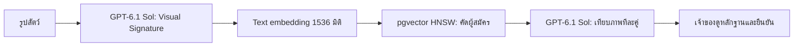

# PetID — Vector retrieval + LLM image comparison

PetID ในโค้ดนี้มีทั้งการลงทะเบียน ค้นหาด้วยภาพ ถอนการลงทะเบียน และให้เจ้าของดูภาพหลักฐานเพื่อยืนยันผล หน้าใช้งานอยู่ที่ **คลินิก & น้องหาย → PetID & น้องหาย**

ผู้พบที่ยังไม่มีสัตว์เลี้ยงในบัญชีเข้าได้จาก **ฉันพบสัตว์ · ค้น PetID** หรือ `/app?tab=petid` โดยไม่ต้องลงทะเบียนสัตว์ของตัวเองก่อน

## วิธีทำงาน

1. อัปโหลดรูปเข้า private Blob ระบบหมุนภาพ ย่อ และตัด EXIF
2. `gpt-6.1-sol` อ่านรูปเป็น Visual Signature: ชนิดสัตว์ ภาพรวม ใบหน้า ลายขน และจุดเด่น พร้อมตรวจว่ารูปใช้งานได้
3. นำข้อความลักษณะไปสร้าง embedding ด้วย `text-embedding-3-small` 1536 มิติ เก็บใน Supabase/pgvector
4. รูปจากผู้พบผ่านขั้นตอนเดียวกัน จากนั้นค้นเวกเตอร์ที่ใกล้กันด้วย HNSW cosine index; มี exact fallback เมื่อเงื่อนไขกรองทำให้ได้ผู้สมัครไม่ครบ
5. ค้นเฉพาะชนิดเดียวกันที่เจ้าของเปิด PetID และมีประกาศหายที่ยัง active จำกัดผู้สมัครสูงสุด5ตัว
6. `gpt-6.1-sol` เทียบรูปใหม่กับรูปอ้างอิงของแต่ละตัวแบบขนาน ระบุหลักฐานและข้อจำกัด ถ้าต่างกันจะตัดออก ถ้าข้อมูลไม่พอจะบอกตรง ๆ
7. เจ้าของได้รับผลในแอป ดูรูปหลักฐานผ่าน URL อายุสั้น แล้วเลือกใช่/ไม่ใช่ ผู้พบไม่ได้รับข้อมูลติดต่อเจ้าของจากผลค้นหา

## ขอบเขตของรุ่นนี้

เป็น PetID v0 แบบช่วยค้นหาตัวที่อาจคล้ายกัน ทุกผลต้องให้เจ้าของยืนยัน ยังไม่ได้วัด Top-5 accuracy/FMR/FNMR ด้วยรูปสัตว์จริง และยังไม่เรียก OpenAI จริงจนผู้ใช้ใส่ API key

โค้ดปัจจุบันรวม4ข้อความลักษณะเป็น **หนึ่งเวกเตอร์ต่อการลงทะเบียน** และใช้รูปอ้างอิงหนึ่งรูป ต่างจากแผนเต็มใน SYSTEM_DESIGN.md ข้อ9.7 ที่แยก4facet vectorsต่อcapture เก็บหลายมุม หลายวัน รวมคะแนน attribute/พื้นที่ และใช้รูปอ้างอิง2รูป ยังไม่มี capture guide/auto-shutter, dedicated1:1 verification หรือหน้าจัดการreindexเต็ม

ไฟล์สำคัญ:

- `backend/biometric/src/app.ts`: ลงทะเบียน ค้นหา เทียบภาพ หลักฐานและยืนยันผล
- `packages/ai/src/index.ts`: OpenAI client, โมเดล, embeddings, quotaและbudget
- `supabase/bootstrap.sql` และ migrations: ตาราง เวกเตอร์ RLS และindex
- `frontend/owner-app/components/petid.tsx`: หน้าจอPetID

HNSW เป็น approximate nearest-neighbor index ซึ่งแลก recallบางส่วนกับความเร็ว ค่าsimilarityจึงเป็นตัวคัดผู้สมัคร ไม่ใช่ความน่าจะเป็นว่าเป็นสัตว์ตัวเดียวกัน ดู[pgvector indexing](https://github.com/pgvector/pgvector#hnsw)
